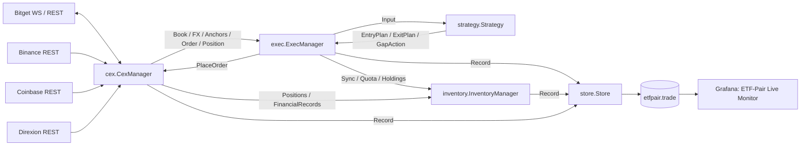

# core 架构与设计方案

版本：0.11 · 2026-11-25（UTC+8）；2026-11-26 新增第 12 节（新任务的设计稿：薄腿先行的双 Taker 入场与两段出场，待审计，用户第 85–92 条；同日按第 93 条的答复和外部实现的调研改为第 2 版，按审计意见（第 94 条）改为第 3 版，按第 95 条和审计第二次意见改为第 4 版，实现中）；2026-11-26 补充：第 8 步回放与选参已实现（5.8、第 9 节第 8 行），铃锚点的 F 只取 Coinbase 收盘前一分钟 1 分钟 K 线的收盘（用户第 69 条，5.1“锚点”、5.4a），纸面成交的手续费逐笔截断到 8 位（审计第 70 条，5.1“纸面”），文档订正（用户第 79 条转来的审计意见第 3 点：“文档应让读者在规则所在章节就能看到实际行为”）：第 1 节的下单通道只写一种说法“默认 WSS，连接不可用时走 REST；已发出但结果未知的订单按原编号查询”，第 6 节（看板）改为两块看板已实现并发布、变量和各行照 Live Monitor 4.1，规则改指 PRD 3.10（1.4 节的首版收窄已写进 PRD 正文；5.2 的“5 秒从哪一刻起”和第 10 节收窄表的表头随之注明 PRD 一栏是原正文） · 状态：**设计稿；审计五次批复后分步实施中：第 0–4 步已实现并提交；第 5 步（cex 订单与纸面、Bitget 账户侧）和第 5.3 步（延迟相关的改动、WSS 下单通道）已实现并通过测试，未提交；第 6 步起未开始。** 0.11 之后的补充（2026-11-25 晚）：审计第 6 步之后 exec 和 inventory 的修改（用户第 65、66 条）见 5.4c；用户第 61 条：5.6 新增只供 Live Monitor 显示的三项落库（`funding_rate` 表、`inventory_sample` 的标记价等八列、`signal_sample` 的两腿中价）。0.11 落实用户第 56、57 条：取价不再归档（SOXL 第 2 个、SOXS 第 5 个原始价位，5.2 末尾“取价档”），下单默认改用 WSS 并用真实订单验证（5.7 末尾）。0.10 落实第 53–55 条（SOXS 改 `books5`、延迟设计 L1–L4 和 WSS 下单的实现与实测）。规则在 PRD 3.9。0.9 写入第 5 步的做法和延迟研究；0.8、0.7 落实审计第五、四次意见（5.4b、5.4a）。各轮审计原文、检查报告和 0.1–0.10 的副本在 `experiments/decisions_20261123/spec_core_20261124/`。

core 是 ETF Pair Arbitrage 的交易进程：读 Bitget 上 SOXLUSDT / SOXSUSDT 两个永续合约的盘口，按锚点算出价差、均线和 σ，在非盘中两条腿同时偏离均线足够远时用 IOC 限价单同时买入（或同时卖出）两条腿，价差回到平仓线时平仓，每个美股常规收盘前全部平掉。

- **规则在 [../PRD.md](../PRD.md)（3.10）**，本文件只写怎么实现：模块、接口、数据结构、算法的参考代码、落库和实施步骤。两者不一致时以 PRD 为准并修本文件。文中“PRD 5.3”指 PRD 的第 5.3 节。
- **设计取舍**（用户第 41 条：“不要考虑 Corner Case，不要冗余设计”）：每条规则只有一个实现位置；不为 PRD 没写的故障情形加机制；PRD 写明的例外情形（订单结果未知、成交不齐、零头、重启）各用一个通用机制覆盖，集中在 5.4 的“例外情形”等三小节，不在主流程里逐个分支。第 10 节是 PRD 条款到实现位置的对照。
- 代码、标识符、注释、日志用英文；架构、命名、日志、配置的形式沿用相邻仓库 `../dex-cex-arbitrage/arb-core`（第 8 节）。代码从头写，不复制相邻仓库或已归档的旧代码。
- 监控看板 ETF-Pair Live Monitor 读本进程写的表（5.6），看板自身的设计在 [../dashboard/SPEC.md](../dashboard/SPEC.md) 第 7 节。

## 1. 目标与边界

| 项目 | 本方案 |
|---|---|
| 交易 | Bitget USDT 永续 `SOXLUSDT`、`SOXSUSDT`，UTA（统一账户）v3 接口。行情走公共 WebSocket；订单结果、成交、持仓走私有 WebSocket；下单默认 WSS，连接不可用时走 REST；已发出但结果未知的订单按原编号查询（`clientOid`，REST `order-info`），不重发（只有 IOC 限价单，没有撤单；通道见 5.7 末尾） |
| 外部来源 | Binance（指数价 K 线、交易时段表，公开接口，只读）；Coinbase（USDT-USD 买一卖一，公开）；Direxion（NAV、分红，只读，密钥在 `.env`）。全部由本进程自己读，不读看板的表（PRD 3.3） |
| 组合 | 一个进程一个组合（bull = SOXL，bear = SOXS）；组合写在配置里，代码里不写死代码名 |
| 运行方式 | `exec.live: false` 纸面（默认；订单不出进程，由 `cex.PaperVenue` 按本地盘口撮合）；`true` 实盘（要用户另行授权） |
| 账户 | 策略独占的账户，由用户提供（PRD 6.8）。`core/.env` 里现在的密钥是用户给来查询交易所事实的：2026-11-24 只读核实，统一账户、单向持仓，两个合约都是全仓、杠杆 10；**那个账户里还有别的合约的仓位**，实盘用哪个账户由用户定（第 7 节）。本进程在任何账户上都只读写 `SOXLUSDT`、`SOXSUSDT` 的订单和持仓，核对也只比这两个合约 |
| 数据库 | `etfpair` 库的独立 schema `trade`（PRD 3.7），本进程用自己的写入角色；启动时只读录制服务的 `etfpair.perp_second` 补分钟 |
| 首版不做 | 挂单、撤单、Binance 交易、多组合、跨收盘持仓、保证金率规则（看板只显示账户的保证金率，5.6 末尾）、自动选参（PRD 1.3、6.6）；任何 PRD 没写的重试、降级、熔断。（下单通道见“交易”一行：配置 `cex.order_transport` 默认 `ws`，用户第 56 条；设成 `rest` 时每张单都走 REST，5.7） |
| 进程 | 单进程；每个模块一个 manager，`NewManager(...)` + `Run(ctx)`；`main` 按依赖顺序启动 store、cex、inventory、exec，阻塞在 `ExecManager.Run` |

## 2. 模块划分

| 目录 / 包 | 类型 | 职责 | 边界 |
|---|---|---|---|
| `logger` | `GlobalLogger` | 结构化日志（slog），与相邻仓库同一实现，文件前缀 `etf_core` | |
| `config` | `Config`、`Env` | 读 `config.yaml`（公开配置）和 `.env`（JSON，密钥）并校验 | 每个模块的配置段是该模块的 `Config`，各自 `Validate()` |
| `cex` | `CexManager` | 交易所和外部来源的全部事实：两条腿的盘口（深度 + 最优价，PRD 3.1）、合约规则、账户设置、持仓、资金费流水、订单与成交；汇率 F；美股日历（Session）；锚点（铃锚点 → NAV）、分红拆股 | 只维护事实：不算价差、不决定下单；交易所的 JSON 只出现在各子包 |
| `cex/bitget` | `Client` | Bitget 的 REST 签名与端点、公共 WS、私有 WS、帧编解码 | 实现 `cex.Venue` |
| `cex/binance`、`cex/coinbase`、`cex/direxion` | `Client` | 各一个只读来源：指数 K 线与时段表；USDT-USD 行情；NAV 与分红 | 各实现 `cex` 里对应的小接口（5.1） |
| `strategy` | `Strategy` | 纯计算：取价档、价差、分钟 bar、均线与 σ、开仓的检查与数量、平仓线与数量、成交不齐时补齐还是回吐、强制平仓的限价 | 不联网、不持有状态、不打日志；输入输出都是值 |
| `inventory` | `InventoryManager` | 库存与资金：一轮（cycle）、仓位（lot）、先开先平记账、每个仓位和每一轮的盈亏、累计已实现净额 R、额度、零头；与交易所持仓核对；资金费流水 | 事实来自 cex 的订单回报和持仓；不下单 |
| `exec` | `ExecManager` | 执行：一个事件循环拥有全部交易状态——分钟 bar 的采样、每一拍的判断顺序、发单与等结果、成交不齐的处理、强制平仓、停止信号、重启恢复 | 通过 cex 取事实和下单，通过 strategy 计算，通过 inventory 记账 |
| `store` | `Store` | 把各模块的记录写进 `trade` schema；启动时读回上次的状态 | 每个模块的行构造在它自己的 `store.go`；事实只由掌握它的模块写一次 |
| `cmd/replay` | — | 回放录制的原始帧，用同一套 strategy / exec / inventory 和 `PaperVenue` 跑回测（PRD 第 16 节） | 第 9 节第 8 步，不影响交易进程 |

用户给的雏形里有 `cex`、`exec`、`inventory`、`strategy`、`logger` 五个目录；`config`、`store` 两个包是本设计加的，形式与相邻仓库相同。包的依赖是单向的：`store`（不引用任何模块）← `cex` ← `strategy` ← `inventory` ← `exec`。雏形的 `go.mod` 把模块叫 `etf-pair-arbitrage`，与仓库根目录的模块同名；两个模块互不引用，第 0 步把 core 的模块路径改成 `etf-pair-arbitrage/core`（审计的建议）。



目录：

```
core/
  main.go  go.mod  config.example.yaml  .env.example  SPEC.md  README.md  scripts/dev_db.sh
  logger/        logger.go
  config/        config.go  config_test.go
  cex/           types.go manager.go books.go reference.go fx.go calendar.go anchors.go orders.go paper.go store.go *_test.go
  cex/bitget/    types.go client.go rest.go ws.go public.go private.go trade.go convert.go *_test.go
  cex/binance/   client.go *_test.go
  cex/coinbase/  client.go *_test.go
  cex/direxion/  client.go *_test.go
  strategy/      types.go strategy.go levels.go spread.go stats.go entry.go exit.go gap.go *_test.go
  inventory/     types.go manager.go ledger.go quota.go reconcile.go store.go *_test.go
  exec/          types.go manager.go step.go bars.go orders.go recover.go store.go *_test.go
  store/         types.go store.go schema.sql *_test.go
  cmd/replay/    main.go tape.go reference.go sim.go report.go *_test.go
```

## 3. 数值与标识

| 量 | 表示 |
|---|---|
| 价格、数量、金额、手续费、资金费、盈亏、额度 | `github.com/shopspring/decimal`；库里 `NUMERIC` |
| 价差的统计量 D、s、μ、σ、x | `float64`。它们只用来比较大小，不入账；入账的数全部来自成交 |
| 费率 | 配置里写 bps（`0.65`），计算时转 decimal |
| 时间 | `time.Time`；库里 `*_ms` 为 Unix 毫秒 `BIGINT`；日志和看板显示 UTC+8；交易所时间与本机收到的时间分列存 |
| 标识 | 命名类型：`cex.Symbol`（`SOXLUSDT`）、`cex.Leg`（`Bull` / `Bear`）、`cex.Side`（`buy` / `sell`）、`cex.ClientOrderID`、`cex.OrderID`、`strategy.Direction`（`long` = 两条腿都买，`short` = 都卖）、`inventory.CycleID`、`inventory.LotID` |

价差的单位（PRD 第 2 节）：D 的 1 个单位 = 两腿合计名义 V 的 0.5 bps。例：V = 10,000 USDT 时价差走 1 个单位是 0.5 USDT；往返手续费 1.3 bps × V = 1.3 USDT，折成价差约 2.6 个单位。配置和日志里凡是价差单位的键以 `_d` 结尾（`entry_step_spacing`），按名义算的以 `_bps` 结尾。

## 4. 数据流

每一张订单都由一个地方决定和发出：`ExecManager.Run` 的事件循环；记账（`inventory.Sync`）也只在这个循环里调用。别的 goroutine（各条连接的读循环、定时读来源的 worker、发单的 goroutine、inventory 自己的核对和资金费）只把事实发布成不可变快照或送进循环的 inbox。

```
唤醒：cex.BookChanged() / cex.OrdersChanged() / cex.AccountChanged() / cex.ReferenceChanged()（F、锚点）/ 200 ms 定时器 / 停止信号
  → step(now)：
      1. 分钟：先结束已经过去的分钟（用它里面最后一次观测），重算 μ、σ；再看 Session 和锚点有没有变；最后记这一刻的观测（两条腿深度可用、F 有效时的原始中价和 F）
      2. 停止信号的报警和人工接管；持仓不符时到此为止
      3. 有在途的订单就等；有结果未知的订单：不开仓、不按线平仓，强制平仓照做
      4. 持仓时依次：强制平仓 → 两条腿不齐 → 按线平仓 → 再开仓；空仓时：开仓
      5. 采样落库（每秒一行 signal_sample）
```

一批订单的时序（开仓为例）：

```
strategy.EvaluateEntry → EntryPlan（方向、两条腿的限价和数量）
  → inventory 开一轮、开一个仓位（两行同步写库）并预留额度；cex 同步写入两张 cex_order（status = pending）  # 发单之前落盘，PRD 13.5
  → 两个 goroutine 各发一张 IOC 限价单（cex.PlaceOrder）
  → 结果经私有 WS 的 order 推送到达（下单的应答——默认是下单连接上的 WSS 应答，连接不可用时是 REST 应答——只表示受理）；结果未知的按原 ClientOrderID 查询，不重发
  → 每一拍先取这一轮订单的快照并入账（inventory.Sync）；两张都有了最终状态 → strategy.EvaluateGap 看两条腿差多少
      → 差额发得出单：补齐或回吐（一次一张，有结果再判断）
      → 发不出：这一批建成，成为一个仓位（lot），重置开仓间隔
  → 等两条腿各收到一份新的深度，才进入下一次开仓或按线平仓的判断
```

## 5. 各模块设计

### 5.1 `cex`（CexManager）与来源子包

cex 是事实层：两条腿的盘口、合约规则、账户设置、持仓、订单与成交，以及汇率 F、锚点、分红和美股日历。它不算价差、不决定下单。首个交易所是 Bitget；接口按“一套 `Venue` 接口、多种实现”设计，以后接 Binance 交易只加一个实现。

#### 已核验的事实

带 † 的是 2026-11-24 用 `core/.env` 的密钥只读实测（20 个请求全部是 GET，其中 16 个带签名；原始应答在 `experiments/decisions_20261123/spec_core_20261124/bitget_facts/`）；带 ‡ 的来自录制服务和 11-24 的盘口探测（`experiments/decisions_20261123/book_conflict/`）；其余出自官方文档和相邻仓库已核验的记录（第 11 节）。

| 项 | 事实 |
|---|---|
| 域名 | REST `https://api.bitget.com`；WS 公共 `wss://ws.bitget.com/v3/ws/public`，私有 `wss://ws.bitget.com/v3/ws/private` |
| 拼写 | REST 的 `category` 大写 `USDT-FUTURES`；WS 的 `instType` 小写 `usdt-futures`（私有频道是 `UTA`） |
| REST 签名 | `ACCESS-SIGN = base64(HMAC-SHA256(secret, ts_ms + METHOD + path [+ "?" + query] + body))`；头 `ACCESS-KEY`、`ACCESS-TIMESTAMP`（毫秒）、`ACCESS-PASSPHRASE`、`Content-Type: application/json`；成功 `code == "00000"` † |
| 合约规则 † | `GET /api/v3/market/instruments?category=USDT-FUTURES&symbol=`。SOXLUSDT：`priceMultiplier 0.01`、`quantityMultiplier 0.01`、`minOrderQty 0.01`、`minOrderAmount 5`、`buy/sellLimitPriceRatio 0.08`、`maxLeverage 50`、`fundInterval 8`、`status online`、`isRwa YES`、`baseCoin SOXL`。SOXSUSDT：价格刻度 `0.001`，限价比例 `0.05`，`maxLeverage 20`，其余相同。数量以 `baseCoin` 计，没有合约乘数字段 |
| 费率 † | `GET /api/v3/account/fee-rate?category=USDT-FUTURES&symbol=`：两个合约都是 `takerFeeRate 0.000065`（0.65 bps）、`makerFeeRate -0.00001`。成交和订单里的 `feeDetail[].fee` 是**正数表示支出**，`feeCoin USDT`；账户最近 100 笔 SOXL / SOXS 成交 `fee ÷ execValue` 全部是 0.65 bps |
| 账户设置 † | `GET /api/v3/account/settings`：`accountMode unified`、`holdMode one_way_mode`、`assetMode multi_assets`；`symbolConfigList[]{category, symbol, marginMode, leverage}` 里 SOXLUSDT、SOXSUSDT 都是 `crossed`、`leverage 10` |
| 持仓 † | `GET /api/v3/position/current-position?category=USDT-FUTURES[&symbol]`：`data.list[]{symbol, posSide, marginMode, total, available, avgPrice, markPrice, unrealisedPnl, totalFunding, ...}`；没有持仓时 `list` 是 `null`。账户里有别的合约的仓位，所以一律带 `symbol` 过滤 |
| 下单 | `POST /api/v3/trade/place-order`，体 `{category, symbol, side: buy\|sell, orderType: "limit", timeInForce: "ioc", qty, price, marginMode: "crossed", reduceOnly: "yes"\|"no", clientOid}`；单向持仓不传 `posSide`。应答只表示受理（返回 `orderId`），结果以推送或查询为准。限速 10 单 / 秒 / UID，与相邻仓库的进程共用 |
| 订单查询 † | `GET /api/v3/trade/order-info?clientOid=`：返回 `orderStatus`（今天见到的是 `filled` 和 `cancelled`；文档另有 `partially_filled`、`new`、`live`）、`cumExecQty`、`cumExecValue`、`avgPrice`、`feeDetail`、`cancelReason`、`reduceOnly`（`YES` / `NO`）、`createdTime`、`updatedTime`。**不存在的 `clientOid` 返回 `code 25204`（Order does not exist，HTTP 400）**。部分成交的 IOC 是 `cancelled` + `cancelReason ioc_not_full_cancel` + `cumExecQty > 0` |
| 历史订单与成交 † | `GET /api/v3/trade/history-orders?category&symbol&limit`（cursor 分页，带 `clientOid`）；`GET /api/v3/trade/fills?category&startTime&endTime&limit`：`execId`、`orderId`、`clientOid`、`symbol`、`execPrice`、`execQty`、`execValue`、`feeDetail`、`tradeScope`、`createdTime`；**这个接口没有 `symbol` 参数，传了也不过滤**（今天按两个合约分别问，返回的是同一批成交），要按时间窗读回再本地筛。`history-orders` 的 `symbol` 过滤有效；API 下的已撤销订单只保留 2 小时（文档）。IOC 订单的最后一笔成交时间与订单的 `updatedTime` 相同（今天能对上的 65 张订单全部差 0 ms） |
| 资金费 | `GET /api/v3/account/financial-records?category=USDT-FUTURES`（cursor 分页，窗口 ≤ 30 天）：`{id, symbol, coin, type, amount, positionAmount, ts}` †，没有 `symbol` 参数；全仓的资金费类型是 `CONTRACT_MAIN_SETTLE_FEE_USER_IN/OUT`（文档；今天读到的 5 条都是别的合约的逐仓类型 `MARGIN_SETTLE_FEE_USER_IN`）。流水的时间比结算时刻晚几秒。结算费率 `GET /api/v3/market/history-fund-rate`；每 8 小时结算（UTC+8 00:00、08:00、16:00） |
| 公共 WS ‡ | 订阅 `{"op":"subscribe","args":[{"instType":"usdt-futures","topic":"books5","symbol":"SOXLUSDT"}, ...]}`。数据帧 `{"action":"snapshot"\|"update","arg":{...},"data":[{"a":[[价,量],...],"b":[...],"seq":N,"pseq":N,"ts":"ms"}],"ts":ms}`，最优在前，量为 `"0"` 表示删档。`books1` / `books5` / `books50` 共用一条撮合序号 `seq`；录到的每帧都是 `snapshot`、`pseq 0`（文档说 `books50` 可以在首帧之后发 `update`，`pseq` 等于上一帧的 `seq`）。交易所建议 30 秒发一次文本 `ping`（回 `pong`），2 分钟收不到才断开、5 秒内超过 10 个会被断开（第 5.2 步重读官方页面核实）；本设计与录制服务一样每 5 秒发一次 |
| 私有 WS | 登录 `{"op":"login","args":[{apiKey, passphrase, timestamp, sign}]}`，`sign = base64(HMAC-SHA256(secret, timestamp + "GET" + "/user/verify"))`；订阅 `{"instType":"UTA","topic":"order"\|"fill"\|"position"}`。`order` 在下单、成交、撤单时推；`position` 订阅即推快照、之后在仓位变化时推（字段 `size`，不是 REST 的 `total`） |
| Binance（公开） | 指数 K 线 `GET https://fapi.binance.com/fapi/v1/indexPriceKlines?pair=SOXLUSDT&interval=1m&startTime=<ms>&limit=1`，行 `[openTime, open, high, low, close, ...]`，必须检查返回的 `openTime` 等于要的那一分钟；时段表 `GET /fapi/v1/tradingSchedule`，取 `marketSchedules.EQUITY.sessions[]{startTime, endTime, type}` |
| Coinbase（公开） | `GET https://api.exchange.coinbase.com/products/USDT-USD/ticker`（`bid`、`ask`）；分钟 K 线 `.../candles?granularity=60&start=&end=`，行 `[time, low, high, open, close, volume]` |
| Direxion | `POST` AppSync GraphQL（地址和两条查询的文本与看板采集器相同，见 `dashboard/internal/scan/sources.go`），头 `X-Api-Key`。NAV：`getThirtyDayPrice(Ticker, TradeDate){Nav TradeDate}`；分红：`getKurtosysFunds(Ticker){Distributions{IncomeDividend ShortTermCapitalGain LongTermCapitalGain ReturnOfCapital ExDate}}`，同一除息日四项相加。按用户授权的节奏读（PRD 3.3） |
| 本机到 Bitget † | 16 个签名 GET 的往返（每个都是新连接，含 TCP 和 TLS 握手）：最小 37 ms、中位 58 ms、最大 274 ms。下单的往返已在 2026-11-25 用真实订单量过（5.7 末尾：WSS 是默认通道，REST 热连接作后备） |

#### 包结构

```
cex/
  types.go       配置、Credentials、Env、标识与领域类型、Venue 和三个来源接口、错误
  manager.go     CexManager：装配、Run、读接口、就绪判定、状态日志
  books.go       每条腿一本盘口：深度帧与 books1 的合并、冲突、有效期
  reference.go   合约规则、账户设置、持仓快照、资金费流水的读取与发布
  fx.go          F：定时读 Coinbase，记每分钟最后一个值
  calendar.go    美股日历：Session、时段、提前收盘、人工改动；与 Binance 时段表的每小时核对
  anchors.go     每个 Session 的锚点：铃锚点 → NAV；分红调整；发布 Anchors
  orders.go      订单登记、发送、回报合并、结果未知时按 ClientOrderID 查询
  paper.go       PaperVenue：纸面模式的下单、成交、持仓和资金费
  store.go       本模块的行（cex_order、cex_fill、anchor_fact）
cex/bitget/      types.go（端点常量、线上 JSON）client.go rest.go ws.go public.go private.go trade.go（WSS 下单连接）convert.go
cex/binance/、cex/coinbase/、cex/direxion/   各一个 client.go：一个 http.Client、两三个只读方法
```

#### 接口（`cex/types.go`）

```go
// Venue is one exchange as cex uses it: reference reads, market-data and private
// streams, and the one order command. Implementations convert wire shapes to these
// types and nothing else.
type Venue interface {
    Name() string

    // --- reference ---
    MarketRules(ctx context.Context, symbols []Symbol) (map[Symbol]MarketRule, error)
    AccountSettings(ctx context.Context, symbols []Symbol) (AccountSettings, error)
    Positions(ctx context.Context, symbols []Symbol) (PositionSet, error)
    OrderByClientID(ctx context.Context, symbol Symbol, id ClientOrderID) (OrderRecord, error) // ErrUnknownOrder: the venue says there is no such order
    RecentOrders(ctx context.Context, symbol Symbol, since time.Time) ([]OrderRecord, error)   // restart: orders recognised by their id format
    Fills(ctx context.Context, since time.Time) ([]Fill, error)                               // the venue cannot filter by symbol: the caller does
    FinancialRecords(ctx context.Context, since time.Time) ([]FinancialRecord, error)         // likewise
    FundingHistory(ctx context.Context, symbol Symbol, limit int) ([]FundingSettlement, error)

    // --- streams: handlers run on the connection's read goroutine and must not block ---
    SubscribeBooks(ctx context.Context, subs []BookSubscription, onEvent func(BookEvent), onDown func(error)) error
    SubscribePrivate(ctx context.Context, symbols []Symbol, onEvent func(PrivateEvent), onDown func(error)) error

    // --- command ---
    // PlaceOrder sends one IOC limit order. ErrNotSent: nothing left the process.
    // *VenueError: the venue refused it. ErrOrderStateUnknown: the venue may have it.
    PlaceOrder(ctx context.Context, req OrderRequest) (OrderAck, error)
}

// The read-only sources behind F and the anchors, one implementation each.
type IndexSource interface { // binance
    IndexClose(ctx context.Context, symbol Symbol, minute time.Time) (price decimal.Decimal, ok bool, err error)
    TradingSchedule(ctx context.Context) ([]ScheduleDay, error)
}
type FXSource interface { // coinbase
    Quote(ctx context.Context) (bid, ask decimal.Decimal, err error)
    MinuteClose(ctx context.Context, minute time.Time) (price decimal.Decimal, ok bool, err error)
    MinuteCloses(ctx context.Context, from, to time.Time) ([]FXMinute, error) // a range in one read, for restart
}
type IssuerSource interface { // direxion
    NAV(ctx context.Context, ticker string, tradeDate time.Time) (nav decimal.Decimal, ok bool, err error)
    Distributions(ctx context.Context, ticker string) ([]Distribution, error) // every declared round: ex-date, amount, whether the amount is declared
}
```

没有撤单、改单、设置杠杆或保证金模式的方法：程序只发 IOC，账户设置只读不改（PRD 6.7、V17）。

#### 数据模型（`cex/types.go`，节选）

```go
// --- configuration ---
type Config struct {
    Pair             Pair               `yaml:"pair"`              // the two legs
    DepthMaxAge      time.Duration      `yaml:"depth_max_age"`     // a leg's depth or best price older than this is not usable
    FXMaxAge         time.Duration      `yaml:"fx_max_age"`
    NAVWatch         time.Duration      `yaml:"nav_watch"`         // after the NAV first replaces the bell anchor it is read on this long (owner item 97)
    NAVHotSwitchD    float64            `yaml:"nav_hot_switch_d"`  // spread units: a NAV switch with a smaller jump keeps the mean and sigma
    CalendarOverrides []CalendarOverride `yaml:"calendar_overrides"`
    CorporateActions []CorporateAction  `yaml:"corporate_actions"` // planned ex-dates, kept by hand
}
type Pair struct {
    Bull LegConfig `yaml:"bull"` // {symbol: SOXLUSDT, ticker: SOXL, book_topic: books5}
    Bear LegConfig `yaml:"bear"` // {symbol: SOXSUSDT, ticker: SOXS, book_topic: books5} (books50 until owner item 53)
}
type Credentials struct{ Key, Secret, Passphrase string } // .env; never logged
type Env struct {
    Bitget   Credentials `json:"bitget"`
    Direxion struct{ SiteAPIKey string `json:"site_api_key"` } `json:"direxion"`
    Store    struct{ DSN string `json:"dsn"` } `json:"store"`
}

// --- identifiers ---
type Symbol string        // SOXLUSDT
type Leg int              // Bull, Bear; indexes [2]T
type Side string          // buy, sell
type ClientOrderID string // made by exec, see 5.4
type OrderID string       // assigned by the venue
type OrderPurpose string  // entry, complete, trim, exit, forced
type OrderStatus string   // pending, acked, filled, cancelled, rejected, not_sent, never_arrived

// --- market data ---
type BookLevel struct{ Price, Qty decimal.Decimal }
// Book is one leg's published book, immutable. Bids and Asks are the depth levels with
// the best level's quantity taken from books1 when books1 is newer at the same prices.
type Book struct {
    Symbol          Symbol
    Bids, Asks      []BookLevel // best first; empty when the depth was dropped
    DepthSeq        uint64
    DepthReceivedAt time.Time   // local arrival of the last depth frame
    Conflict        bool        // books1 is newer than the depth and one best price differs (PRD 3.1)
    BestBid, BestAsk BookLevel  // from the newer of depth and books1 by seq
    BestSeq          uint64     // the sequence number of the frame BestBid and BestAsk come from
    BestReceivedAt  time.Time
    Connected       bool
}

// --- reference ---
type MarketRule struct {
    Symbol                 Symbol
    PriceTick, QtyStep     decimal.Decimal
    MinQty, MinNotional    decimal.Decimal
    Online                 bool
}
func (r MarketRule) Sendable(qty, price decimal.Decimal) bool // qty ≥ MinQty and qty × price ≥ MinNotional
type AccountSettings struct{ OneWay bool; BySymbol map[Symbol]SymbolSetting } // SymbolSetting{Crossed bool; Leverage int}
type Position struct{ Symbol Symbol; Qty decimal.Decimal; AvgPrice decimal.Decimal; UpdatedAt time.Time; MarkPrice, UnrealisedPnL, LiqPrice decimal.NullDecimal } // Qty signed: short is negative; the last three for the board only, not valid when not reported
type AccountAssets struct{ Equity, MarginRatio decimal.Decimal; ReceivedAt time.Time } // the whole account, for the board only
type AccountAssetsReader interface{ AccountAssets(ctx context.Context) (AccountAssets, error) } // optional on a Venue: the real exchange has it, the paper venue not
type PositionSet struct{ BySymbol map[Symbol]Position; ReceivedAt time.Time; Loaded bool }
type FinancialRecord struct{ ID string; Symbol Symbol; Type string; Amount decimal.Decimal; At time.Time }

// --- F, calendar, anchors ---
type FX struct{ Price, Bid, Ask decimal.Decimal; ReceivedAt time.Time }
type Session struct {
    ID           string    // New York date of the close that starts it, 2006-01-02
    Start        time.Time // that regular close
    RegularOpen  time.Time // 09:30 New York of the trading day that ends it: entries stop here
    End          time.Time // the next regular close (13:00 on an early-close day)
}
type AnchorKind string // "", bell, nav
type Anchors struct {
    SessionID  string
    Kind       AnchorKind
    Bull, Bear decimal.Decimal // USD per share, dividend already subtracted from its effective time on
    KnownAt    time.Time       // when this pair of values became usable
    SwitchedAt time.Time       // when the anchor itself was taken (bell read, or the NAV in use switched to); a dividend does not move it
    EntryBan   bool            // inside a dividend or split window (PRD 3.4)
    RestartAt  time.Time       // the mean and sigma restart at this time (a dividend took effect); zero otherwise
}

// --- orders ---
type OrderRequest struct {
    ClientOrderID ClientOrderID
    Symbol        Symbol
    Leg           Leg
    Side          Side
    Price, Qty    decimal.Decimal
    ReduceOnly    bool
    Purpose       OrderPurpose // recorded, not sent to the venue
    CycleID, LotID string      // recorded, not sent to the venue
}
type OrderRecord struct {
    Request       OrderRequest
    OrderID       OrderID
    Status        OrderStatus
    Unknown       bool          // the outcome is not known yet: being queried, never resent
    UnknownSince  time.Time
    FeeKnown      bool          // the venue has reported the fee of what was filled; a zero-fill order needs none
    NotFound      bool          // unknown for 30 s, the venue says there is no such order, and no fill carries its id
    CumExecQty, CumExecValue, AvgPrice, Fee decimal.Decimal // Fee positive = paid, in USDT
    CancelReason, ErrorCode, ErrorMessage   string
    SubmittedAt, SentAt, AckedAt            time.Time // local clock
    ExchangeUpdatedAt                       time.Time // the venue's updatedTime
    UpdateReceivedAt                        time.Time
    UpdateSeq                               uint64
}
func (s OrderStatus) Terminal() bool // filled, cancelled, rejected, not_sent, never_arrived

// --- errors ---
var ErrNotSent, ErrOrderStateUnknown, ErrUnknownOrder error
type VenueError struct{ Code, Message string; Kind ErrorKind } // rate_limited, price_limit, other
```

#### 对 exec 和 inventory 的读写接口

```go
func NewManager(cfg Config, venue Venue, index IndexSource, fx FXSource, issuer IssuerSource, opts ...Option) (*CexManager, error) // opts: WithClock, Synchronous (replay only, 5.8)
func (m *CexManager) StartSynchronous(ctx context.Context) error // replay only: Run without its loops (5.8)
func (m *CexManager) UseStore(s store.Sink)
func (m *CexManager) Restore(facts []AnchorFact, orders []OrderRecord) // before Run: this Session's anchor state and the open cycle's orders; those without a final state become Unknown and are queried
func (m *CexManager) Run(ctx context.Context)

// --- market data ---
func (m *CexManager) Books() Books                        // both legs' books from ONE load of the published view
func (m *CexManager) BookChanged() <-chan struct{}        // closed at the next book publication
// Books is one read of both legs; every question below is answered on that same snapshot.
//   type Books struct { ByLeg [2]*Book; MaxAge time.Duration }
//   func (b Books) DepthUsable(leg Leg, now time.Time) bool // connected, has depth, the last depth frame within MaxAge
//   func (b Books) DepthOK(leg Leg, now time.Time) bool     // usable and without a conflict
//   func (b Books) HasPrice(leg Leg, now time.Time) bool    // a best price from either stream within MaxAge

// --- reference ---
func (m *CexManager) FX(now time.Time) (fx FX, fresh bool) // fresh: read within fx_max_age
func (m *CexManager) Anchors() Anchors
func (m *CexManager) Session(now time.Time) Session
func (m *CexManager) ReferenceChanged() <-chan struct{}   // F, anchors, rules or settings published
func (m *CexManager) Rule(leg Leg) (MarketRule, bool)
func (m *CexManager) SettingsOK(leverage int) (ok bool, detail string) // one-way, crossed, this leverage on both legs (PRD 6.7)
func (m *CexManager) TradingReady() bool                  // rules loaded, both legs online, private stream up (live)

// --- account ---
func (m *CexManager) Positions() PositionSet              // latest pushed or read snapshot of the two legs
func (m *CexManager) ReadPositions(ctx context.Context) (PositionSet, error) // a fresh REST read, published too
func (m *CexManager) AccountChanged() <-chan struct{}     // closed when positions or financial records are published
func (m *CexManager) FinancialRecords() []FinancialRecord // funding records of the two legs read so far, oldest first
func (m *CexManager) FundingRateAt(leg Leg, settlement time.Time) (rate decimal.Decimal, ok bool)
func (m *CexManager) AccountAssets() (AccountAssets, bool) // last read of the account's equity and margin ratio, for inventory_sample; false before one and on the paper venue

// --- orders ---
func (m *CexManager) PlaceOrders(reqs ...OrderRequest) error // writes the pending rows, then sends each order on its own goroutine
func (m *CexManager) OrdersChanged() <-chan struct{}      // closed when any order record changes
func (m *CexManager) CycleOrders(cycleID string) []OrderRecord // one consistent snapshot of a cycle's orders, taken under the lock
func (m *CexManager) UnresolvedOrders() []OrderRecord     // orders without a final state
func (m *CexManager) RecoverOrders(ctx context.Context, cycleID string) ([]OrderRecord, error) // restart with an unfinished cycle: that cycle's orders at the venue which the table does not hold; both legs read or nothing recognised
func (m *CexManager) SetOrderLot(id ClientOrderID, lotID string) // stores the lot the ledger gave a recognised order (record and row)
func NewClientOrderID(cycleAt time.Time, seq int, leg Leg, purpose OrderPurpose) ClientOrderID // ids are made and parsed in cex; the cycle id is derived from the id
func OrderRecordsFromRows(rows []store.OrderRow) []OrderRecord // start-up: the rows read back by store.LoadState
func NewPaperVenue(real Venue, cfg PaperConfig) *PaperVenue // PaperConfig{Pair, Latency [2]time.Duration, TakerFeeBps, Leverage, DepthMaxAge, Clock (nil: wall clock; a replay's virtual clock, 5.8)}; UseStore(store.Sink); SeedPositions(qty [2]decimal.Decimal)
func (m *CexManager) MarkNeverArrived(id ClientOrderID)   // exec's verdict once the three evidences are in (PRD 13.3)
```

快照的发布与相邻仓库相同：`atomic.Pointer` 换整份不可变快照，同时关闭旧的 `changed` 通道。读的一方先取通道、再读快照、再等通道（5.4 的循环），发布不会漏。

其余在本节用到的类型，都在 `cex/types.go`：

```go
type LegConfig struct{ Symbol Symbol `yaml:"symbol"`; Ticker string `yaml:"ticker"`; BookTopic string `yaml:"book_topic"` }
type BookSubscription struct{ Symbol Symbol; Topic string } // books1, books5, books50
type BookEvent struct { // Venue → manager, one frame
    Symbol Symbol; Topic string
    Action BookAction // snapshot, update
    Bids, Asks []BookLevel
    Seq, PrevSeq uint64
    ExchangeTime, ReceivedAt time.Time
}
type PrivateEvent struct{ Order *OrderRecord; Fill *Fill; Positions *PositionSet; ReceivedAt time.Time } // one of the three is set
type OrderAck struct{ OrderID OrderID; ReceivedAt time.Time }
type Fill struct{ ExecID string; OrderID OrderID; ClientOrderID ClientOrderID; Symbol Symbol; Side Side; Price, Qty, Value, Fee decimal.Decimal; ExecTime, ReceivedAt time.Time }
type FundingSettlement struct{ Symbol Symbol; Rate decimal.Decimal; At time.Time }
type ScheduleDay struct{ Date string; RegularOpen, RegularClose time.Time }
type CalendarOverride struct { // close: "closed" or "HH:MM" New York
    Date string `yaml:"date"`; Close string `yaml:"close"`; Source string `yaml:"source"`
}
type CorporateAction struct { // kind: dividend, split
    Ticker string `yaml:"ticker"`; ExDate string `yaml:"ex_date"`; Kind string `yaml:"kind"`; Source string `yaml:"source"`
}
type AnchorFact struct{ SessionID string; Kind string; Leg Leg; Value, F decimal.Decimal; Source string; KnownAt time.Time }
```

#### 盘口（`books.go`，PRD 3.1）

每条腿一条深度（`books5`；第 53 条之前 SOXS 用 `books50`，它仍是接受的值）加 `books1`，各开 `book_connections` 条连接（5.7 的 L1）。全部帧进 `Run` 的 goroutine 顺序处理：

```go
// legBook is one leg's working book, owned by Run.
type legBook struct {
    depth       *depthState // levels, seq, receivedAt; nil after a broken update chain until the next snapshot
    best        *bestState  // books1: bid, ask, seq, receivedAt
    conflictSeq uint64      // seq of the newest books1 frame that disagreed with the depth; 0 when there is no conflict
}

// applyDepth takes a depth frame; order is by seq only, never by arrival time.
func (b *legBook) applyDepth(ev BookEvent) (resubscribe bool) {
    switch {
    case b.depth != nil && ev.Seq <= b.depth.seq:
        return false                                  // older than what we hold: dropped
    case ev.Action == ActionSnapshot:
        b.depth = newDepth(ev)                        // the whole book is replaced
    case b.depth == nil:
        return false                                  // an update while waiting for the snapshot: ignored
    case ev.PrevSeq == b.depth.seq:
        b.depth.merge(ev)                             // an update that chains: set levels, quantity 0 deletes
    default:
        b.depth = nil                                 // an update that does not chain: drop the depth, resubscribe once
        return true
    }
    b.recheck()
    return false
}

// applyBest takes a books1 frame.
func (b *legBook) applyBest(ev BookEvent) {
    if b.best == nil || ev.Seq > b.best.seq {
        b.best = newBest(ev)
        b.recheck()
    }
}

// recheck runs after every accepted frame. A depth at least as new as the disagreeing books1
// ends a conflict; a books1 newer than the depth with a different best price starts one.
func (b *legBook) recheck() {
    if b.depth == nil { return }
    if b.depth.seq >= b.conflictSeq { b.conflictSeq = 0 }
    if b.best != nil && b.best.seq > b.depth.seq && !b.depth.sameBestPrices(b.best) {
        b.conflictSeq = max(b.conflictSeq, b.best.seq)
    }
}

// publish builds the immutable Book the readers see.
func (b *legBook) publish(symbol Symbol, connected bool) *Book {
    out := &Book{Symbol: symbol, Connected: connected, Conflict: b.conflictSeq != 0}
    if b.depth != nil {
        out.Bids, out.Asks = b.depth.copyLevels()
        out.DepthSeq, out.DepthReceivedAt = b.depth.seq, b.depth.receivedAt
        out.BestBid, out.BestAsk, out.BestReceivedAt = b.depth.bestBid(), b.depth.bestAsk(), b.depth.receivedAt
    }
    if b.best != nil && (b.depth == nil || b.best.seq > b.depth.seq) {
        out.BestBid, out.BestAsk, out.BestReceivedAt = b.best.bid, b.best.ask, b.best.receivedAt
        if b.depth != nil && !out.Conflict {
            out.Bids[0].Qty, out.Asks[0].Qty = b.best.bid.Qty, b.best.ask.Qty // same prices, newer quantities
        }
    }
    return out
}
```

- 冲突记的是那条 `books1` 的序号，所以 `books1` 的价格自己变回来不解除它，只有接受了一份 `seq ≥ conflictSeq` 的深度才清零。例一：深度 `seq 100` 买一 40.45；`books1 seq 101` 买一 40.44 → 冲突；`books1 seq 102` 回到 40.45 → 仍冲突；深度 `seq 103` 到 → 解除。例二（迟到的深度）：`books1 seq 105` 买一 40.45；深度 `seq 103` 买一 40.46 到 → 冲突（`recheck` 在接受深度后也比），直到 `seq ≥ 105` 的深度。
- 冲突期间 `BestBid` / `BestAsk` 仍取较新的 `books1`，强制平仓和回吐用它定限价；数量只在没有冲突时才从 `books1` 贴到深度的第一档。
- 有效期由 `CexManager` 的读方法按当前时刻判断（`DepthUsable(leg, now)`、`HasPrice(leg, now)`，都用 `depth_max_age`）；exec 每 200 ms 至少判断一次。心跳应答、另一条腿的帧和 `books1` 都不刷新 `DepthReceivedAt`。
- 连接断开：这条腿的全部连接（`cex.book_connections`，5.7 的 L1）都断开时 `Connected = false`、深度丢弃；还有一条在线就照常。重连后重新订阅。重连的退避是 `timings` 里的常量（200 ms 到 5 s）。

#### F（`fx.go`，PRD 3.5）

每 5 秒（`timings.fxPoll`）读一次 Coinbase 的 `ticker`，F = (bid + ask) / 2；`ReceivedAt` 是这次应答到达的时刻，超过 `fx_max_age`（60 秒）没有新的成功读数就算失效；读失败或读到无效值（非正数、买一高于卖一）不更新 `ReceivedAt`。这个读数只供开仓、平仓和分钟 bar 用；铃锚点的 F 不用它，而是 Coinbase 收盘前一分钟那根 1 分钟 K 线的收盘（下面“锚点”，用户第 69 条；2026-11-26 起，原先每分钟留最后一个读数、铃锚点优先用它的做法已删）。

取 REST 轮询而不是 WebSocket：推送在安静时段多久来一次没有量过（PRD 18.4），轮询的新鲜度只取决于自己，这一项不用再量。看板的采集器也是轮询。

#### 日历（`calendar.go`，PRD 3.6、第 12 节）

`Calendar` 是纯数据加纯函数：休市日和提前收盘日是代码里的表（与看板的 `dashboard/internal/scan/calendar.go` 同一来源 NYSE，各自一份），`calendar_overrides` 是人工改动。

```go
func NewCalendar(overrides []CalendarOverride) (*Calendar, error)
func (c *Calendar) SessionAt(t time.Time) Session   // the Session that contains t
func (c *Calendar) Carrier(day string) time.Time    // 04:00 New York of that trading day: where a dividend window starts
```

例（冬令时，UTC+8）：周五 11-20 收盘 → `Start = 11-21 05:00`，`RegularOpen = 11-23 22:30`，`End = 11-24 05:00`；提前收盘日 11-27 的 Session `End = 11-28 02:00`。

`CexManager.Run` 每小时读一次 Binance 的时段表，与日历比交易日和收盘时刻，不同只打一条 Error（报警），不跟随。

#### 锚点（`anchors.go`，PRD 3.3、3.4、第 11 节）

一个 Session 一份状态，由 `Run` 推进，每次变化发布新的 `Anchors` 并写一行 `anchor_fact`：

```
Session 开始（常规收盘）              Kind = ""                      # 没有锚点：不开仓
  ↓ 收盘后 1 分钟读 Binance 指数（收盘前一分钟那根 K 线的收盘；返回的 openTime 不对就是没读到）
  ↓ 没读到：每 5 分钟（timings.anchorPoll）再读
铃锚点                               Kind = bell，A = F × 指数      # F：Coinbase 那一分钟 1 分钟 K 线的收盘（第 69 条），没有或读失败就 5 秒后再读（referenceRetry），指数没有就每 5 分钟再读
  ↓ 从收盘起每 5 分钟每只基金读一次 NAV（用户授权的节奏）（开始这个 Session 的那个交易日的）
  ↓ 同一轮两条腿的数字都读到（第 97 条：不等稳定 1 小时）
NAV                                  Kind = nav，A = NAV            # nav_watch（1 小时）内照常每 5 分钟读
  ↓ 观察期内一条腿的数字变了：这一轮就换成新数字（另一条腿不变），再写一组 nav 事实
NAV（新数字）                         Kind = nav，A = 新 NAV          # 观察期从第一次换成 NAV 算起；过后不再读，到下一次收盘
```

每次换锚（铃锚点读到、换成 NAV、观察期里换成新 NAV）`Anchors.SwitchedAt` 取换锚时刻（与 `KnownAt` 相同，分红调整只动 `KnownAt`、不动它）：exec 靠它区分“换锚”和“分红调整”，决定热切换还是重新预热（5.4，PRD 11.3）。cex 只发布数字，不算价差（跳变由 exec 在当时的中间价上算），阈值 `nav_hot_switch_d` 经 `CexManager.NAVHotSwitchD()` 给 exec。

- 两条腿总是同一种锚点。Direxion 的密钥没配或被拒：停在铃锚点，打一条 Error。
- **分红**：`corporate_actions` 里有这条腿的除息日时，`Carrier`（载体日纽约 04:00）到生效时刻 T（除息日前一个日历日的纽约 20:00）之间 `EntryBan = true`；金额从载体日的收盘起每 5 分钟读一次，读到就停。到 T：`RestartAt = T`（均线和 σ 在生效时刻重新开始，不管金额读没读到）；金额已读到则 A 改为 A − Div、`EntryBan = false`；没读到则 A 不变、`EntryBan` 保持，读到的那一刻改 A、解除，均线不再重新开始（PRD 3.4）。T 之后这个 Session 的锚点一律是减过 Div 的：T 之后才确认的 NAV 也减。
- 每天读一次两只基金的分红数据（PRD 3.4）：读到的除息日不在 `corporate_actions` 里就报警（Error 加 `event`），由人补进配置；程序不自己加。
- **拆股**：首版不自动处理（第 10 节）。`corporate_actions` 里有拆股条目时，从生效日前一个交易日的纽约 04:00 起 `EntryBan = true`，一直到人工核对了新单位下的锚点和交易所持仓、把这一条从配置里删掉并重启；期间每个 Session 开始时打一条 Error 提醒。
- 换锚和分红调整不动已有仓位；exec 读到新的 `Anchors` 后按 5.4 处理。

#### 订单（`orders.go`，PRD 13.3）

订单表（`orderStore`）有自己的一把锁，三处会改它：`PlaceOrders`（exec 的循环调用）、每张单自己的发送 goroutine、私有流的回调和查询的 goroutine。每次变化后关闭 `OrdersChanged()` 的通道（与盘口相同的写法）。**通知不带数据**：exec 被唤醒后用 `CycleOrders(cycleID)` 在锁内取这一轮全部订单的一份快照，账本和下一步的决定都只依据这份快照（5.3、5.4）。所以不存在“订单表已经更新、通知还在路上”时按半份事实做决定的情形。

`PlaceOrders(reqs...)`：把每张单登记为 `pending`，**同步写入 `cex_order`**（PRD 13.5），然后每张单在自己的 goroutine 里调用 `venue.PlaceOrder`（超时 1 秒，`timings.placeTimeout`）。写库失败时：这一组里有不是只减仓的单就整组不发、返回错误；全是只减仓的单照发。结果的合并：

| `venue.PlaceOrder` 的结果 | 记录 |
|---|---|
| 受理（返回 `orderId`） | `acked`；最终状态等私有流的 `order` 推送 |
| `ErrNotSent` | `not_sent`（最终状态：确认本地没有发出） |
| `*VenueError` | `rejected`（最终状态：交易所明确拒绝），带错误码 |
| `ErrOrderStateUnknown`（超时、连接中断、错误码 40010 / 40725 / 45001） | `Unknown = true` |

`acked` 之后 1 秒还没有最终状态的订单同样置 `Unknown = true`（推送可能丢了）。所以一张单发出后最多约 2 秒，要么有最终状态，要么是 `Unknown`；exec 把“既没有最终状态也不是 `Unknown`”的单叫作在途，只等它（5.4）。

`Unknown` 的订单每 1 秒按 `ClientOrderID` 查一次 `order-info`，查到最终状态就合并并清掉 `Unknown`，不重发。交易所答复“没有这张单”（25204）且 `UnknownSince` 已满 30 秒时，再读一次这段时间的成交（`Fills(since)`，接口不能按合约过滤，读回后本地按 `clientOid` 找）：里面也没有它，就把 `NotFound` 置为真。`NotFound` 是三样证据里交易所这一侧的两样，第三样（持仓没有因它变化）和最后的认定在 exec（5.4）。

推送和查询的合并规则：累计成交量只增不减；最终状态之后只接受成交量和手续费的补齐。`fill` 推送逐笔写 `cex_fill`（按 `execId` 去重），不参与数量的计算——数量取订单的累计成交量（PRD 7.7）。零成交被撤的 IOC 在交易所是 `cancelled`、累计成交量为零（11-23 的实盘记录里有 12 张，第 7 节），撤单原因的字符串那份记录没有存；合并只看状态是不是最终状态和累计成交量，不依赖撤单原因。有成交的订单，手续费可能晚于最终状态到达：`FeeKnown` 为假时 cex 按订单号再查（每秒一次，与结果未知同一个查询），查到才置真——“手续费还不知道”和“手续费确认为零”是两回事。数量一确定就可以减仓，不等手续费。

#### 纸面（`paper.go`，PRD 13.10）

`exec.live: false` 时 `main` 用 `cex.NewPaperVenue(real Venue, cfg)` 包住真实的 Bitget 客户端（用空的 `Credentials` 构造，所以它发不出任何签名请求）：公开数据的方法原样转发，账户侧全部在本地。

- 盘口：`SubscribeBooks` 转发事件的同时，`PaperVenue` 用同一个 `legBook` 自己维护一份两条腿的原始盘口，撮合只用它。
- `PlaceOrder`：立即返回受理；过这条腿的 `sim_order_latency` 后按**到单规则**撮合（`cex/arrival.go`）：先由 `ArrivalLevels(book, side, depth_max_age)` 决定这张单能吃哪一部分盘口，再由 `MatchIOC` 在限价以内逐档吃到订单数量为止——吃满是 `filled`，吃不满是 `cancelled` 加部分成交，一档都吃不到是 `cancelled` 零成交；`reduceOnly` 的数量不超过纸面持仓。结果作为 `order` 和 `fill` 事件走与实盘相同的回调。手续费 = 成交额 × `taker_fee_bps`，每笔成交截断（朝零）到 8 位小数，订单的手续费是它各笔成交手续费之和（2026-11-26，审计第 70 条：与真实通道 `convert.go` 的 8 位截断一致；交易所是逐笔截断还是对订单合计截断一次，要用一张多笔成交的真实订单确认，11-26 11:36 起的小额实盘会产生这样的订单）。`PaperConfig.DepthMaxAge` 由 `main` 从 `cex.depth_max_age` 抄入（不是新的配置项；每个构造纸面交易所的地方都显式传入）。
- `Positions`：纸面持仓（两条腿带符号的数量）。重启时 `main` 在 `inventory.Restore` 之后调用 `PaperVenue.SeedPositions`，把账本的持仓回填进去。
- `AccountSettings`：返回期望值（纸面不检查账户设置）。`OrderByClientID`、`RecentOrders`、`Fills`：答本地的纸面订单。
- `FinancialRecords`：每个结算时刻过后读 `FundingHistory` 的结算费率，资金费 = −持仓数量（带符号）× 那一刻的中价 × 费率，生成一条纸面流水（费率为 0 时金额为 0）。
- 真实交易所收不到任何下单调用（V18）。

#### 日志（前缀 `cex:`，子包 `bitget:` 等）

`running` / `stopped`（Info）；`book live` / `book down; resubscribing`（Info / Warn，带 `symbol`、`topic`、`seq`）；`depth chain broken; resubscribing`（Warn）；`anchor changed`（Info，`session`、`from`、`to`、两条腿的值、`known_at`）；`bell index not ready; retrying`（Info）；`fx stale`（Warn，`age`）；`calendar differs from the venue schedule`（Error）；`account settings differ`（Error，期望值和读到的值）；`order status changed`（Info，`client_order_id`、`from`、`to`、`cum_exec_qty`）；`order outcome unknown; querying`（Warn）；每 30 秒一行 `status`（Info：两条腿的深度年龄、冲突、F 的年龄、锚点种类、私有流是否在线、未出结果的订单数）。逐帧的内容只在 Debug。

#### 第 2 步实现时定下的（2026-11-24）

实现与上文的出入和上文没写、实现时定下的做法，以代码为准：

- **连接**：每条腿一条公共连接（各调一次 `SubscribeBooks`）。增量接不上时重开这条腿的订阅。`Book.Connected` 因此按腿算。断线或增量接不上而丢深度时，最优价不跟着丢：深度的第一档比 `books1` 新就先存成最优价，所以 `HasPrice` 仍按最后一个最优价的到达时刻算，最多再撑 `depth_max_age`（PRD 3.1）。序号与已有深度相等的帧也丢弃。
- **`Run` 是四个循环**：盘口在 `Run` 自己的 goroutine；F、锚点、参考数据各一个，读取内联、每次最多等 10 秒。
- **`Venue.FinancialRecords` 只返回资金费结算流水**：流水类型是线上的字符串，留在适配器里，manager 只按合约筛。
- **读取间隔**（`timings`）：资金费流水首次回看 7 天、之后每分钟读一次并重叠一个间隔；合约规则每小时；账户设置每分钟；结算费率每 5 分钟（每条腿 100 条，新的结算各写一行 `funding_rate`）；持仓在启动时读到成功一次，之后只在 `ReadPositions` 时读；账户权益和保证金率每 10 秒（与 `inventory_sample` 同频，只在交易所适配器实现了 `AccountAssetsReader` 时读，纸面交易所不实现；结果只存在一个原子指针里，不关 `AccountChanged`，不唤醒任何循环）。
- **`TradingReady`**：规则已读到且两个合约在线；实盘另要求私有流在线（第 5.2 步加上：适配器实现可选接口 `PrivateStreamStatus{PrivateUp() bool}`，纸面交易所不实现）。`Restore` 的 `orders` 参数第 5.1 步起使用。
- **NAV**（第 96–97 条，`readNAV`）：取到分；返回的交易日必须等于所问的日期。第一次读到、或与上次读到的不同，写一行 `nav_seen`。同一轮两条腿都读到的那一轮换成 NAV（不再有 `nav_settle_delay`；配置里写旧键会报错）；之后 `nav_watch` 内照常每 `anchorPoll` 读，一轮里有新数字就在这一轮换成它（读失败的那条腿保留在用的数字）。每次换锚两条腿各写一行 `nav`，`known_ms` 相同，detail 带 `watch_until_ms`。观察期过后不再读 NAV。重启（`restore`）取本 Session 每条腿最新的 `nav` 行作在用的 NAV、最早的 `nav` 行的时刻作观察期起点（所以重启在观察期内会接着读、过了就不读），`nav_seen` 取每条腿最新的；只有一条腿的 `nav` 行时当作还没换。铃锚点不取整。
- **分红**：调整后的 `KnownAt` 取锚点得知时刻、T、金额读到时刻三者里最晚的；窗口跨两个 Session，按时刻判断。每天的核对在启动时做一次、之后每 24 小时，只对晚于当前 Session 起始日的除息日报警。Direxion 的密钥缺失或被拒：本次运行不再读，一条 Error 加 `event`。
- **`SettingsOK`** 只在结果变化时打 Error 加 `event`。`event.kind` 新增：`account_settings_differ`、`calendar_differs`、`issuer_key`、`ex_date_not_configured`、`split_entry_ban`。
- **日历**：`Calendar` 另有 `CarrierDay(exDate)`、`CompareSchedule(days)`；休市日和提前收盘日的表与看板采集器的日期相同。
- **`main`**：`LoadState` 失败直接退出；“每 5 秒重试”随第 6.4 步的恢复流程实现。
- **实测**（门控的公开测试，原始输出在 `experiments/core_step2/`）：60 秒里 SOXL `books5` 3,717 帧、`books1` 7,189 帧，SOXS `books50` 2,684 帧、`books1` 5,082 帧，全是 `snapshot`；两条腿 600 次采样深度都可用，深度帧最大间隔 269 ms / 190 ms。**冲突占采样的比例：SOXL 5.5%，SOXS 27%**（`books1` 经常领先 `books50`）——冲突期间不开仓、不按线平仓、不补齐，这个比例直接影响可交易的时间，纸面阶段继续统计。结算费率接口 `GET /api/v3/market/history-fund-rate` 返回 `data.resultList[]{symbol, fundingRate, fundingRateTimestamp}`，新的在前，落在 8 小时的格点上。
- **Direxion**（用户第 48 条：“可以自己寻找新的或者用看板的有效的”）：2026-11-25 把看板那把有效的密钥放进了 `core/.env` 的 `direxion.site_api_key`（文件权限改为 600；密钥不进仓库），并把门控的实读测试跑了一次、通过：SOXL 11-24 的 NAV 当时还没公布（接口返回空，按“没读到”处理），分红列表读到 32 轮，最近一轮除息日 2026-09-22、金额 0.0929。这次测试没有把原始应答落盘。
- **没做**：第 9 节 2.4 的“读到的指数、NAV 与看板库逐项相同”没有验收（要看板的只读连接串），留到第 6.5 步纸面联调时做。
- **密钥缺失或被拒时的后果**（现在已配上，写在这里备查）：全程只用铃锚点；配置里有除息日时，分红金额读不到，从载体日纽约 04:00 起一直不开仓，直到读到金额——例如 12-22 除息：12-21 纽约 04:00 到 12-22 收盘整段不开仓。看板采集器的记录还表明 Direxion 接口里的分红数据比公告晚约一天，有密钥也可能出现同样的结果。12 月的除息日前后要看一次实际行为。

- **独立代码审查之后的修改**（报告 `experiments/decisions_20261123/spec_core_20261124/review_code_step2.md`：没有必须改的，10 处建议改）：`corporate_actions` 里重复的（代码、除息日、种类）校验不通过（同一条分红写两遍会把锚点减两次）；日历与时段表的差异只在首次出现和内容变化时报警，消失时一条 Info；铃锚点重试的日志分三种——`bell index not ready; retrying`（Info）、`bell F of the minute missing; retrying`（Info）、`bell anchor read failed; retrying`（Warn）；断线的 Warn 只由 bitget 适配器打一条（`bitget: stream down; reconnecting`，键 `stream`、`symbol`），manager 这边是 Info `cex: book down`；注释和错误文本里不再出现步骤号。新增只供测试用的内部包 `cex/internal/livetest`：门控的联网测试把每个请求的地址、取得时刻、状态码和应答原文落盘（11-25 12:16 重跑的原始文件在 `experiments/core_step2/`：`bitget_public_rest_raw_…json`、`bitget_public_…jsonl.gz`、`binance_public_raw_…json`、`coinbase_public_raw_…json`）。
- **11-25 重跑的实测**：60 秒里冲突占采样的比例 SOXL 22/599（3.7%）、SOXS 176/599（29%），与前一天的 5.5% / 27% 同一量级；最近一次结算费率 SOXL 0.000237、SOXS −0.000538（不为 0）。

#### 第 5 步实现时定下的（2026-11-25）

用户第 50 条：“可以参考审计意见，修复和提交相关代码，然后完成第五步开发和测试”。实现与上文的出入和上文没写的做法，以这里和代码为准。独立代码审查的报告在 `experiments/decisions_20261123/spec_core_20261124/review_code_step51.md`（四处必须改、十处建议改，都已处理）。

**订单表（`orders.go`）**

- 编号的生成和解析都在 cex（`NewClientOrderID`、`parseClientOrderID`）；`cycle_id = "c" + 毫秒` 由编号推出。
- 发单结果的归类：`ErrNotSent` → `not_sent`；`*VenueError` → `rejected`（带错误码和种类）；`ErrOrderStateUnknown` 和其余任何错误（含超时）→ 结果未知，并记下错误文本。哪些交易所错误码算“未知”由适配器决定（见下）。
- 同步写失败：组里有不是只减仓的单 → 整组记 `not_sent`、返回错误；全是只减仓的单 → 照发、返回 nil。
- `FeeKnown` 的含义是“手续费覆盖了全部 `CumExecQty`”：累计成交量变大而这次回报不带手续费时回到 false，并清掉 `NotFound`。例（审查复现的）：部分成交 4 份带手续费 0.010517，最终回报 10 份不带手续费 → `filled`、`FeeKnown = false`、每秒按编号查，查到 0.0262925 才算已知；不这样做这一轮会提前结清、少记 0.0157755 USDT。
- `OrderRecord.ErrorKind`：拒单取交易所错误的种类，`cancelReason = limit_price_exceed_cancel` 的撤单记为 `price_limit`，exec 不用解析错误码。**只在内存里**——`cex_order` 没有 `error_kind` 列，重启读回的订单种类为空（要落库得加一列，现在没有用到它的重启逻辑，先不加）。
- 成交（`fill`）逐笔写 `cex_fill`，重复的只靠表的主键去掉，内存里不另存。按编号查询读成交时，这张单的每一笔都写。
- 间隔（`timings`）：订单循环 200 ms（只管超时和查询，不影响发单），一次查询最多 2 秒；`UpdateSeq` 整张表一个计数器。私有流订阅失败是一条 Error。
- `cex.Restore` 读回的订单：没有最终状态的置为结果未知、继续查询。`main` 的顺序：`store.LoadState` → `cex.OrderRecordsFromRows` → `cmgr.Restore(facts, orders)` → `imgr.Restore(state, cmgr.CycleOrders(...))` →（纸面）`paper.SeedPositions(imgr.LedgerPositions())`。`inventory.LedgerPositions()` 是账本持仓加零头，每条腿带符号。

**纸面（`paper.go`）**

- **到单时用哪部分盘口**（`ArrivalLevels`，只用盘口合并已有的 `Conflict`、`Connected` 和两路的接收时刻）：
  - 有连接在线、有深度、深度没有被更新的 `books1` 否定（`Conflict = false`），并且手里的最优价比深度晚到不超过 `depth_max_age` → 用深度的原始档位（`source = depth`）。`books1` 比深度新而价格相同时，第一档的数量已是 `books1` 的（5.1「盘口」），所以记录里同时写深度的 `seq` 和 `books1` 的 `best_seq`。
  - 深度被否定、在更新的最优价之下已经过期（`books5` 停了而 `books1` 照常推，价格没变、没有冲突），或者没有深度 → 只用最优价那一档和它那一帧的数量（`source = best_only`）：后面的档位不知道。例一：深度 `seq 100` 卖一 40.46 × 5；`books1 seq 101` 买一 40.49、卖一 40.50 × 3 → 冲突。限价 40.46 的买单零成交（原来的实现会在 40.46 成交 2，比当时可见的最优价还好）；限价 40.51 买 8 只成交 40.50 × 3。例二：深度 40.46 × 5、40.47 × 6 之后 10.001 秒才到一帧同价的 `books1`（卖一 40.46 × 4）→ 限价 40.47 的强制买单只成交 40.46 × 4，不吃过期的 40.47。
  - 没有连接在线，或者没有价格 → 盘口不可观测（`source = unobservable`）：零成交，`cancelled`，撤单原因 `book_unobservable`（与普通 IOC 余量的 `ioc` 分开），日志打 Warn。
  - 时效按“最优价比深度晚到多久”判，两者都是本机接收时刻，与纸面交易所自己的时钟无关（exec 的测试台用假时钟打帧的时间戳，而纸面交易所用真实时钟和真实定时器）。最优价本身是否在 `depth_max_age` 之内，由发单方在发单时判过（开仓、补齐用 `DepthOK`，强制平仓、回吐用 `HasPrice`），到单只晚一个下单延迟。
- **数量共享**（`MatchIOC` 的 `TakenLevels`，每条腿每一侧一份：买单吃卖盘、卖单吃买盘；两条腿互不相干）：纸面单不改变真实盘口，所以先到的纸面单在一个价位吃掉的数量，从之后盘口在这个价位显示的数量里扣掉（不足为 0）。一笔“已吃”在两种情况下作废：这个价位落在可见档位之内（不差于最后一档）却不在档位里，交易所说这里已经没有；或者它比最后一个可见档更差、没被观察到，而之后到了一份比这笔吃单更新（`seq` 更大）的深度。前一种不等下一张单：纸面交易所每接受一帧深度、并且没有更新的 `books1` 否定它（`conflictSeq = 0`）时，就对有“已吃”的一侧判一次（`applyBookEvent` → `LegTaken.observeDepth`，2026-11-26，5.4d）；与 `books1` 冲突的深度比 `books1` 旧，可能早于吃单那一帧，不用。后一种仍只在到单时判，用这张单面对的深度。
  - 例一（审计的复现）：卖一 40.46 × 5 不变，两张只减仓买单相隔 200 毫秒各买 5 → 合计只成交 5；新的深度仍显示 5 → 第三张 0；新的深度显示 7 → 第四张成交 2。
  - 例二（数量抖动）：吃掉 5 之后 `books1` 把这一档改成 6 → 下一张只得 1，而不是又一个 5。
  - 例三：同一时刻到的两张单，先到的吃了 40.46 的 3 / 5，后到的只剩 2，接着吃 40.47。
  - 例四：吃掉 40.46、40.47 各 5 之后卖盘跌到 40.10–40.14（两个价位都在窗口之外），这份更新的深度让两笔记录作废；价格回来时两档可以重新吃满。
  - 例五（审计回放的复现，2026-11-25）：吃掉 40.46 × 5；下一帧深度卖一 40.47（40.46 不在了）；再下一帧 40.46 × 5 又出现 → 同限价的下一张单成交 5。原来是 0：中间那一帧没有单到，它证明的“价位已空”被跳过。反过来，`books1 seq 105` 上吃了 40.46 × 5，之后到的深度 `seq 103` 没有 40.46：它比吃单那一帧旧、仍与 `books1` 冲突，不作废，下一张单成交 0。
  - 不按“新的一帧（新的 `seq`）就清零”：`books5` 每 10 毫秒、`books1` 每 1 毫秒推一次快照（官方页面），强制平仓连发时每张单几乎都对着新的 `seq`，按 `seq` 清零等于不扣。11-25 的记录里按 `seq` 清零只有 3 张单的成交会变，按本规则 9 张（都是同一条腿同一侧 23–199 毫秒前刚吃过的）。
  - 已知的偏向：一个价位一直留在可见档位里，它的“已吃”就一直扣着（保守）。另一处偏向乐观、接受不改（独立复核 2026-11-25，用户第 66 条：不为罕见情形加代码）：已吃的价位在最后一档上，一张新挂单把它挤出可见窗口，这期间恰有一张同一侧的单到达（它面对的深度比吃单新，让这笔记录作废），之后挂单撤掉、它又回到窗口里，这时它的数量又能吃满——只发生在可见档的末尾、先插入再撤掉一笔挂单的那几十毫秒里正好有单到达。2026-11-26 的逐帧判断只用“窗口内不在”这一条，所以这处偏向没有变大：逐帧也按窗口外作废的话，挤出一帧再回来就够，不需要中间有单（测试 `TestPaperTakePushedOutOfTheWindowStaysTaken`）。SOXS 0.001 刻度的稀疏盘口上可能，SOXL 连续的 0.01 盘口上罕见；第 8 步的回放统计它出现的次数，多了再改成按时间作废。重启后纸面单和“已吃”都不保留（纸面订单本来不跨重启）。接受不改的还有一处（复核 2026-11-26）：一条腿的连接全断、重连后第一份快照的 `seq` 若比吃单那一帧还旧，它在窗口内没有的价位照样作废，可能多成交一次；只在断线重连的那一刻。
- 同时到点的两张单按撮合的先后逐张投递事件（一把只管投递顺序的锁），否则两腿的持仓快照可以倒序到达、发布的持仓缺一条腿。（原样保留）
- 纸面订单不跨重启：重启时未结束的纸面单 30 秒后成为 `NotFound`。
- 纸面资金费：结算时刻后这条腿的第一帧记下持仓和中价，真实的结算费率公布后入账；只给有持仓的腿；`FinancialRecords` 返回全部纸面流水，由 manager 按 ID 去重（按时间过滤会把晚公布的那一笔永远挡掉）。纸面持仓不记均价。
- 复算用的记录：每张纸面单一行 `decision`（`kind = paper_match`，带 `cycle_id`、`lot_id`）。`detail` 有订单、结果和撤单原因（`cancel_reason`）；发单时和撮合时这条腿吃单一侧的盘口（`book_at_send`、`book_at_match`：`depth_seq`、`depth_received_ms`、`conflict`、最优买卖价、前 5 档 `levels`）；以及到单规则的结果 `arrival`：`source`（`depth` / `best_only` / `unobservable`）、`seq` 和 `received_ms`（所用那一帧的：深度的，或 `best_only` 时 `books1` 的）、`best_seq`（撮合时最优价那一帧的序号）、`available`（扣掉之前纸面单已吃之后这张单能吃的）、`remaining`（这张单吃完之后剩下的）。各档位列表都只记前 5 档（`paperBookLevels`）。所显示的档位就是 `book_at_match.levels`（`depth`）或最优价那一档（`best_only`），不另记一份。按 `arrival.available` 和限价、数量就能重算这张单的成交；`source` 分开计数就是“不可观测”的样本数。决策那一刻的快照由 exec 写在它自己的 `decision` 行里。不放在 `event` 里，免得挤掉看板的 Recent Events。
- 经数据库的重启验收在 `store/restart_test.go`（外部测试包：库测试会清表，同一个测试二进制里才不互相清）：三个“进程”真走数据库——认回属于 A 批的订单 → 存归属 → 开 B 批 → 读回、两个 `Restore`、重放；A = 10 / 100、5 / 100，B = 10 / 101、5 / 100.5 各阶段不变，卖单的 `quota_price` 10.02 / 20.03 读回不变，纸面回填 −20 / −10。

**Bitget 账户侧（`bitget/rest.go`、`private.go`）**——事实依据是当天重读官方页面并只读核对账户写成的 `experiments/decisions_20261123/spec_core_20261124/bitget_facts/step52_facts.md`（页面副本在 `step52/docs/`，43 个 GET 和两段私有流的原始应答在 `step52/`）；门控的账户实读测试的原始应答在 `experiments/core_step5/`。**下单方法只有单测，没有对交易所调用过。**

- 签名：REST 六个请求头，查询串不必排序；私有流登录的时间戳秒和毫秒都被接受（用毫秒），登录应答的 `code` 在线上是数字 0，等应答之后才订阅，三个频道的确认齐了才算在线。
- 私有频道 `order` / `fill` / `position` 没有合约参数，是全账户的：适配器只留这一对合约，订单和成交另要求编号带本程序的前缀（账户里还有别的程序的仓位和订单）。首个 `position` 帧只含非零持仓，没有出现的合约就是空仓；交给 manager 的持仓事件总是两条腿的整份。
- 心跳：每 5 秒一个 `ping`（文档建议 30 秒；服务端 2 分钟收不到才断开；5 秒内超过 10 个会被断开）。
- 下单请求体 10 个字段、全是字符串，单向持仓不带 `posSide`，开仓 `reduceOnly = no`、减仓 `yes`。**对 `clientOid` 不幂等**：查重只覆盖未完成的订单，IOC 毫秒内结束，同一个请求再发一次会生成第二张单——所以从不重发（PRD 13.3 本来如此）。
- 错误的归类：40010 / 40725 / 45001、25000 / 25001 / 25003 / 40015 / 40908 / 40910、任何 5xx、读不出的应答、请求写出后的超时或断线 → 结果未知；拨号阶段就失败、没有密钥 → `ErrNotSent`；25204 → 订单不存在；文档列出的五对限价范围错误码加破产价一对 → `price_limit`；25004、40500 和不带信封的 HTTP 429 → 限速拒绝（带信封的 429 按信封里的码归类）；其余 → 拒绝（带码）。读取类请求遇到 5xx 是普通错误。
- 手续费：订单的 `feeDetail` 之和截断到 8 位（`Truncate`，不是四舍五入；各接口的精度不同：历史订单和 `order` 推送不取整、`order-info` 8 位、逐笔成交最多 8 位，逐笔之和与订单手续费最多差 4.05e-8）。交易所的 `order-info` 和逐笔成交是截断的：第 9 步只读核对里 SOXS 开仓单推送 0.0003574896，查询 0.00035748，原先四舍五入记成 0.00035749（多 1e-8），2026-11-26 改为截断（5.4d，测试 `TestOrderFeeIsCutToTheVenuesEightDecimals`）。返佣（负的手续费）在交易所是朝零截断还是向下取整没有核实过：程序朝零截断，本账户只付吃单费，遇不到；金额用订单的 `cumExecValue`，不用 `avgPrice × 数量`（247 张里 42 张对不上）。
- 历史订单按 cursor 翻页；成交和流水接口没有合约参数，读回后本地筛；流水按 `type` 请求两个全仓资金费类型（`CONTRACT_MAIN_SETTLE_FEE_USER_IN/OUT`，钱在 `amount`），不取 RWA 现金分红的类型。
- **25204 不只表示没有到达**：零成交被撤的 IOC 过了保留期后按编号查也答“不存在”（11-23 的 12 张零成交撤单 48 小时后都不在历史订单里，按编号查了其中 2 张都答不存在；同一批有成交的订单都还在）。满 30 秒才认定的做法不受影响；长时间停机后重启时“零成交被撤”和“没有到达”分不开，两者都是零成交，账本的结果相同。
- 最小名义的校验对买单取“标记价与委托价的较低者”：本地按限价算能过的单可能被交易所拒绝（45110 / 43027），按普通拒单处理。

**第 5 步全部代码的独立审查**（`experiments/decisions_20261123/spec_core_20261124/review_code_step5_all.md`，2026-11-25）：没有必须改的；改了推送先于应答到达时丢失应答时刻、下单连接的数据竞争、迟到的错误帧连累其他在途单、较旧的 REST 持仓读数盖掉更新的推送、重复帧也唤醒 exec，以及日志和注释。修复后定下的行为：应答晚于最终推送到达时，`acked_ms`、`accepted_ms` 仍从应答记下；带请求号、但已没人在等的错误帧只打 Warn，只有不带请求号的错误帧才让全部在途单变成结果未知；迟到的受理是 Warn（带 `order_id`、`code`）；REST 持仓读取期间到了持仓推送时，这次读取的结果只返回给调用方、不发布；什么都没改变的盘口帧（旧序号或重复帧）不发布、不唤醒 exec；`30006` 算限频；WSS 只减仓的拼写固定为 `YES` / `NO`（已用真实订单验证）。**有意不改的**：交易所发增量帧时多条连接之间的增量链（只重订断链的那一条）和纸面交易所因此多计一条连接——至今录到的全是快照，不会发生；连接卡住时一张单的写帧可能超过 1 秒才算结果未知。

**已知、这一步没有改的三处**（事实核对 `experiments/decisions_20261123/spec_core_20261124/review_spec09_facts.md`）：适配器把“手续费已知”定为“有成交且手续费不为 0”，手续费率为 0 的账户上一轮会永远结不清（现在的账户是 0.65 bps，不受影响；换账户前要改）；订单到最终状态时“结果未知”期间记下的错误文本会被空值盖掉，库里不留（日志里有）；`RecoverOrders` 还没有调用者，认单的流程在第 6.4 步接上。纸面交易所从不拒单，撮合不看深度的年龄。

### 5.2 `strategy`（Strategy）

纯计算：给定事实，返回数字、计划或“不做”的原因。不联网、不读时钟、不持有状态、不打日志；全部函数可以用手算的例子直接测试。只依赖 `cex` 的类型和 decimal。

```
strategy/
  types.go      Config、Direction、Reason、MinuteBar、Stats、各 Input / Plan
  strategy.go   New(cfg)（校验参数：−d_in ≤ d_out < d_in 等）
  levels.go     pricingLevel（取价档）、walk（在原始盘口上逐档吃）
  spread.go     Spread
  stats.go      ComputeStats、Stats.Mu、Stats.Sigma
  entry.go      EvaluateEntry
  exit.go       EvaluateExit、ForcedOrders
  gap.go        EvaluateGap
```

#### 取价档（PRD 3.2）

不归档、不设数量门槛（用户第 57 条）：取价档是吃单一侧从最优价数起的第 N 个原始价位，N 由 `strategy.pricing_level` 按腿给（SOXL 2、SOXS 5）。定义和例子见 5.2 末尾“取价档”一节。

#### 价差、分钟 bar、均线和 σ（PRD 第 4 节）

```go
// Spread is D = 10000 × (F × (P_bull / A_bull + P_bear / A_bear) − 2).
func Spread(f, pBull, aBull, pBear, aBear float64) float64

// MinuteBar is one finished minute: the last observation in it with both legs' depth usable
// and F fresh. Mid is the raw bid1/ask1 midpoint in USDT.
type MinuteBar struct {
    Minute           time.Time // start of the minute
    MidBull, MidBear float64
    F                float64
    Valid            bool
}

// Stats is the mean and the sigma window in per-leg USD prices, so that both can be
// expressed under any pair of anchors (PRD 4.8, 9.7, 11.3).
type Stats struct {
    Ready                    bool      // the run holds at least max(X, Y) minutes
    AsOf                     time.Time // the last minute in the run
    MeanBullUSD, MeanBearUSD float64   // the EMA or SMA of F × Mid, per leg
    Window                   [][2]float64 // F × Mid of the last Y minutes, per leg
}

// ComputeStats takes the run of consecutive valid minutes since the last restart, oldest first.
func ComputeStats(run []MinuteBar, cfg Config) Stats {
    usd := func(b MinuteBar) [2]float64 { return [2]float64{b.F * b.MidBull, b.F * b.MidBear} }
    var s Stats
    if len(run) == 0 { return s }
    switch cfg.MeanModel {
    case MeanEMA: // seeded with the first minute of the run
        m, k := usd(run[0]), 2/float64(cfg.MeanMinutes+1)
        for _, b := range run[1:] { u := usd(b); m[0] += k * (u[0] - m[0]); m[1] += k * (u[1] - m[1]) }
        s.MeanBullUSD, s.MeanBearUSD = m[0], m[1]
    case MeanSMA: // the arithmetic mean of the last X minutes
        s.MeanBullUSD, s.MeanBearUSD = meanOfLast(run, cfg.MeanMinutes, usd)
    }
    for _, b := range lastN(run, cfg.SigmaMinutes) { s.Window = append(s.Window, usd(b)) }
    s.Ready = len(run) >= max(cfg.MeanMinutes, cfg.SigmaMinutes)
    s.AsOf = run[len(run)-1].Minute
    return s
}

func (s Stats) Mu(a cex.Anchors) float64    // 10000 × (MeanBullUSD / A_bull + MeanBearUSD / A_bear − 2)
func (s Stats) Sigma(a cex.Anchors) float64 // population standard deviation of 10000 × (w.bull / A_bull + w.bear / A_bear − 2) over Window
```

- 均线对价格是线性的，所以“每条腿的美元价各自求均线，再按锚点合成”与“对分钟价差求均线”逐值相同（EMA、SMA 都是）；σ 不是线性的，所以留下窗口里每一分钟的两个美元价，按当前锚点现算。换锚时不用存两套数：同一个 `Stats` 换一组 `Anchors` 调用即可（PRD 11.3）。
- 一个 Session 通常不超过 4,320 分钟（周末），连着休市日是 5,760 分钟；每分钟从头算一遍的开销可以忽略，不做增量更新。
- “重新开始”（Session 开始、无效分钟、分红生效，PRD 4.6）由 exec 决定 `run` 从哪一分钟起（5.4）。

例（V1）：X = 3 的 EMA，三分钟的分钟价差 4、6、5（同一组锚点）：μ = 4 → 4 + 0.5 × (6 − 4) = 5 → 5 + 0.5 × (5 − 5) = 5；Y = 3 的 σ = sqrt(((4−5)² + (6−5)² + 0²) / 3) = 0.816。

#### 开仓（PRD 第 5 节）

```go
type EntryInput struct {
    Blocked     Reason          // the first failing check of steps 1–3 of PRD 5.13, gathered by exec; "" when none
    Books       [2]*cex.Book
    Rules       [2]cex.MarketRule
    F           float64
    Anchors     cex.Anchors     // the current anchors: signal and cost cover
    PairAnchors cex.Anchors     // the cycle's pairing anchors: sizes; equal to Anchors when flat
    Stats       Stats
    Holding     Direction       // the open cycle's direction, "" when flat
    QuotaLeft   decimal.Decimal // USDT
    Last        *LastEntry      // the last built entry batch: At, E, Direction
    AnchorChangedAt time.Time
    Now         time.Time
}
type EntryPlan struct {
    Direction    Direction
    Price, Qty   [2]decimal.Decimal // per leg: the 2nd effective level; the size
    X, Mu, Sigma float64
    FeeD         float64         // round-trip fee in spread units, at these limit prices
    FeeUSDT      decimal.Decimal // the same for the planned sizes
    K            decimal.Decimal // anchored amount per leg, USD
}
type LastEntry struct{ At time.Time; E float64; Direction Direction } // the last built entry batch (PRD 5.8)
type LegOrder struct{ Side cex.Side; Price, Qty decimal.Decimal }

func (s *Strategy) EvaluateEntry(in EntryInput) (*EntryPlan, Reason) {
    if in.Blocked != "" { return nil, in.Blocked }                      // steps 1–3
    if !in.Stats.Ready { return nil, ReasonWarmup }                     // step 4
    mu, sigma := in.Stats.Mu(in.Anchors), in.Stats.Sigma(in.Anchors)
    if sigma <= 0 { return nil, ReasonZeroSigma }
    reason := ReasonNoLevels
    for _, dir := range []Direction{Long, Short} {
        lv := s.takerLevels(in.Books, dir)                              // long buys: asks; short sells: bids
        if len(lv[cex.Bull]) < 2 || len(lv[cex.Bear]) < 2 { continue }  // step 5
        p := [2]decimal.Decimal{lv[cex.Bull][1].Price, lv[cex.Bear][1].Price}
        x := Spread(in.F, f(p[0]), a(in.Anchors.Bull), f(p[1]), a(in.Anchors.Bear)) - mu
        if (dir == Long && x > -s.cfg.DIn*sigma) || (dir == Short && x < s.cfg.DIn*sigma) {
            reason = ReasonNoSignal; continue                           // step 6: condition 1, no fee in it
        }
        if in.Holding != "" && in.Holding != dir { return nil, ReasonHoldingOtherSide } // reverse only after flat (PRD 9.9)
        feeD := 2 * s.cfg.TakerFeeBps * in.F * (f(p[0])/a(in.Anchors.Bull) + f(p[1])/a(in.Anchors.Bear))
        if (s.cfg.DIn-s.cfg.DOut)*sigma < feeD+s.cfg.CostMarginD {      // step 7: condition 2
            return nil, ReasonCostNotCovered
        }
        if !s.spacingOK(in, dir, x) { return nil, ReasonSpacing }       // step 8
        qty, k := s.entrySize(lv, p, in)                                // step 9
        if !in.Rules[cex.Bull].Sendable(qty[0], p[0]) || !in.Rules[cex.Bear].Sendable(qty[1], p[1]) {
            return nil, s.sizeReason(in)                                // quota_exhausted when no quota is left, else too_small
        }
        return &EntryPlan{Direction: dir, Price: p, Qty: qty, X: x, Mu: mu, Sigma: sigma, FeeD: feeD, K: k, ...}, ""
    }
    return nil, reason
}

// spacingOK is PRD 5.8. A reverse entry does not wait; the first entry and one after the
// spacing has passed do not wait either.
func (s *Strategy) spacingOK(in EntryInput, dir Direction, x float64) bool {
    if in.Last == nil || in.Last.Direction != dir || in.Now.Sub(in.Last.At) >= s.cfg.EntrySpacing { return true }
    if in.AnchorChangedAt.After(in.Last.At) { return false }           // E before and after an anchor change do not compare
    if dir == Long { return x <= in.Last.E-s.cfg.EntryStepD }
    return x >= in.Last.E+s.cfg.EntryStepD
}

// entrySize is PRD 5.5: half of the first two effective levels per leg, the smaller anchored
// amount of the two legs, capped by the quota left, rounded down to the quantity step.
func (s *Strategy) entrySize(lv [2][]cex.BookLevel, p [2]decimal.Decimal, in EntryInput) (qty [2]decimal.Decimal, k decimal.Decimal) {
    q := [2]decimal.Decimal{in.PairAnchors.Bull, in.PairAnchors.Bear}
    avail := func(l cex.Leg) decimal.Decimal { return lv[l][0].Qty.Add(lv[l][1].Qty).Mul(s.cfg.TakeRatio) }
    k = decimal.Min(avail(cex.Bull).Mul(q[0]), avail(cex.Bear).Mul(q[1]))
    k = decimal.Min(k, in.QuotaLeft.Div(p[0].Div(q[0]).Add(p[1].Div(q[1]))))
    for l := range qty { qty[l] = k.Div(q[l]).RoundFloor(stepPlaces(in.Rules[l])) }
    return qty, k
}
```

例（附录 A 例一，做空，F = 1，A = 40 / 60，μ = 3.33，σ = 4，d_in = 2，d_out = −0.5）：有效买盘第 2 档 40.44 / 59.42 → x = 10000 × (40.44/40 + 59.42/60 − 2) − 3.33 = +10.00 ≥ 8；往返手续费 2 × 0.65 × (1.011 + 0.9903) = 2.60 ≤ (2 + 0.5) × 4 = 10；可用 400 / 70.2 份 → 锚定金额 16,000 / 4,212 → K = 4,212（额度折合 9,993.34，不封顶）→ 卖 105.30 / 70.20 份。测试直接用这组数。

`Reason` 是成组的常量，值就是落库和日志里的字符串：步骤 1 `stopping`、`no_new_entries`、`not_ready`（规则 / 连接 / 持仓没读到）、`settings`、`store_error`、`position_mismatch`；步骤 2 `close_near`（第 108 条：收盘前 `entry_stop_before_close` 起；原为盘中 `regular_hours`）、`no_anchor`、`action_window`（上一 Session 的轮不需要原因：强制平仓占住每一拍直到关轮）；步骤 3 `depth_bull`、`depth_bear`、`conflict_bull`、`conflict_bear`、`fx_stale`、`await_depth`、`await_orders`、`order_unknown`、`rejected_backoff`；步骤 4 `warmup`、`zero_sigma`；步骤 5 `no_levels`；步骤 6 `no_signal`、`holding_other_side`；步骤 7 `cost_not_covered`；步骤 8 `spacing`；步骤 9 `quota_exhausted`、`too_small`。平仓和强制平仓另有 `depth`、`no_price`。

#### 平仓（PRD 第 9 节）

```go
type ExitInput struct {
    Direction   Direction          // of the open cycle
    Hold        [2]decimal.Decimal // remaining quantity per leg
    Books       [2]*cex.Book
    DepthOK     [2]bool            // the leg's depth is usable and has no conflict
    Rules       [2]cex.MarketRule
    F           float64            // the last valid F when F is stale
    Anchors     cex.Anchors
    PairAnchors cex.Anchors
    Stats       Stats              // the last ready Stats when the mean is warming up (PRD 9.7)
}
type ExitPlan struct{ Side cex.Side; Price, Qty [2]decimal.Decimal; X, Mu, Sigma float64 }

func (s *Strategy) EvaluateExit(in ExitInput) (*ExitPlan, Reason) {
    if !in.DepthOK[cex.Bull] || !in.DepthOK[cex.Bear] { return nil, ReasonDepth } // no line exit on a stale or conflicting book
    if !in.Stats.Ready { return nil, ReasonWarmup }                    // there has never been a ready mean
    mu, sigma := in.Stats.Mu(in.Anchors), in.Stats.Sigma(in.Anchors)
    lv := s.takerLevels(in.Books, in.Direction.Opposite())             // a short cycle buys back: asks
    if len(lv[cex.Bull]) < 2 || len(lv[cex.Bear]) < 2 { return nil, ReasonNoLevels }
    p := [2]decimal.Decimal{lv[cex.Bull][1].Price, lv[cex.Bear][1].Price}
    x := Spread(in.F, f(p[0]), a(in.Anchors.Bull), f(p[1]), a(in.Anchors.Bear)) - mu
    // The exit line sits on the entry's axis: a short opened at +d_in·σ closes at x ≤ d_out·σ,
    // a long opened at −d_in·σ closes at x ≥ −d_out·σ. No fee in the test; it exits at a loss too.
    if (in.Direction == Short && x > s.cfg.DOut*sigma) || (in.Direction == Long && x < -s.cfg.DOut*sigma) {
        return nil, ReasonNoSignal
    }
    qty, ok := s.exitSize(lv, p, in)
    if !ok { return nil, ReasonTooSmall }                              // wait for the next book
    return &ExitPlan{Side: in.Direction.Opposite().Side(), Price: p, Qty: qty, X: x, Mu: mu, Sigma: sigma}, ""
}

// exitSize is PRD 9.5: the same sizing as an entry, capped by what is held. A leg whose order
// could not be sent (below the minimum quantity or notional) gets no order; what can never be
// sent is recorded as dust when the cycle closes (5.3).
func (s *Strategy) exitSize(lv [2][]cex.BookLevel, p [2]decimal.Decimal, in ExitInput) (qty [2]decimal.Decimal, ok bool) {
    q := [2]decimal.Decimal{in.PairAnchors.Bull, in.PairAnchors.Bear}
    avail := func(l cex.Leg) decimal.Decimal { return lv[l][0].Qty.Add(lv[l][1].Qty).Mul(s.cfg.TakeRatio) }
    if avail(cex.Bull).GreaterThanOrEqual(in.Hold[0]) && avail(cex.Bear).GreaterThanOrEqual(in.Hold[1]) {
        qty = in.Hold                                                  // the book takes all that is left
    } else {
        k := decimal.Min(avail(cex.Bull).Mul(q[0]), avail(cex.Bear).Mul(q[1]), in.Hold[0].Mul(q[0]), in.Hold[1].Mul(q[1]))
        for l := range qty { qty[l] = floorToStep(k.Div(q[l]), in.Rules[l].QtyStep) }
    }
    for l := range qty {
        if !in.Rules[l].Sendable(qty[l], p[l]) { qty[l] = decimal.Zero } // no order for this leg
    }
    return qty, qty[0].IsPositive() || qty[1].IsPositive()
}
```

例（附录 A 例二）：持仓 165.30 / 110.20，卖盘取价档以内可用 350 / 100 份 → 锚定金额 14,000 / 6,000 → K = 6,000 → 买回 150.00 / 100.00，剩 15.30 / 10.20（都够一张单，不调整）。

#### 成交不齐：补齐还是回吐（PRD 第 8 节）

```go
type GapInput struct {
    Direction   Direction
    Hold        [2]decimal.Decimal // the cycle's quantity per leg, from the ledger synced with the order snapshot
    PairAnchors cex.Anchors
    Books       [2]*cex.Book       // raw levels are used here, not effective levels
    HasPrice    [2]bool            // the leg has a best price within depth_max_age
    Rules       [2]cex.MarketRule
    // The entry batch the gap came from; nil when it came from an exit, which only reduces.
    Batch       *GapBatch
    CanComplete [2]bool            // per leg, PRD 8.5: off-hours, no stop signal, settings fine, depth usable, no conflict
    BookNew     [2]bool            // per leg: a depth or books1 frame arrived after the batch's results (PRD 5.9)
    QuotaLeft   decimal.Decimal
    Now         time.Time
}
type GapBatch struct {
    PlanPrice   [2]decimal.Decimal // the batch's limit prices
    AvgFill     [2]decimal.Decimal // what each leg actually filled at
    SentAt      time.Time          // when the batch's orders were sent: the completion window starts here (see below)
}
type GapAction struct {
    Kind       GapKind // none, wait, blocked, complete, trim
    Leg        cex.Leg
    Side       cex.Side
    Price, Qty decimal.Decimal
    LossComplete, LossTrim decimal.Decimal // USDT, recorded with the decision
}

func (s *Strategy) EvaluateGap(in GapInput) GapAction {
    q := [2]decimal.Decimal{in.PairAnchors.Bull, in.PairAnchors.Bear}
    gap := in.Hold[0].Mul(q[0]).Sub(in.Hold[1].Mul(q[1]))             // anchored amount, USD
    lead, lag := cex.Bull, cex.Bear
    if gap.IsNegative() { lead, lag = cex.Bear, cex.Bull }
    trimQty := gap.Abs().Div(q[lead]).RoundFloor(stepPlaces(in.Rules[lead]))
    compQty := gap.Abs().Div(q[lag]).RoundFloor(stepPlaces(in.Rules[lag]))
    if trimQty.IsZero() && compQty.IsZero() { return GapAction{Kind: GapNone} }

    // Trim: reduce the larger leg, through the best price by forced_slip_bps. It needs a price.
    var trimPrice decimal.Decimal
    canTrim := false
    if in.HasPrice[lead] {
        trimPrice = throughBest(in.Books[lead], in.Direction.Opposite(), s.cfg.ForcedSlipBps, in.Rules[lead].PriceTick)
        canTrim = in.Rules[lead].Sendable(trimQty, trimPrice)
    }
    trim := GapAction{Kind: GapTrim, Leg: lead, Side: in.Direction.Opposite().Side(), Price: trimPrice, Qty: trimQty}

    // Complete: only for an entry batch, inside the window, when PRD 8.5 allows it on the short leg.
    canComp := false
    var capQty, compPrice decimal.Decimal
    var compFills []cex.BookLevel
    if in.Batch != nil && in.CanComplete[lag] && in.Now.Sub(in.Batch.SentAt) <= s.cfg.CompletionWindow {
        if !in.BookNew[lag] { return GapAction{Kind: GapWait} }        // only the short leg's new frame is missing: wait, the window still ends on time
        capQty, compPrice, compFills = capByLimit(in.Books[lag], in.Direction, compQty, in.QuotaLeft, in.Rules[lag])
        canComp = capQty.IsPositive() && in.Rules[lag].Sendable(capQty, compPrice)
    }
    switch {
    case !canComp && canTrim:
        return trim
    case !canComp && !in.HasPrice[lead]:
        return GapAction{Kind: GapBlocked}                             // a gap to reduce but no price: look again next round
    case !canComp:
        return GapAction{Kind: GapNone}                                // dust: no order can be sent for it
    }
    comp := GapAction{Kind: GapComplete, Leg: lag, Side: in.Direction.Side(), Price: compPrice, Qty: capQty}
    if !canTrim { return comp }                                        // only the completion can be sent

    // Both can be sent: the smaller loss wins, for the same share of the gap. The part over
    // the quota is not compared; it is trimmed after the completion's result (PRD 6.4).
    cmpTrimQty := trimQty.Mul(capQty.Div(compQty)).RoundFloor(stepPlaces(in.Rules[lead]))
    lossComp := adverse(value(compFills), capQty.Mul(in.Batch.PlanPrice[lag]), in.Direction)
    trimFills := walkOrLast(in.Books[lead], in.Direction.Opposite(), cmpTrimQty) // short levels: the rest at the last level's price
    entryValue := cmpTrimQty.Mul(in.Batch.AvgFill[lead])
    lossTrim := adverse(value(trimFills), entryValue, in.Direction.Opposite()).
        Add(s.feeRate().Mul(entryValue.Add(value(trimFills))))        // plus this part's entry and exit fees
    comp.LossComplete, comp.LossTrim, trim.LossComplete, trim.LossTrim = lossComp, lossTrim, lossComp, lossTrim
    if lossComp.LessThan(lossTrim) { return comp }                     // equal losses: trim
    return trim
}
```

辅助函数（`levels.go`，都在原始盘口上）：

- `capByLimit(book, dir, qty, quota, rule) (capQty, limit, fills)`：从吃单一侧最优价起逐档往下试，取“累计数量 × 这一档的价 ≤ `quota`”的最大数量（不超过 `qty`，取整到数量步长）。`limit` 是取到的最后一档的价：它既是这张补齐单的限价，也是预留额度用的价（数量 × `limit`）；`fills` 是每档取了多少，只用来算预期损失。盘口的档位加起来不够 `qty` 时返回 0：不补齐，回吐（PRD 8.4）。例（PRD 6.4）：剩余额度 200 USDT，卖盘 `9 × 10`、`11 × 10`，要补 20 份：只取第一档是 10 × 9 = 90；取到第二档时数量 × 11 ≤ 200 → 最多 18.18 份，限价 11，预留 199.98；逐档成交额 10 × 9 + 8.18 × 11 = 179.98 只用来比损失。
- `walkOrLast(book, dir, qty)`：逐档取到 `qty` 为止，档位不够时剩下的按最后一档的价算。
- `value(fills)`：Σ 价 × 量。`adverse(got, ref, dir)`：比参照差出的金额——买的时候 `got − ref`，卖的时候 `ref − got`。
- **5 秒从哪一刻起**：PRD 8.2 的原正文（3.9 及以前）写的是这一批第一笔成交的时刻；首版取这一批订单发出的本机时刻（`batch.sentAt`），PRD 3.10 起正文就这样写：它不晚于第一笔成交，本机就能记下，重启后也能从这一批第一张订单的 `submitted_ms` 读回（第 10 节的收窄；窗口因此比原写法短多少没有量过）。补齐、撤单、查询、重启都不刷新这个截止时刻。
- `GapWait`：补齐被允许、只差少的那条腿的新帧；这一拍不发单，窗口到点自然落到回吐。少的那条腿深度无效或冲突时不等，按 PRD 8.5 直接进回吐（`CanComplete[lag]` 为假）。`GapBlocked`：该回吐而这条腿没有价格；这一拍不发单，也不结清这一批。

例（附录 A 例三，做空开仓，SOXL 成交 105.30、SOXS 成交 60）：差额 105.30 × 40 − 60 × 60 = 612 USD → 回吐 SOXL 15.30 份或补齐 SOXS 10.20 份。回吐：按 40.47 买回，比当初的 40.44 差 0.46，加手续费 0.65 bps × (618.73 + 619.19) = 0.08，共 0.54 USDT；补齐：按 59.418 卖出，比原计划的 59.42 差 0.02 USDT → 补齐。例四（最优档很薄）逐档算得回吐 0.99、补齐 0.50 → 补齐。两例都是测试。

#### 强制平仓和回吐的限价（PRD 8.4、10.4）

```go
// throughBest is the limit that gives up slipBps past the raw best price, rounded to the tick
// against ourselves: a buy rounds up from ask × (1 + slip), a sell rounds down from bid × (1 − slip).
func throughBest(b *cex.Book, dir Direction, slipBps float64, tick decimal.Decimal) decimal.Decimal

// ForcedOrders closes everything that is left, one reduce-only order per leg (PRD 10.2).
func (s *Strategy) ForcedOrders(dir Direction, hold [2]decimal.Decimal, books [2]*cex.Book, rules [2]cex.MarketRule) [2]*LegOrder
```

例：平空（买），SOXS 卖一 59.385，让 10 bps → 59.385 × 1.001 = 59.444385 → 向上取到 0.001：59.445。

#### 第 3 步实现时定下的（2026-11-25）

上文的伪代码与实现的出入，以及上文没写、实现时定下的做法，以代码为准：

- 取整到数量步长用 `floorToStep`（除以步长后向下取整），任意步长都对；伪代码里的 `stepPlaces` + `RoundFloor` 只对 10 的幂的步长成立。
- 数量过小的原因：K 被额度封顶而发不出单是 `quota_exhausted`，否则 `too_small`。`Reason` 另有 `await_close`；`Strategy.Config()` 把配置交给 exec。
- 开仓两个方向分别判断，都不开时原因取走得最远的那一步：一个方向档位不足、另一个没到线，记 `no_signal`；两个方向都不足才是 `no_levels`。
- `capByLimit` 逐档试到吃够数量的那一档为止，取“数量 × 额度价 ≤ 额度”的最大数量，相等时取更好的价。额度价见 5.4a：买单是这一档的限价，卖单是决策那一刻盘口的原始买一（PRD 6.4）。
- 平仓数量（用户第 47 条）：发不出单的那条腿数量为 0、这一批不下单，两条腿都发不出才是 `too_small`；exec 发单时跳过数量为 0 的腿。
- 价格和锚点转 `float64` 只用于价差统计；费率和让价由 `decimal.NewFromFloat` 得到；比较不加容差。σ 以窗口第一分钟为基准求偏差，各分钟相同时严格等于 0。
- 深度被丢弃但 `books1` 还有最优价时，回吐的损失按那一个最优档估；连最优价也没有就不读这条腿的盘口。`LossComplete` / `LossTrim` 只在两种单都发得出、做了比较时才填。
- 整轮的差额不区分“累积的零头”和“本批的差额”（用户第 47 条：零头暂不处理）：差额发得出单时照普通的差额处理。

- **独立代码审查之后的修改**（报告 `review_code_step34.md`）：无效的输入不出计划——锚点不为正是 `no_anchor`，μ、σ 不是有限值是 `warmup`，x 不是有限值（F 是 NaN）是 `fx_stale`；`EvaluateEntry`、`EvaluateExit`、`EvaluateGap`、`ForcedOrders` 的注释写明前提（步长、刻度、配比锚点为正，有最优价）。恰好在线上时由浮点比较决定（差在 1e-12 量级），测试固定了现在的结果。

#### 取价档（2026-11-25，用户第 53、55、57 条；PRD 3.9 的 3.1、3.2）

两条腿都订阅 `books5`（第 53 条：SOXS 从 `books50` 改过来，两条腿的延迟相近）。取价**不归档**（第 57 条：“可以不再归档，即SOXL就用第二档实际数字参与Spread有效计算；SOXS用实际第五档的0.001的数字参与Spread有效计算即可，不再需要约到0.01”）：

```go
// pricingLevel is the level a leg's limit price and offered quantity come from: the N-th raw
// level of the taker side (N from strategy.pricing_level). Price is that level's price, Qty
// the summed quantity of levels 1..N; ok is false when the side has fewer than N levels.
func (s *Strategy) pricingLevel(b *cex.Book, leg cex.Leg, dir Direction) (level cex.BookLevel, ok bool)
```

- 配置 `strategy.pricing_level: { bull: 2, bear: 5 }`（整数 1–5，两条腿都订阅 `books5`）。
- **每批开仓的最小名义**（用户第 59 条：“先保持 ½；最小两腿共100U”）：`strategy.min_batch_notional`（默认 100 USDT，不能为负，0 即不限）。数量取整之后，两条腿按限价算的名义合计不足它就不开仓，原因 `too_small`（受额度所限时是 `quota_exhausted`）。只管开仓；按线平仓和强制平仓不受它限制——减仓的单越小越要发出去。数据核对里不归档时每批 < 50 USDT 的时间是 0.78%、< 200 USDT 是 2.12%（非盘中），这条规则挡掉的就是这些小批。测试 `TestEvaluateEntry_MinBatchNotional`（96.06 USDT 不开、101.87 开、最小值改成 90 时 96.06 开）、`TestConfigMinBatchNotional`。
- 信号的价差（开仓、平仓两个方向）、限价、可用数量（`Qty × take_ratio`）、`no_levels`、计划里的手续费都取自这一个定义；卖单的额度价仍是买一；均线和 σ 仍用买一卖一的中点。补齐、回吐、强制平仓按原始价位逐档算，不经取价档。
- 例（PRD 3.2）：SOXS 买盘 `59.452 × 10`、`59.441 × 20`、`59.438 × 30`、`59.431 × 5`、`59.427 × 40` → 限价 59.427，数量 105；SOXL 买盘 `40.45 × 0.4`、`40.44 × 500` → 限价 40.44，数量 500.4。
- **去掉的**（第 57 条“去除冗余设计”）：0.01 归档、“1 份”的尘埃门槛、`EffectiveLevels`、配置 `level_bucket` 和 `min_level_qty`、0.10 的 `pricing_level: { bull: second, bear: worst }` 两个词。0.10 的两个待定问题（差的那一档只露出不到 1 份时怎么取；不足 1 份的挂单引起的冲突要不要算）随之不再存在：不归档就没有“一档只露出不到 1 份”；而最优价上任何一个价位的出现或消失几乎总会让第 5 个（SOXS）或第 2 个（SOXL）价位移动（实测冲突时取价档的价变了 92%、价或量变了 99.4%，见下），`books1` 报出的价格变化说明 `books5` 已经过时，冲突规则照旧。

**在真实数据上**（SOXS 改 `books5` 的核对：`experiments/decisions_20261123/spec_core_20261124/soxs_books5_20261125/REPORT.md`；不归档这一版的补充：`.../soxs_raw_20261125/REPORT.md`）：

- `books5` 与 `books50` 的前 5 档在同一序号下逐字相同（34,936 个序号，0 个不同）；`books5` 每秒 50–53 帧、`books50` 39–44 帧；最优价变化时 `books5` 从不比 `books50` 晚，平均早 4.6–6.5 毫秒。
- 冲突：两段探测里 SOXS 用 `books5` 时 28.5% / 39.0% 的时间在冲突中，用 `books50` 时 39.7% / 49.0%；一次冲突的中位时长 0.8 / 5.3 毫秒对 11.6 / 14.2 毫秒。“等新的深度才解除”与“价格变回一致就解除”几乎没有差别，PRD 的写法不用改。
- SOXS 几乎总是决定批量的那条腿（99.7% 的时间），用 `books5` 后每批小约四成（每腿名义中位约 1,600 USDT，`books50` 第 2 个有效档时约 2,700）。
- **不归档这一版**（补充报告 `soxs_raw_20261125/REPORT.md`；同样 61 小时非盘中、219 万个格点，WORST = 0.10 的“归到 0.01 后所到的最差一档”，OLD = `books50` 的第 2 个有效档）：

| 项 | 不归档 | WORST | OLD |
|---|---:|---:|---:|
| SOXS 限价距最优价（中位，tick） | 9 | 13 | 15 |
| 两腿中价到取价档之和（价差单位，均值） | 6.66 | 7.29 | 7.72 |
| 每批每腿名义（中位，USDT） | 1,570 | 1,577 | 2,673 |
| 每批 < 50 USDT 的时间 | 0.78% | 0.18% | 0 |
| 下不了单的时间 | 0 | 0.68% | 0 |
| SOXS 可用量 15 / 50 / 100 ms 后仍全在 | 96.3% / 89.7% / 84.1% | 97.6% / 93.2% / 89.1% | 97.6% / 93.1% / 88.9% |
| 一批两条腿都仍全在（15 / 50 ms） | 96.2% / 89.1% | 97.5% / 92.7% | 97.4% / 92.5% |
| 冲突时取价档的价真的变了 | 92% | 43–51% | 52–61% |

  - 可行：74 小时的录制里每一帧都算得出取价档（SOXS 不足 5 个价位、SOXL 不足 2 个价位的帧都是 0）。SOXL 几乎不变：只在第 1 个价位不足 1 份时（1.9% 的时间）紧 1 tick。
  - 代价：限价就是第 5 个价位，限价以内除了看得见的 5 个价位没有别的，× ½ 是唯一的余量，所以成交把握比 WORST 低（15 ms 后低约 1.3 个百分点，50 ms 后低约 3.5）；信号平均松 0.63 个价差单位。要回到 WORST 的成交把握，`take_ratio` 约取 ¼，代价是批量减半。
  - 小批：5 个价位全是不足 1 份的小挂单时（非盘中 0.6–0.9% 的帧）、或 SOXL 前两个价位都很小时，会下每腿几十 USDT 的小批，并受再开仓间隔的约束。
  - 冲突：用这一版时，`books1` 报出的冲突 92% 意味着取价档的价已经变了（价或量变了 99.4%），冲突规则不用改。

### 5.3 `inventory`（InventoryManager）### 5.3 `inventory`（InventoryManager）

库存与资金：记下每一轮、每个仓位的数量和金额，算盈亏、R 和额度，与交易所的持仓核对，收资金费流水。它不下单，也不决定什么时候平仓。

```
inventory/
  types.go      Config（capital、leverage）、CycleID、LotID、Cycle、Lot、LotLeg、Holdings、Quota
  manager.go    InventoryManager：NewManager、Run（核对、采样、资金费）、读接口
  ledger.go     OpenCycle、OpenLot、Sync / rebuild（由订单重算，先开先平）、SettleLot、CloseCycle
  quota.go      Quota（额度、R、未出结果的开仓和补齐单的预留）
  reconcile.go  与交易所持仓核对
  store.go      本模块的行（cycle、lot、funding、inventory_sample、inventory_state）
```

```go
// Lot is one entry batch (PRD 7.1): a position once it is built, void when it was fully
// trimmed back. Each leg keeps what it bought or sold on entry and what has closed it.
type Lot struct {
    ID        LotID
    CycleID   CycleID
    Seq       int
    Status    LotStatus // building, open, closed, void
    VoidReason string   // no_fill, one_leg
    Direction strategy.Direction
    Legs      [2]LotLeg
    OpenedAt, ClosedAt time.Time
    X, Mu, Sigma, FeeD float64 // the decision's numbers, for the record
}
type LotLeg struct {
    EntryQty, EntryValue, EntryFee decimal.Decimal // filled on entry and completion
    ExitQty, ExitValue, ExitFee    decimal.Decimal // closed by trims and exits
}
func (l LotLeg) Open() decimal.Decimal // EntryQty − ExitQty

// Cycle is one round from flat to flat (PRD 第 2 节). All of its lots use PairAnchors.
type Cycle struct {
    ID          CycleID // "c" + unix ms of its creation
    Status      CycleStatus // open, closed, takeover
    SessionID   string
    Direction   strategy.Direction
    PairAnchors cex.Anchors // the anchors when its first lot opened (PRD 11.2)
    Lots        []*Lot
    Funding     decimal.Decimal
    FundingKnown bool
    OpenedAt, ClosedAt time.Time
    EndReason   string // exit_line, close_window, stop, session_changed, no_fill, one_leg, dust_only, store_error
}
```

#### 记账（`ledger.go`，PRD 第 7 节）

账本不做增量记账：这一轮各仓位的数量、金额和手续费，每次都由这一轮的全部订单记录**从头算一遍**。输入是 cex 给出的一份订单快照（每张单的累计成交量、成交额、手续费），输出只取决于这份快照，所以逐笔更新、只收到最终状态、重启后回放，三种情形得到同一个账本；通知的先后、重复、迟到都不影响结果；晚到的手续费下一次算时带上，一轮要等它名下有成交的订单手续费都确认了才关闭（5.4 的 `closeIfFlat`）。一轮只有几十张单，重算的开销可以忽略。

```go
// Sync books a snapshot of the cycle's order records, as cex gave it. cex never lets an
// order's cumulative fields go backwards, so the snapshot is used as it is.
func (m *InventoryManager) Sync(orders []cex.OrderRecord) {
    m.mu.Lock(); defer m.mu.Unlock()
    rebuild(m.cycle, orders)                                           // every lot of the cycle, from scratch
    m.reserved = pendingNotional(orders)                               // entry and completion orders without a final state: remaining quantity × QuotaPrice
    m.realise(orders)                                                  // lots' results and status, the cycle's totals; rows only when something changed
}

// rebuild recomputes every lot of the cycle from its orders, in the order they were sent
// (the sequence number in the ClientOrderID). An order's money is spread over its quantity
// at the order's average price through share.take, which gives the last part the remainder.
func rebuild(c *Cycle, orders []cex.OrderRecord) {
    c.resetLots()
    for _, o := range sortedBySeq(orders) {
        if !o.CumExecQty.IsPositive() { continue }
        rest := share{qty: o.CumExecQty, value: o.CumExecValue, fee: o.Fee} // what of this order is not allocated yet
        leg := o.Request.Leg
        switch o.Request.Purpose {
        case cex.PurposeEntry, cex.PurposeComplete:
            c.lot(o.Request.LotID).addEntry(leg, rest.take(rest.qty))
        case cex.PurposeTrim:                                          // booked on the batch it trims (PRD 7.4)
            c.lot(o.Request.LotID).addExit(leg, rest.take(rest.qty))
        default:                                                       // exit, forced: first in, first out
            for _, lot := range c.Lots {                               // every lot, oldest first; a lot with nothing open takes nothing
                if q := decimal.Min(rest.qty, lot.Legs[leg].Open()); q.IsPositive() {
                    lot.addExit(leg, rest.take(q))                     // one order across two lots is split by quantity
                }
            }
        }
    }
}

// take cuts q out of what is left of an order. A part gets value and fee in proportion to its
// quantity, rounded; the part that takes all that is left gets exactly the remaining value and
// fee, so the parts of an order always add up to its totals.
func (s *share) take(q decimal.Decimal) (part share) {
    if q.Equal(s.qty) { part, *s = *s, share{}; return part }
    part = share{qty: q, value: s.value.Mul(q).Div(s.qty).Round(8), fee: s.fee.Mul(q).Div(s.qty).Round(8)}
    s.qty, s.value, s.fee = s.qty.Sub(q), s.value.Sub(part.value), s.fee.Sub(part.fee)
    return part
}
```

- 用途怎么定：开仓批的回吐是 `trim`（记在那一批上）；平仓后把平得少的那条腿继续平（PRD 8.7）用 `exit`，照先开先平。
- 跨两个仓位的一张平仓单，两个仓位都按这张单的**成交均价**记（PRD 7.4 写的是按逐笔成交的先后；第 10 节把它列为首版的简化）：整轮的毛额、手续费、净额不受影响，只是同一张单内部在两个仓位之间不按逐笔的价格分。逐笔成交照样存在 `cex_fill` 里，供核对和看板用。
- **盈亏**（USDT）：一条腿已平掉的部分，毛额 = 方向 × (平仓金额 − 已平数量 × 开仓均价)（做多 +1，做空 −1）；手续费 = 这部分的平仓手续费 + 开仓手续费按已平数量占开仓数量的比例。`realise` 按当前的账本算各仓位的已实现毛额和手续费。
- 仓位的状态也由重算得出：`settle` 之前是 `building`；建成后两条腿都归零、并且这一轮此刻没有任何没有最终状态的订单时是 `closed`（平掉它的那张平仓单还没出结果时不算，否则会按中途的均价写定）。`lot`、`cycle` 的行只在重算的结果与上次写的不同才写。
- **零头只记录，不处理**（用户第 47 条）：成交只按上面的规则入账，没有“先冲掉旧零头”的步骤，也不把后面的成交归到以前的仓位上。
- 认回的补齐单和回吐单（重启时本地没有记录，`ClientOrderID` 里没有仓位号）记给这一轮最后一个 `building` 的仓位：同一时刻只有它可能被补齐或回吐。
- 例（附录 A 例二）：仓位 1 卖 105.30 @ 40.44、70.20 @ 59.42，买回 @ 40.38、59.40 → 毛额 105.30 × 0.06 + 70.20 × 0.02 = 7.722，手续费 0.65 bps × (4,258.33 + 4,171.28 + 4,252.01 + 4,169.88) = 1.095，净额 6.627。仓位 2 只平掉 44.70 / 29.80（开 60.00 / 40.00）：开仓手续费按 74.5% 摊，手续费合计 0.465，净额 6.389。
- 没建成的批是 `void` 的 lot，`void_reason` 分两种：`no_fill`（两条腿都没成交）和 `one_leg`（只成交一条腿、全部回吐，PRD 8.6；亏损照实计入这一轮和 R）。回测的分项统计（PRD 16.5）按它分。
- 各仓位（含 `void`）的毛额、手续费之和等于这一轮的合计；测试从 `cex_order` 重算核对（PRD 14.3）。

#### 额度（`quota.go`，PRD 第 6 节）

```go
// Quota is the notional the strategy may hold: L × (M + min(0, R)). Profit does not raise it.
func (m *InventoryManager) Quota() (total, used, left decimal.Decimal) {
    total = m.cfg.Leverage.Mul(m.capital.Add(decimal.Min(decimal.Zero, m.r)))     // m.capital: the M the ledger runs on (see below)
    used = m.openEntryNotional().Add(m.reserved)     // open quantity × entry average price, both legs, unbuilt batches included;
    return total, used, total.Sub(used)              // plus entry and completion orders without a final state (remaining quantity × QuotaPrice), plus recorded dust
}
```

R = 已结束各轮的已实现净额（含 `void` 的亏损）+ 已入账的资金费 + 未结束这一轮的已实现净额。前两项的合计存在 `trade.inventory_state.r_closed`（每轮结束、每条资金费入账时更新），第三项随时从账本算，所以重启时重放这一轮的订单不会把它算两次。`inventory_state` 还带着对应的 `capital`（账本正在用的那一份 M）。**改 M**（PRD 6.3）：启动时配置的 `capital` 与库里的不同、且没有未结束的一轮，就在恢复时切到新基线——`capital` 取配置值、`r_closed` 置 0、`since_ms` 取当时、写一条 `event`（`capital_changed`）。有未结束的一轮时不切：按库里的旧 M、旧 `r_closed`、旧 `since_ms` 恢复，`CapitalPending()` 为真、不开新仓（`OpenLot` 返回 `ErrCapitalPending`），减仓、核对、关轮照常；这一轮关闭时，在关轮的同一次同步写里切到新基线（顺序 `cycle`、`lot`、`event`、`inventory_state`）。等待期间写库的 `capital` 一直是旧值，所以中途再重启会再次发现不同、继续等，不需要新列。例（审计的数字）：M 1,000 → 2,000、L = 10，旧轮已实现 −10、还持有 350 → 重启后额度 9,900、已用 350、不开仓；关轮后 M = 2,000、R = 0、额度 20,000。例：M = 1,000、L = 10，R = −30 → 额度 9,700；R = +50 → 仍是 10,000。

#### 核对、零头、资金费（`reconcile.go`、`manager.go`）

- **核对**（PRD 13.4、13.7）：用 REST 读的持仓（`cex.ReadPositions`，两个合约），推送只用来触发。只由 exec 的循环调用（`inv.Reconcile`），每次之前刚 `Sync` 过订单快照：`recover` 的最后一步；每批订单都有了最终状态之后；`closeIfFlat`；没有未出结果的订单时每 10 秒一次。inventory 的 `Run` 自己不核对。比的是两条腿带符号的数量与账本（各仓位的未平数量 + 零头）。差额能由还没查清的订单解释（同一条腿、同一方向、不超过它的未成交数量）不算不符。不符要至少间隔 1 秒再读一次、差额相同且账本没有变过才置 `Mismatch() = true`，打 Error（两次之间不限多久：读得慢或恢复时隔几秒重试也能确认；差额或账本变了从头算，中间读到相符就作废，见 5.4c）；置位后不自动清除，人核对后重启。持仓读不到不当作空仓，也不当作不符。最近一次读取失败或不符（`PositionsInDoubt()`）期间不开仓（`not_ready`）；不符 1 秒后再读，读取失败 5 秒后再读，都从上一次读完时算起。
- **零头**（用户第 47 条：“零头暂时不处理，记录零头仓位和价格即可”）：一轮结束时某条腿剩下发不出单的数量（低于最小数量或最小名义），`CloseCycle` 把它从仓位里取出来记下：一行 `event`（`dust_left`，Warn：腿、带符号的数量、它的开仓均价、`cycle_id`、`lot_id`），并把每条腿的**净零头**（带符号的数量和均价）写进 `inventory_state.dust`，与 `cycle` 行、`r_closed` 同一次 `WriteSync`。零头不产生已实现盈亏：仓位和这一轮的毛额、手续费、净额以及 R 都只算实际平掉的部分。核对持仓时把净零头算上（交易所持仓 = 各仓位的未平数量 + 净零头），所以留着零头不会被当成持仓不符。之后不再对它做任何事——不冲抵、不归属、不专门去平；实盘里出现得多不多，从 `event` 和 `inventory_state` 看，再决定要不要处理。
- **资金费**（PRD 7.6）：cex 每分钟读一次资金费流水（接口不能按合约过滤，读回后本地取两个合约的资金费类型），inventory 在 `cex.AccountChanged()` 时取新的流水：每条写一行 `funding`、计入 R，按它的结算时刻（流水时间向下取到 8 小时的结算点；实测流水比结算晚 2–6 秒）记给持仓区间包含这个时刻的那一轮。一轮跨过某个结算时刻时：这个时刻两个合约的结算费率（`FundingHistory`）是 0 就按 0 算已知；不是 0 而流水还没读到，`FundingKnown = false`，净额显示“待出账”。
- **采样**：每 10 秒一行 `inventory_sample`（交易所持仓、账本持仓、R、额度、是否不符；另有只供看板显示的标记价、未实现盈亏、强平价和账户权益、保证金率，见 5.6）。

读写接口：

```go
type cexSource interface { // what inventory needs from cex; *cex.CexManager satisfies it, tests pass a fake
    ReadPositions(ctx context.Context) (cex.PositionSet, error)
    Positions() cex.PositionSet                       // for the samples
    AccountChanged() <-chan struct{}
    AccountAssets() (cex.AccountAssets, bool)         // for the samples only
    FinancialRecords() []cex.FinancialRecord
    FundingRateAt(leg cex.Leg, settlement time.Time) (rate decimal.Decimal, ok bool)
}

func NewManager(cfg Config, c cexSource) *InventoryManager
func (m *InventoryManager) Restore(state StoredState, orders []cex.OrderRecord) // before Run: cycle, lots' identities, r_closed, dust; then Sync(orders)
func (m *InventoryManager) Run(ctx context.Context)
func (m *InventoryManager) Cycle() *Cycle                             // the open cycle, nil when flat; a deep copy
func (m *InventoryManager) Holdings() (dir strategy.Direction, hold [2]decimal.Decimal)
func (m *InventoryManager) Quota() (total, used, left decimal.Decimal)
func (m *InventoryManager) Mismatch() bool
func (m *InventoryManager) Reconcile(ctx context.Context) error       // one read and compare, as described above
func (m *InventoryManager) OpenCycle(sessionID string, dir strategy.Direction, pair cex.Anchors, now time.Time) (*Cycle, error)
func (m *InventoryManager) OpenLot(plan *strategy.EntryPlan, now time.Time) (*Lot, error)
func (m *InventoryManager) Sync(orders []cex.OrderRecord)                  // the cycle's order snapshot: the ledger is recomputed from it
func (m *InventoryManager) SettleLot(id LotID, built bool, now time.Time) // built → open; not built → void
func (m *InventoryManager) CloseCycle(reason string, now time.Time)       // settles a lot still building by its orders (built or void), turns any remainder into dust, writes cycle and inventory_state together
func (m *InventoryManager) MarkTakeover(now time.Time)                  // the cycle stays as it is, status takeover (PRD 10.3)
```

- `OpenCycle`、`OpenLot` 先把行同步写库（`store.WriteSync`），写成功才改内存；写失败返回错误，这一批不发（PRD 13.5），并把同一个主键的作废状态（`cycle` 记 `closed`、`end_reason = store_error`；`lot` 记 `void`、`void_reason = store_error`；订单记 `not_sent`）也用 `WriteSync` 写——`WriteSync` 的错误只说明没有确认写入，那一行可能已经在库里，不作废的话重启会读回一轮并不存在的仓位。作废行不能走 `Record`（队列满时会被丢掉）：它没有确认写入之前，每一拍重试，期间不开仓（`store_error`）；只减仓的单不受影响。重启时仍按订单和交易所持仓的事实核对。其余的行异步写。
- 记账的方法只由 exec 的循环调用；`Run` 的 goroutine 只做核对、采样和资金费。两边共用一把 `mu`，每个方法在一次加锁内完成判断和修改；读方法返回拷贝。
- 重启与在线走同一条路：`Restore` 读回这一轮和各仓位的身份、状态和决定时的数，净零头取自 `inventory_state.dust`，然后 `Sync` 这一轮的订单。`lot` 表里的金额列是算出来的结果，订单才是依据。
- 一轮结束时，`cycle` 行和 `inventory_state.r_closed` 在同一次 `WriteSync` 里写；资金费入账时，`funding` 行和 `r_closed` 同一次写。所以 `r_closed` 与已存的行总是一致，流水按 `record_id` 去重，重启后只取库里没有的。

日志（前缀 `inventory:`）：`cycle opened` / `lot built` / `lot void` / `lot closed`（Info，带数量、均价、毛额、手续费、净额）/ `cycle closed`（Info，`reason`、合计、`funding_known`）/ `quota`（Debug）/ `positions do not match the ledger; no orders until a person checks`（Error，两边的数量）/ `dust left`（Warn）/ `funding booked`（Info）/ 每 30 秒一行 `status`。

#### 第 4 步实现时定下的（2026-11-25）

上文与实现的出入，以及上文没写、实现时定下的做法，以代码为准。exec 调用的签名：

```go
func NewManager(cfg Config, pair cex.Pair, c cexSource) (*InventoryManager, error) // the pair names the two contracts
func (m *InventoryManager) UseStore(s store.Sink)
func (m *InventoryManager) Restore(state store.State, orders []cex.OrderRecord) error
func (m *InventoryManager) Run(ctx context.Context)
func (m *InventoryManager) Cycle() *Cycle
func (m *InventoryManager) Holdings() (strategy.Direction, [2]decimal.Decimal)
func (m *InventoryManager) Quota() (total, used, left decimal.Decimal)
func (m *InventoryManager) Mismatch() bool
func (m *InventoryManager) Settled() bool       // every order of the cycle has a final state and, where filled, a confirmed fee
func (m *InventoryManager) StoreBlocked() bool  // a voiding row is not confirmed yet: no entries
func (m *InventoryManager) CapitalPending() bool // the configured capital waits for the open cycle to close: no entries
func (m *InventoryManager) Reconcile(ctx context.Context) error // nil, ErrPositionsUnread or ErrPositionsDiffer
func (m *InventoryManager) OpenCycle(sessionID string, dir strategy.Direction, pair cex.Anchors, now time.Time) (*Cycle, error)
func (m *InventoryManager) OpenLot(plan *strategy.EntryPlan, now time.Time) (*Lot, error) // may return ErrStoreBlocked or ErrCapitalPending
func (m *InventoryManager) Sync(orders []cex.OrderRecord)
func (m *InventoryManager) SettleLot(id LotID, built bool, now time.Time)
func (m *InventoryManager) CloseCycle(reason string, now time.Time) error // ErrNotSettled while orders or fees are open; a failed write changes nothing and is retried next round
func (m *InventoryManager) MarkTakeover(now time.Time)
```

- `Sync` 对每张单按 `UpdateSeq` 留最新的一份，旧的快照不会把账本往回改；没有任何订单记录时不重算。快照里没有比已入账更新的记录（`UpdateSeq` 都不大于已有的）时也不重算，只看资金费是否因时间跨过结算点变成待出账（5.4c）。
- 核对所说的“还没查清的订单”取自最近一次 `Sync` 的快照（cex 的订单表在第 5.1 步才有）；`cexSource` 另有 `Positions()` 供采样。
- 订单按 `ClientOrderID` 的字符串排序（同一轮前缀相同、序号定宽）。`LotID` 是 `<cycle_id>-<序号>`。预留 = 未成交数量 × `QuotaPrice`（订单请求里带着、存在 `cex_order.quota_price`；买单等于限价，卖单是决策时的原始买一）。按比例分摊保留 8 位小数，最后一份取余额。
- 作废行由 `Run` 每 200 毫秒重试一次同步写，`store.Healthy()` 为假时跳过；确认之前 `StoreBlocked()` 为真。
- 零头的均价取那个仓位的开仓均价；净零头的合并规则：同号相加、按数量加权均价，异号相减、保留剩余一侧的价，过零时余量取新的价。
- 资金费记给持仓区间 `[OpenedAt, ClosedAt]` 包含结算时刻的那一轮。首次启动时 cex 回看 7 天，这两个合约在这 7 天里的旧资金费流水会记进 R——换到策略独占的新账户时没有旧流水；在现有账户上首次启动前要注意这一点（第 9 步）。
- `takeover` 的轮重启后保持 `takeover`、照常记账；是否改回 `open` 随第 6.4 步定。
- `store.LoadState` 新增两样：已入账的资金费流水（整行）和资金费未到账的已结束轮次。`main` 现在传给 `Restore` 的订单是空的（cex 还不能把 `cex_order` 行转成记录，第 5.1 步补上）：重启后仓位先显示库里的金额，到第一次 `Sync` 才重算。

- **独立代码审查之后的修改**（报告 `review_code_step34.md`：一处必须改、十处建议改，都已修）：
  - **回吐的记法**：回吐单先记在它那一批上，至多记到这一批这条腿的未平数量，余下的照先开先平（差额按整轮算，回吐量可能大于本批的开仓量；原先整张记在本批上会让仓位和 `r_closed` 记错）。
  - **仓位 `closed` 的条件**与关轮相同：这一轮的订单都有最终状态、有成交的手续费都已确认。关轮的那次同步写带上这一轮的**全部**仓位行（此前被队列丢掉的行在这里补上）。`CloseCycle` 的前提是调用方已确认各腿剩余的数量发不出单、持仓核对相符。
  - **账本的起点**：`inventory_state.since_ms`（第一次建这一行时和改 M 时取当时的时刻）；结算时刻早于它的资金费流水不入账、不写库（PRD 6.3：R 从这一份 M 生效起累计）。上面“首次启动会把 7 天的旧流水记进 R”的问题因此不再存在。
  - **资金费只等有持仓的腿**：一轮跨过结算时刻时，只要求那一刻确有持仓的腿有流水（`one_leg` 的轮不会一直待出账）；已结束的轮还在等的（结算时刻、腿）存在 `cycle.funding_awaited` 里，重启后照样补记。持仓由订单的成交时刻推出，所以有成交的订单必须带成交时间（`ExchangeUpdatedAt`，没有时取 `UpdateReceivedAt`）。一次读到的新流水连同相关的轮和 `r_closed` 在**一次**同步写里落库，不在持锁期间逐条写。
  - 写库失败的日志：开始时一条、期间每分钟至多一条、恢复时一条。`store.Fake` 有“报错但留下行”的模式，用来测“报错却已提交”的路径。
  - `Sync` 的调用方要保证：同一张单的 `UpdateSeq` 在一个进程里严格递增（第 5.1 步的 cex 订单表负责）。
  - 表：`inventory_state` 加 `since_ms`，`cycle` 加 `funding_awaited` JSONB；按第 1 步建过表的开发库要删掉重建。

### 5.4 `exec`（ExecManager）

exec 决定并发出每一张订单：一个 goroutine 的事件循环，每一拍从 cex 读事实、调用 strategy、经 inventory 记账、经 cex 发单。分钟 bar、均线、一批订单的进度、停止状态都只属于这个循环。

```
exec/
  types.go     Config（live、sim_order_latency、stop_alarm_after）、batchState、stopState、timings
  manager.go   ExecManager：NewManager、Run（循环、信号）、状态日志
  step.go      step：每一拍的判断顺序；entryInput / exitInput / gapInput 的拼装
  bars.go      closeMinutes、observe：分钟 bar、均线的“重新开始”、换锚
  orders.go    openBatch、send、ClientOrderID、settle、强制平仓、结果未知
  recover.go   启动时的恢复
  store.go     本模块的行（minute_bar、signal_sample、decision、event）
```

```go
// batchState is the batch of orders being worked: an entry batch with its completions and
// trims, or one pair of exit orders, or forced-exit orders. Owned by the loop.
type batchState struct {
    kind        cex.OrderPurpose          // entry, exit or forced: what opened the batch
    lotID       inventory.LotID           // entry batches only
    orders      []cex.ClientOrderID       // the orders of the batch; their records are read from the snapshot
    sentAt      time.Time                 // when its first orders were handed to cex
    planPrice   [2]decimal.Decimal        // entry batches: the limit prices
    x           float64                   // entry batches: the executable deviation at the decision
    doneAt      time.Time                 // when the last of its orders got a final state; zero while any has none
    settled     bool                      // settle has run for this batch
    rejected    bool                      // one of its orders was refused by the venue
}
// In-flight and unknown orders are read from the cycle's order snapshot, not from the batch,
// so an order of an earlier batch or of an earlier run is still seen. doneAt, rejected and
// gapBatch() are derived from the same snapshot.
func (b *batchState) gapBatch() *strategy.GapBatch // PlanPrice, AvgFill and SentAt; nil unless kind == entry
```

#### 循环（PRD 13.1、13.2）

```go
func (m *ExecManager) Run(ctx context.Context) error {
    if err := m.recover(ctx); err != nil { return err }       // a stop signal during recovery only sets stopping; recovery goes on
    tick := m.clock.NewTicker(m.timings.step)                 // 200 ms
    for {
        // Take the change channels before reading, so a publication during step still wakes the next round.
        books, account, reference, orders := m.cex.BookChanged(), m.cex.AccountChanged(), m.cex.ReferenceChanged(), m.cex.OrdersChanged()
        if done := m.step(m.clock.Now()); done { return nil } // flat after a stop signal, or taken over
        select {
        case <-ctx.Done(): return ctx.Err()                   // hard cancel: tests only; main stops through signals
        case sig := <-m.signals: m.onSignal(sig, m.clock.Now()) // stop, or no new entries (below)
        case <-orders:                                        // some order record changed; step reads the snapshot
        case <-books:
        case <-account:
        case <-reference:
        case <-tick.C():
        }
    }
}

func (m *ExecManager) step(now time.Time) (done bool) {
    r := m.newRound(now)                             // ONE read of both legs' books, F and the rules: every check of the round uses these values
    m.closeMinutes(now)                              // finish the minutes that have ended, then take this moment's observation
    m.observe(r)                                     // the Session, the anchors (a dividend's restart, bell → NAV), the minute's observation
    defer m.report(r)                                // one signal_sample row a second, with m.idleReason
    m.syncOrders(r)                                  // one snapshot of the cycle's orders, booked into the ledger (r.orders, r.cycle)
    if m.stopCheck(r, now) { return true }           // flat, nothing unresolved and a comparison agreed since the stop; a takeover leaves here
    if m.inv.Mismatch() { return m.mismatched(r) }   // no orders at all until a person checks
    if anyInFlight(r.orders) { return m.idle(ReasonAwaitOrders) } // neither final nor unknown: its result is due within about two seconds
    if u := unknownOf(r.orders); len(u) > 0 { return m.whileUnknown(r, u) } // the evidences; the forced exit and the 30 s trim by the venue's positions
    m.noteBatchDone(r)
    if r.cycle != nil && m.holding(r) {              // the forced exit, the gap, the comparison after a batch, settle and close, the line exit
        if m.idleReason != "" && m.compareDue(r) { m.reconcile(r) } // a round that waits still lets the routine comparison run
        return false
    }
    if m.compareDue(r) { m.reconcile(r); return false } // the routine comparison, before any entry; the round ends with it
    plan, reason := m.strat.EvaluateEntry(m.entryInput(r)) // Blocked carries steps 1–3: not_ready while the last comparison failed or differed
    if plan == nil { m.noteAtLine(r, reason); return m.idle(reason) }
    m.openBatch(r, plan)                             // cycle and lot rows, then the two orders
    return false
}

// Every read of the venue's positions (reconcile, closeIfFlat, readPositions for an unknown outcome)
// sets r.read: nothing is decided after it in the round, the next round reads the facts again.
func (m *ExecManager) holding(r *round) (ended bool) {
    if m.forcedDue(r.cycle, r.now, !r.cycle.Flat()) { m.forcedExit(r, false); return true } // regardless of the line and of the depth
    if m.workGap(r) { return true }                  // a completion or a trim sent, or the gap waits (await_depth, no_price)
    if b := m.batch; b != nil && !b.doneAt.IsZero() && !b.compared { b.compared = true; m.reconcile(r); return true }
    m.settle(r)                                      // once per batch: built or void
    if m.closeIfFlat(r) { return true }              // read the positions: closed, or tried again closeRetry later
    if r.cycle.Flat() { m.idle(ReasonAwaitClose); return true }
    if !m.freshDepthSince(r) { m.idle(ReasonAwaitDepth); return true }
    return m.exitAtLine(r)                           // false: on to a new entry of the cycle's direction
}
```

- `syncOrders`：`orders := m.cex.CycleOrders(cycle.ID)` → `m.inv.Sync(orders)` → 返回其中没有最终状态的。这一拍后面所有的判断（在途、未知、差额、结清、平仓）都依据这同一份快照；通知只负责唤醒。两条腿都已有最终状态而只收到一条通知时，快照里两条腿都在，不会把另一条腿当成没成交。没有未结束的一轮时返回空。
- **读持仓是一拍的最后一个动作**（5.4c）：例行核对、批后核对、关轮核对和结果未知时的持仓读取，读完这一拍就结束（`round.read`），下一拍重新取时间、两条腿的盘口和时段再决定。顺序是：强制平仓、成交不齐（补齐 / 回吐）、批后核对、结清与关轮、按线平仓，然后例行核对（到期时），最后才是开仓；持有期间等待（`await_depth`、`no_price` 等）的一拍若例行核对到期也做核对。
- 每个不发单的出口都经 `m.idle(reason)`：记下这一拍的原因（`m.idleReason`，随 `signal_sample` 落库）并返回 `false`。条件 1 成立而后面的步骤没过（`cost_not_covered`、`spacing`、`quota_exhausted`、`too_small`、`holding_other_side`）时另写一行 `decision`（kind `at_line_blocked`），同一原因持续期间只写一次。不开仓的原因只有这一个出口：`step` 里提前返回的（程序和订单的状态）与 `entryInput.Blocked` 里的（PRD 5.13 第 1–3 步的其余事实）不重复。
- `entryInput.Blocked` 按 PRD 5.13 的顺序取第一个不满足的：停止或停新仓；`cex.TradingReady()`、`cex.SettingsOK(L)`、`store.Healthy()`、`!inv.StoreBlocked()`、`!inv.CapitalPending()`（原因 `capital_pending`）；非盘中、上一个 Session 的仓位已平完、有锚点、`!Anchors.EntryBan`；两条腿 `DepthUsable` 且没有冲突、F 有效、`freshDepthSince(batch.doneAt)`；上一批有被拒的单时另等 1 秒（见第 10 节“本设计加的”）。
- `freshDepthSince(t)`：两条腿的 `DepthReceivedAt` 都晚于 `t`（PRD 5.9）；`t` 为零值时为真。
- `gapInput`：`Hold` 取账本；`Batch = m.batch.gapBatch()`（平仓批和强制平仓批是 `nil`，只回吐）；`CanComplete[leg]` 是 PRD 8.5 的那几条（非盘中、没有停止或停新仓信号、账户设置相符、这条腿深度可用且没有冲突）；`BookNew[leg]` 是这条腿有晚于 `batch.doneAt` 的深度或 `books1`；`HasPrice[leg]` 来自 `cex.HasPrice`。
- `gapOrder`：开仓批的差额单用途是 `complete` 或 `trim`（带这一批的 `lotID`，并入这一批）；平仓批的差额单用途是 `exit`（先开先平）。回吐和继续平仓的单记 `m.lastReduceAt[leg] = now`。
- `exitInput`（PRD 9.7）：均线没就绪时用 `m.lastReady`（最近一次就绪的 `Stats`），F 失效时用最近一次有效的 F，决定的记录里带上它们的时刻和当时的锚点种类；`DepthOK[leg]` 是深度可用且没有冲突。从来没有就绪过的 `Stats`（`Ready` 为假）不判断按线平仓。

#### 分钟 bar、重新开始、换锚（`bars.go`，PRD 第 4、11 节）

```go
// closeMinutes finishes every minute that has ended, with the last observation taken inside it.
// It runs before observe, so a minute never sees data from the next one.
func (m *ExecManager) closeMinutes(now time.Time) {
    for !m.minute.Add(time.Minute).After(now) {                      // m.minute: start of the open minute, set by recover
        bar := strategy.MinuteBar{Minute: m.minute, Valid: m.obs != nil}
        if bar.Valid { bar.MidBull, bar.MidBear, bar.F = m.obs.midBull, m.obs.midBear, m.obs.f }
        m.bars = append(m.bars, bar)
        if !bar.Valid { m.runStart = len(m.bars) }                   // an invalid minute restarts the mean and sigma
        m.stats = strategy.ComputeStats(m.bars[m.runStart:], m.strat.Config())
        if m.stats.Ready { m.lastReady = m.stats }
        m.record(minuteBarRow(bar))                                  // raw inputs only; the statistics go to signal_sample
        m.minute, m.obs = m.minute.Add(time.Minute), nil
    }
}

// observe follows the Session and the anchors, then keeps this moment's observation if it is usable.
func (m *ExecManager) observe(now time.Time, books cex.Books) {
    if s := m.cex.Session(now); s.ID != m.session.ID {               // a regular close passed: a new Session
        m.session, m.bars, m.runStart, m.stats = s, nil, 0, strategy.Stats{}
    }
    a := m.cex.Anchors()
    if a.SessionID != m.session.ID { a = cex.Anchors{SessionID: m.session.ID} } // just after a close cex may still publish the previous Session's anchors: no anchor yet
    if a.RestartAt.After(m.restartedAt) {                            // a dividend took effect
        m.runStart, m.restartedAt, m.stats = len(m.bars), a.RestartAt, strategy.Stats{}
    }
    if a.Kind != m.anchors.Kind || !a.Bull.Equal(m.anchors.Bull) || !a.Bear.Equal(m.anchors.Bear) {
        m.anchorChangedAt = now                                      // Stats holds no anchor, nothing to recompute
        switched := a.Kind != m.anchors.Kind || !a.SwitchedAt.Equal(m.anchors.SwitchedAt) // a dividend adjustment keeps SwitchedAt
        jump := anchorJump(f, midBull, midBear, m.anchors, a)        // NaN without both mids
        if switched && m.warmsUpAgain(a.Kind != m.anchors.Kind, jump) { // bell → NAV always; NAV → NAV when |jump| >= nav_hot_switch_d or unknown
            m.runStart = first bar at or after rewarmMinute(a.SwitchedAt), not before the run's start
        }
        m.event("anchor_changed", ...)                               // with the spread's jump (PRD 11.4)
    }
    m.anchors = a
    if books.DepthUsable(cex.Bull, now) && books.DepthUsable(cex.Bear, now) {
        if fx, fresh := m.cex.FX(now); fresh {
            m.obs = &observation{at: now, midBull: mid(books.ByLeg[cex.Bull]), midBear: mid(books.ByLeg[cex.Bear]), f: fx.Price}
        }
    }
}
```

- `mid(book)` 取 `BestBid`、`BestAsk` 的中点（两路里较新的最优价）。冲突不影响分钟 bar（PRD 3.1）。
- `m.lastReady` 不随 Session 或重新开始清空：它就是 PRD 9.7 说的“最近一次有效的均值和 σ”，平仓时按当前锚点表达。
- 时段（`signal_sample.phase`）由 exec 从 `Session` 算：`now < RegularOpen` 是 `off_hours`，`now < End − forced_exit_before_close` 是 `regular`，之后是 `close_window`。开仓和补薄腿只看 `now < End − entry_stop_before_close`（第 108 条，默认 2h，原为 `now < RegularOpen`），`regular` 时段照常开仓。

#### 发单与结清（`orders.go`）

```go
// openBatch opens the cycle if there is none, opens the lot, and sends the two entry orders.
// The cycle and lot rows are written before any order leaves (PRD 13.5).
func (m *ExecManager) openBatch(plan *strategy.EntryPlan, now time.Time) {
    if m.inv.Cycle() == nil {
        if _, err := m.inv.OpenCycle(m.session.ID, plan.Direction, m.anchors, now); err != nil { m.idle(ReasonStoreError); return }
    }
    lot, err := m.inv.OpenLot(plan, now)
    if err != nil { m.idle(ReasonStoreError); return }
    m.newBatch(cex.PurposeEntry, now); m.batch.lotID, m.batch.planPrice, m.batch.x = lot.ID, plan.Price, plan.X
    m.send(now, m.entryOrders(lot, plan)...)
}

// send hands the orders to cex, which writes their pending rows before sending. The quota they
// take is counted from the next order snapshot on.
func (m *ExecManager) send(now time.Time, reqs ...cex.OrderRequest) {
    if err := m.cex.PlaceOrders(reqs...); err != nil {               // the write failed and the orders may not go without it
        m.event("store_error", ...)
        return
    }
    m.batch.track(reqs, now)
    m.record(decisionRow(...))
}
```

- **`ClientOrderID`**：`etfp` + 这一轮的创建时刻（Unix 毫秒）+ `-` + 这一轮里的序号（四位，36 进制，补零）+ 腿（`B` = bull，`R` = bear）+ 用途（`E` 开仓、`C` 补齐、`T` 回吐、`X` 平仓、`F` 强制）。例：`etfp1795406754673-0007BE`（24 个字符，符合交易所的 `[A-Za-z0-9_:-]{1,32}`）。前缀让程序认得出自己的单，后面几段让重启时不查本地记录也能知道它属于哪一轮、哪条腿、做什么（PRD 13.4）。账户里另一个试验的单是 `ep…` 前缀，不会混。
- **`settle`**（每批只做一次，`batch.settled`）：在 `EvaluateGap` 返回 `none` 之后。开仓批两条腿都有成交 → `SettleLot(built = true)`，记 `m.lastEntry = {At: batch.sentAt, E: batch.x, Direction}`（PRD 5.8）；只成交了一条腿、已经全部回吐，或两条腿都没成交 → `void`，不重置间隔。
- **`closeIfFlat`**（每一拍都做，直到成功）：这一轮两条腿都只剩零或发不出单的数量、没有未出结果的订单、有成交的订单手续费都已确认（`FeeKnown`）→ `inv.Reconcile`（读一次交易所持仓，与账本相符）→ `inv.CloseCycle`：还在 `building` 的批按它的订单结清（两条腿都有成交是建成后平掉，否则 `void`），剩下的数量记成零头并写 `event`（`dust_left`，Warn）。核对没通过或没读到，下一拍再试，这期间不发单（`await_close`）。结束原因（`endReason`，按这一轮自己的订单定）：没有建成的批时是 `no_fill` / `one_leg`；强制平仓进行中是它的原因；这一轮发过按线平仓单（`purpose = exit`）是 `exit_line`，平仓后剩下零头也一样；发过强制平仓单而进行中的强制平仓已不在（上一个进程平完后没来得及关轮就退出了）时，取现在成立的强制平仓原因，一个都不成立就是 `stop`（停止信号是唯一不跨重启的原因）；否则是 `dust_only`——一张平仓单也没有，建成的部分（回吐之后，若有回吐）只剩零头（5.4d）。
- `rejectedAt(leg, price)`：这条腿上一张只减仓单因**价格超出交易所允许的范围**被拒（`VenueError.Kind == price_limit`，错误码在第 5.2 步核实），且新算出的限价与它相同。回吐（`gapOrder`）和强制平仓发单前都看它：同一个无效价不重发，价格变了再发。别的拒单（限频等）不受它限制，照 200 毫秒的节拍重发；结果未知的单继续按编号查询。
- **强制平仓**（PRD 第 10 节）：

```go
func (m *ExecManager) forcedExit(now time.Time, unknown bool) (done bool) {
    dir, hold := m.inv.Holdings()
    if unknown { dir, hold = fromPositions(m.cex.Positions()) }       // an outcome is unknown: size by the venue's positions (PRD 13.3)
    if hold[0].IsZero() && hold[1].IsZero() {
        m.closeIfFlat(now)                                            // closes the cycle once the venue's positions confirm it
        return false                                                  // leaving after a stop is decided in one place: stopCheck
    }
    for l := range hold {
        if hold[l].IsPositive() && !books.HasPrice(cex.Leg(l), now) { // books: the one read taken at the start of this round
            return m.idle(ReasonNoPrice)                              // a leg without a price: both wait, the pair stays hedged (PRD 10.4)
        }
    }
    orders := m.strat.ForcedOrders(dir, hold, m.books(), m.rules())   // nil for a leg whose remainder cannot be sent: dust
    if orders[0] == nil && orders[1] == nil {
        m.closeIfFlat(now)                                            // only dust is left: the cycle closes and the remainder becomes dust (PRD 8.1)
        return false
    }
    if m.batch.kind != cex.PurposeForced { m.newBatch(cex.PurposeForced, now) }
    for l, o := range orders {
        if o != nil && now.Sub(m.lastReduceAt[l]) >= m.timings.resend && !m.rejectedAt(cex.Leg(l), o.Price) { // 200 ms apart; not the price the venue just refused
            m.send(now, m.forcedOrder(cex.Leg(l), o)); m.lastReduceAt[l] = now
        }
    }
    return false
}
```

  `forcedDue`：有未结束的一轮（不要求账本里已有持仓——开仓单结果未知时账本可能还是空的），并且 `now ≥ Session.End − forced_exit_before_close`，或这一轮属于已经结束的 Session（过了收盘还没平完、重启时 Session 边界变了），或收到了停止信号。一旦为真，到这一轮结束为止都为真（PRD 10.5），期间不开仓。过了收盘还在平时写一条 `event`（`late_exit`），新 Session 的开仓被 `prev_session_open` 挡住。

#### 例外情形（各一个机制）

| 情形（PRD） | 机制 |
|---|---|
| 订单结果未知（13.3） | cex 每秒按 `ClientOrderID` 查询，不重发。`step` 在这期间不开仓、不按线平仓；到了强制平仓的时刻按交易所持仓发只减仓单 |
| 未知满 30 秒（13.3） | `chase` 写 `event`（`order_unknown_30s`，Error）。`gapByPositions`：用交易所持仓代替账本算两条腿的差额，只回吐（`Batch = nil`），每条腿 200 毫秒一张。按持仓推出的数量只用来定这张回吐单，不写进账本；账本只随订单回报变 |
| 认定“没有到达交易所”（13.3） | 三样证据：cex 给出的 `NotFound`（`order-info` 答 25204、成交记录里没有这个编号，且已满 30 秒）加上这条腿的交易所持仓等于账本。持仓这一样必须来自循环在第一次看到 `NotFound` 的那一拍或之后**成功**读到的持仓（读失败或更早的快照都不算，订单保持未知、不重发，5.4c）。齐了 → `cex.MarkNeverArrived(id)`（最终状态 `never_arrived`）+ `event`。之后它又冒出成交：持仓核对会报不符，由人处理（13.7） |
| 只成交一条腿（8.6） | 不单独处理：`EvaluateGap` 对“一条腿为零”的差额同样给出补齐或回吐；全部回吐后 `settle` 把这一批记为 `void`（`one_leg`） |
| 零头（8.1；用户第 47 条） | 只记录、不处理：`MarketRule.Sendable` 是唯一的判断；发不出的数量在这一轮关闭时由 `CloseCycle` 记进 `event` 和 `inventory_state.dust`（5.3） |
| 交易所拒单（6.5） | `rejected` 是零成交的最终状态，后面与没成交相同；强制平仓和回吐 200 毫秒后按新盘口重发。因价格超限被拒的只减仓单，新算出的限价与被拒的那张相同时不重发，价格变了再发；限频等其他拒单照常重发（第 10 节） |
| 持仓不符（13.4、13.7） | `inv.Mismatch()` → `step` 不发任何单，每 60 秒一条 Error；停止信号和人工接管仍然有效（`stopCheck` 在它前面） |
| 一条腿没有价格（13.6） | `forcedExit` 里两条腿都等；`EvaluateGap` 的回吐没有价格时返回 `GapBlocked`，这一拍不发单、不结清，下一拍再看 |

#### 停止信号（PRD 10.3）

`main` 在启动的最开头（打开数据库之前）用 `signal.Notify` 注册一个带缓冲的通道，交给 exec 作 `m.signals`，不取消 `ctx`；启动和恢复期间到的信号留在通道里，不会杀掉进程。

- `SIGUSR1`：“停新仓”。`stop.noEntries = true`，其余照常。
- `SIGINT` / `SIGTERM`：“停止”。`stop.stopping = true`、记 `stop.at`；`forcedDue` 为真，交易所确认空仓后 `step` 返回 `done`，进程退出。空仓时收到就直接退出。
- `stopCheck`：正常退出只有这一个出口，条件是：停止信号已到，没有未结束的一轮（它只在订单都查清、成交已入账、交易所持仓核对相符之后才会关闭，见 `closeIfFlat`），没有任何没有最终状态的订单，并且停止之后有一次核对确认交易所持仓等于账本（含已记录的零头；收到停止信号时把下一次核对提到当下，5.4c）。某一次读到持仓为零不算数。空仓时收到停止信号立即满足。停止后每满 `stop_alarm_after`（60 秒）还没满足，写 `event`（`stop_not_flat`，Error：两条腿的余量、没出结果的订单、最后可用的价格），记 `stop.alarmed = true`；进程不退出，继续平。
- `stop.alarmed` 之后再收到 `SIGINT` / `SIGTERM`：人工接管。这一轮**不关闭**，只调 `inv.MarkTakeover`（`cycle.status = takeover`）、写 `event`，`stopCheck` 返回 `true`，进程退出。报警之前重复的信号不算。之后再启动时，这一轮照样被读回（恢复读的是 `status` 为 `open` 或 `takeover` 的一轮），持仓与账本一致就接着管，不一致就不发单、报警。

#### 启动与恢复（`main.go` 和 `recover.go`，PRD 13.4）

读库在 `main` 里、所有 `go Run` 之前完成，各模块拿到的是值：

1. `store.LoadState`：没结束的一轮（`status` 为 `open` 或 `takeover`，不限 Session）和它的 `lot`、`cex_order` 行；`inventory_state`；当前 Session 的 `minute_bar` 和 `anchor_fact`；`lastEntry`（最近一个建成的 lot 的开仓时刻、方向和 `x_d`）。 第 4 步实现 inventory 时再加两样（第 1 步的 `State` 还没有）：已入账的资金费流水的 `record_id`（去重用）、已结束但 `funding_known = false` 的轮（流水到了要补记）。
2. `cmgr.Restore(anchorFacts, orders)`（锚点、得知时刻、NAV 的计时不重来；订单表）→ `imgr.Restore(state, orders)` → `emgr.Restore(minuteBars, lastEntry)` → 纸面时 `PaperVenue.SeedPositions`。
3. 各 manager `go Run`；exec 的 `recover`：
   - **认单**：只在有未结束的一轮时做，`cex.RecoverOrders(ctx, cycleID)`：读两个合约的历史订单（起点由轮次号得出），两个合约都读到才认；编号里的轮次等于这一轮、本地没有的单，按 `ClientOrderID` 的几段补出记录并入订单表，返回新认回的名单。接着 `inv.Sync(cex.CycleOrders(cycleID))`，再对名单里每张单 `cex.SetOrderLot(id, string(inv.LotOf(id)))`（5.4a：归属只定一次并存库）。空仓启动不认单——别的轮次的单在库里已有完整的行，重认会用缺 `lot_id`、`quota_price` 的记录覆盖它（0.8 及以前写的“没有未结束的一轮时取最近 2 小时”已删除）。没有最终状态的订单由 cex 继续查询。
   - **等结果**：读回的没有最终状态的订单都已是 `Unknown`（cex 在查），不用等它们；再 `syncOrders` 一次（读 cex 的订单快照入账，不依赖通知）。这一轮里最后一个 `building` 的 lot 和它的订单重建为当前批；没有就是空批。`ClientOrderID` 的序号从这一轮已有订单（本地的和认回的）的最大序号加一接着编。
   - **分钟**：本 Session 自己记下的分钟直接用；自己没有的分钟用 `etfpair.perp_second` 补——取这一分钟里最后一个两条腿都有买一卖一的秒（`second_ms ∈ (minute, minute + 60 s]`，按 `second_ms` 倒序第一行），F 取 Coinbase 那一分钟 K 线的收盘；补不出的是无效分钟。读 `perp_second` 带 `venue = 'bitget'`，经 `store.LoadPerpSeconds`；F 的分钟收盘经 `cex.FXMinuteCloses(ctx, from, to)` 按区间一次读回。置 `m.session`、`m.bars`、`m.runStart`（最后一个无效分钟或分红生效时刻之后；还有最后一次重新预热的换锚所在的那一分钟：`anchorSwitches` 把库里本 Session 的 `bell`、`nav` 事实按 `(kind, known_ms)` 分成一次次换锚，`restoredRewarm` 对每一次按 `warmsUpAgain` 判断——铃锚点换成 NAV 在 `rewarm_on_anchor_change` 打开时总是预热，NAV 换 NAV 的跳变用换锚那一分钟之前最后一个有效分钟的中间价和 F 算，5.4c、5.4e）、`m.stats`、`m.lastReady`（本 Session 的分钟里最近一次就绪的 `Stats`）、`m.minute`（当前这一分钟的起点）、`m.anchors`、`m.restartedAt`（`Anchors.RestartAt`）、`m.anchorChangedAt`（当前锚点的得知时刻）。
   - **核对**：`inv.Reconcile`。一致就进入循环——属于已结束 Session 的仓位由 `forcedDue` 直接平掉；不符则不发单、报警。
4. 任何一步读不到事实就每 5 秒重试，不当作空仓；持仓与账本不符则 1 秒后再读（与循环相同，第二次差额相同、账本未变即确认不符，带着不符进入循环，5.4c）。恢复期间收到停止信号：只记 `stop.stopping`（之后不开仓），恢复照常做完——上一个进程可能留着仓位或结果未知的订单，不能直接退出；进入循环后由 `stopCheck` 按同一个条件决定何时退出，人工接管也照 5.4 的规则。

参数只在启动时读；留下的仓位按重启时的参数管理（PRD 13.8）。

#### 采样与日志

- `signal_sample` 每秒一行（`timings.sample`）：时段、锚点种类和两个值、F、中点价差、μ、σ、两个方向的可执行偏离 x、`idle_reason`（这一秒不发单的原因，发了单时为空）、两条腿深度是否可用和是否冲突、持仓方向和数量、额度、本 Session 的收盘时刻。看板的 Status、曲线和 Decisions 都读它；开仓线和平仓线由看板用 μ、σ 和 `process_run.config` 里的 d_in、d_out 现算。
- `decision`：每次开仓、平仓、补齐、回吐、强制平仓的决定各一行，`detail` 带复算要用的数（x、μ、σ、限价、档位、数量、两种损失、往返手续费的两个单位；用旧均值平仓时带它的时刻和锚点种类）；“到线没开”一行。`detail`、`signal_sample` 和 `event` 里的统计量写库前检查：不是有限值的（没有锚点、没有档位时算不出来）写 NULL，不写 NaN。
- 日志（前缀 `exec:`）：`running`（Info：`live`、参数、Session）/ `entry`、`exit`、`gap`、`forced exit`（Info，带同样的数）/ `batch settled`（Info：`built` 或 `void`）/ `order outcome unknown for 30 s; using positions`（Error）/ `stop requested`、`no new entries`、`taken over`（Info）/ `not flat 60 s after stop`（Error）/ `late exit past the close`（Error）/ 每 30 秒一行 `status`（Info：时段、锚点、μ、σ、x、原因、持仓、额度）。“报警”就是一条 Error 日志加一行 `event`（PRD 第 15 节）。

#### 第 6.1 步实现时定下的（2026-11-25）

用户第 59 条：“…然后开始实现第六章。” 6.1（主流程）在 `exec/manager.go`、`step.go`、`bars.go`、`orders.go`、`store.go`；独立审查 `experiments/decisions_20261123/spec_core_20261124/review_code_step61.md`（无必须改，3 处应改和 7 处小问题都已修）。与上文不同或上文没写的：

- exec 依赖一个 `cexSource` 接口（相邻仓库的写法），不直接依赖 `*CexManager`；杠杆 L 从 inventory 取（`inventory.Leverage()`）。
- 一批的 `doneAt` 取循环第一次看到这一批全部有最终状态的那一拍的时刻（exec 的时钟），之后等两条腿的新深度（V6）。
- 关轮失败（写库失败、持仓暂时对不上）后 1 秒内不再试，这期间原因是 `await_close`——否则持仓读回会立刻再唤醒循环、连续请求持仓。
- 接手一个不是本进程开的未结束的一轮时，订单编号从这一轮已有订单的最大序号接着编（`cex.ClientOrderSeq`）；从 1 重来会与已有订单重号。
- 已经平空、只差确认的轮不再启动强制平仓，结束原因保持真实的那个（例如 `exit_line`）。
- 新 Session 开始时锚点从无到有只记日志，不算换锚；进循环前先读完已排队的信号。
- 原因新增 `capital_pending`（排在 `store_error` 之后）；`at_line_blocked` 行记下到线的方向（`strategy.AtEntryLine`）。
- 6.1 只做了停止信号的最小部分：不开仓、强制平仓、平完退出（其余在 6.3）。
- 测试（真实 cex 盘口 + 纸面交易所 + 真实 inventory / strategy）：`TestScriptedSession`（预热到收盘前 1 分钟强平的整段 Session，附录 A 例一、例二逐数）、`TestEntryReasonOrder`（V4，全部阻挡一次设好、逐个解除）、`TestConflictStopsEntryAndLineExitNotForcedExit`（V3）、`TestMinBatchBlocksEntryNotExit`、`TestExitAtTheLineAtALoss`、`TestReentryAfterPartialExitAndReverseAfterFlat`、`TestVoidEntryDoesNotResetSpacing`（V6、V10）、`TestAnchorChangeKeepsEntriesAndPairing`（V12）、`TestDataGaps`（V13）、`TestSessionTimes`（V11）、`TestCloseRetryWaits`、`TestOrderIDsContinueInATakenOverCycle`、`TestSignalsQueuedBeforeTheFirstRound`、`TestFlatCycleInTheCloseWindowKeepsItsEndReason`。

#### 第 6.2 步实现时定下的（2026-11-25）

成交不齐（PRD 第 8 节）在 `exec/step.go` 的 `workGap` 和 `exec/orders.go` 的 `sendGap`：每一拍按 `EvaluateGap` 的结果处理——补齐、回吐、等少的那条腿的新帧（`await_depth`）、回吐那条腿没有价格（`no_price`），`GapNone` 时才结清这一批；6.1 的临时原因 `uneven_fills` 已删除。

- 在建的开仓批：补齐单用途 `complete`（带 lot 和额度价，不是只减仓），回吐单用途 `trim`（带 lot，只减仓）。平仓批之后的差额用途 `exit`（先开先平、只减仓），只减大的那条腿。每张差额单记一行 `decision`（`complete` / `trim`，带两种损失和剩余额度）。
- 差额单并入当前批：5 秒窗口仍从这一批第一次发出算起；`doneAt` 随每张差额单的结果重置，补齐要的“新帧”相对上一张差额单的结果判断。补齐单不受 200 毫秒重发间隔的约束（它本来就要等少的那条腿的新帧），回吐单同一条腿相隔不足 200 毫秒时等（`await_orders`）。
- 一条腿全部回吐掉的批是 `void`（`one_leg`），不重置再开仓间隔；发不出单的差额是零头，只记录（`dust_left`，用户第 47 条）。
- 恢复进来的轮（本进程没有它的批）只回吐、用途 `exit`；端到端测试在 6.4。
- 测试（`exec/gap_test.go`；测试用的纸面延迟 250 毫秒，留时间在撮合前换盘口；`gateVenue` 可以扣住一个合约的私有推送）：`TestAppendixExample3`（回吐损失 0.539464995 对补齐 0.0204 → 补齐 10.20 @ 59.418；盘口变差时补齐 1.224 → 回吐 15.30）、`TestAppendixExample4`（回吐 0.98649405 对补齐 0.496 → 补齐）、`TestCompletionWithinTheQuota`（V7：补齐被额度截到 67.90，已用 8,189.43 ≤ 8,190，超出部分随后回吐）、`TestHeldNotificationSendsNothingExtra`（第二条腿的通知被扣住时只有原来 2 张单；放行后只记一次）、`TestCompletionWindowFromTheFirstSend`（第 0 秒发出、第 4 秒才到结果、第 6 秒少的那条腿才恢复 → 只回吐）、`TestOneLegBatchIsTrimmedAndVoid`、`TestOneLegCycles`、`TestRegularHoursOnlyTrim`、`TestExitGapReducesTheLargerLeg`。
- 顺带修的测试：`TestRunKeepsTheRESTConnectionWarm` 在高负载下偶发失败——最后那个请求可能撞上正在途中的保温请求、或调度停顿超过测试服务器的空闲时限。改为先停保温循环再发请求，空闲时限放宽到 600 毫秒；产品代码不变。

#### 第 6.3 步实现时定下的（2026-11-25）

例外与停止（PRD 10.3、13.3、13.6–13.8）在 `exec/step.go`、`orders.go`、`manager.go`：

- **结果未知**：期间不开仓、不按线平仓；强制平仓按交易所持仓定数量。从循环第一次看到这张单未知起满 30 秒（循环自己的时钟）记 Error 和 `order_unknown_30s` 事件，另一条腿按持仓的差额回吐；按持仓推出的数量不入账。三样证据齐了（cex 的 `NotFound`、这条腿交易所持仓等于账本）才 `MarkNeverArrived`，记 `order_never_arrived` 事件。期间交易所持仓最多每秒用 REST 读一次，其余时候用推送的快照。
- **持仓核对**：每批出结果后、以及平时每 10 秒核对一次；第一次不符隔 1 秒再读，两次都不符才认定。**认定后什么单都不发**（PRD 13.7：只报警、等人处理），每 60 秒重报一次 Error。
- **被拒的减仓单**：同一条腿相隔 200 毫秒；因价格超限被拒的同价不重发、价格变了再发（只看这条腿最近一张只减仓单，跳过时原因记 `await_depth`）；限频被拒不卡价格，解除后同价可以再发。
- **停止信号**：不开仓、减仓并结清，没有未结束的一轮、也没有未出结果的订单时才退出；没平完每 60 秒一次 Error（`stop_not_flat`）。报警之前重复的停止信号不算，报警之后再来才算人工接管（`MarkTakeover`、`taken_over` 事件，级别 warn），留下这一轮直接退出。
- 测试（`exec/exceptions_test.go`；九个关键机制逐一撤掉过，对应测试都会失败）：`TestStopWithAnUnknownEntryOrder`（停止时先读到零持仓、那张结果未知的开仓单随后成交：继续减仓、结清后才退出，全程不开仓，那张单只交给交易所一次）、`TestUnknownOrderNeverArrived`、`TestUnknownOrderPartlyFilled`、`TestRefusedReducingOrders`、`TestStopAlarmAndTakeover`、`TestNoNewEntriesKeepsExits`、`TestPositionMismatchStopsAllOrders`、`TestAccountSettings`（V17）。

#### 第 6.4 步实现时定下的（2026-11-25）

恢复（PRD 13.4）在 `exec/recover.go`，`Run` 进入主循环之前执行；`main` 读回库内状态也改为失败时每 5 秒重试，读到后 `Restore`。

- 有未结束的一轮时依次：`RecoverOrders` → `inv.Sync(CycleOrders)` → 对每张认回的订单 `SetOrderLot`；接回仍在建的那一批和上一次建成的开仓（再开仓间隔用）；与交易所对账一次。读不到时每 5 秒重试，期间收到停止信号只置 stopping；恢复中确认持仓不符的，带着这个状态进入主循环，按 PRD 13.7 不发任何单。
- 分钟：本程序自己的 `minute_bar` 优先；缺的分钟取录制服务 `perp_second` 在 (M, M+60 s] 内两条腿都有买一卖一的最后一秒，F 取那一分钟的收盘；都缺则是无效分钟。从录制服务补的分钟写成 `source = perp_second`。
- 人工接管之后重启，这一轮保持 `takeover` 并照常管理到平仓，不回到 `open`。
- 数据库测试的隔离：根包和 store 包的库测试先取一个会话级 advisory lock（`core/internal/dbtest`），并行的各包轮流使用同一个开发库；启动测试在锁内先清掉 `process_run` 以外的 `trade` 表。`scripts/dev_db.sh` 只在开发库里建 `etfpair.perp_second` 并授予写权限（正式库上交易程序只有 SELECT）。
- 测试（`exec/restart_test.go`，前 7 个真实落库）：`TestRecoveryReadsBeforeItStops`（旧进程带仓 → 恢复时读取失败 → 收到停止 → 读取恢复 → 减仓并核对后才退出）、`TestRestartAfterTheSend` / `TestRestartBeforeTheSend`（第二条腿的通知被扣住，发单前后各一个崩溃点）、`TestRestartRecognisesAnUnrecordedOrder`、`TestRestartAfterAnUnrecordedExit`（V16 末句）、`TestRestartAfterATakeover`、`TestRestartAcrossTheClose`、`TestMinutesResumedPreferringOwnRows`（V15）；store 包 `TestLoadPerpMinutes`。五处关键改动逐一撤掉过，对应测试都会失败。

#### 第 6.2–6.4 步的合并审查之后（2026-11-25）

审查 `experiments/decisions_20261123/spec_core_20261124/review_code_step62_64.md`：无必须改；4 处应改、8 处小问题都已修，各有回归测试（逐项改回旧逻辑都会失败）。定下的行为：

- 恢复时分钟读不到（录制服务或 F 的分钟收盘价）只记 Warn，补不出的分钟算无效，恢复照常——否则带仓重启可能过了收盘也不平。
- 结果未知期间按持仓回吐：持仓快照早于这一轮订单里最晚的最终状态时先用 REST 再读一次，仍旧则这一拍等待——避免同一个差额回吐两次。
- 按持仓强平和回吐都先减去账本记录的零头（带符号）。
- 一批出结果后的持仓核对放在 `workGap` 不再发单之后、结清之前，不挡补齐 / 回吐的判断。
- 持仓不符的确认要求两次差额相同，且在 2 × 1 秒之内（这个上限已在 5.4c 取消）；价格超限只按 `ErrorKind` 判断（含被撤的 IOC），补齐单也受同价不重发和 200 毫秒间隔约束。
- 认定“没有到达”之后又报来的成交不入账，记 Error，交给持仓核对报不符；`order_never_arrived` 只在认定生效时记。
- 恢复和读库重试期间照常每 60 秒报警，报警之后的停止信号算人工接管；恢复出的在建批一张订单都没有的，作废，这一轮以 `no_fill` 结束；超出持有量被丢弃的平仓成交记 Warn。

### 5.4a 审计第四次意见之后的修改（2026-11-25）

审计在第 2–4 步的代码上复现了六个问题，另提了两处口径；都已修并有回归测试（审计的数字原样用作断言）。上文与这里不同的地方以这里和代码为准。

**每一拍一次读取两腿盘口**（cex，5.1 的读接口已改）：`Books()` 一次取出两条腿，新鲜度（`DepthUsable`）、能否用于开仓 / 按线平仓 / 补齐（`DepthOK` = 可用且无冲突）、有没有价格（`HasPrice`）、取价档、回吐估价和订单限价都从这同一份得出；`observe`、`entryInput`、`exitInput`、`gapInput`、强制平仓都用 `step` 开头取的那一份。原先分开的 `Book(leg)`、`DepthUsable(leg, now)`、`HasPrice(leg, now)` 已删除——两次读取之间来一帧，通过检查的深度和参与计算的深度就不是同一版。纸面撮合（第 5.1 步）要把决策所用的快照和模拟成交所用的后续盘口都记下，便于解释成交差异。

**铃锚点的 F 固定**（cex）：收盘前一分钟的 F 第一次取到时，就为这个 Session 固定数值和来源，并写一条 `anchor_fact`（kind `bell_f`，每条腿一行）。之后的重试只读缺的指数；重启先读回它。**2026-11-26 起（用户第 69 条：“汇率 F 统一用 Coinbase 收盘前一分钟 1 分钟 K 线的收盘价”）F 只取那根 K 线的收盘（来源 `candle`）**，不再优先用程序自己在那一分钟读到的值（原来的 `own`、`fxAtMinute` 和每分钟留值的 `fxMinutes` / `fxKeep` 已删）；重启时读回的旧 `bell_f`（来源可能是 `own`）照旧沿用。K 线还没有或读失败时 5 秒（`referenceRetry`）后再读，不等 5 分钟（独立复核 2026-11-26：一次超时原来会把铃锚点和开仓推后 5 分钟；测试 `TestAnchorBellFIsReadAgainSoon`）；没有 K 线就没有铃锚点不变。例：K 线 0.999 在收盘后 1 分钟读到并固定，两条腿的指数 40、50 第 11 分钟才到、K 线其间被修订为 0.998 → 锚点 39.96 / 49.95（测试 `TestAnchorBellFixesTheCandleFWhenTheIndexIsLate`、`TestAnchorBellUsesTheCandleCloseOfTheMinute`、`TestAnchorBellKeepsItsFAcrossARestart`）。

**回吐的估价与限价用同一份盘口**（strategy，`GapInput.DepthOK [2]bool`）：这条腿深度可用且无冲突时逐档估；深度过期或冲突、但最优价还新鲜时，整笔按那个最优价估（限价本来就由它定）。例：做空，SOXL 要买回 15.30 份，开仓均价 40.44；旧深度卖一 40.47，新的 `books1` 卖一 40.60 × 300。按旧深度估回吐 0.5395 USDT，小于补齐的 0.714，会选回吐；按看得见的 40.60 估是 2.5286，应当补齐。少的那条腿的补齐门槛（`CanComplete`）不变。

**两个按线判断要求 F 有限且大于零**（strategy）：`EvaluateEntry`、`EvaluateExit` 在 F 为零、负数或非有限值时返回 `fx_stale`、不出计划（进程还没读到过有效的 F 时读数就是零值）。开仓另要求 F 新鲜；按线平仓可以用最近一次有效的正值；强制平仓不看 F。

**额度价**（strategy、inventory；PRD 6.4 已写明）：买单的额度按限价算；卖单按决策那一刻盘口的**原始买一**算——卖出的限价是最低接受价，成交可以更高，按限价算会低估它能占用的名义。开仓的额度封顶、补齐的 `capByLimit`、没出结果订单的预留用同一个口径。`EntryPlan.QuotaPrice [2]`、`GapAction.QuotaPrice` 把它带给 exec，exec 抄进 `cex.OrderRequest.QuotaPrice`（只记录，不发给交易所；库里是 `cex_order.quota_price`），inventory 的预留用它，为零时退回限价；平仓和强制平仓的单不带额度价。成交后按实际入账；发单之后价格再改善仍可能小额超出。例：剩余额度 5,000 USDT 时两腿卖单按限价预留 4,999.13，按当时的买盘实际可成交 5,000.22；改用买一后数量略小，按买盘成交不超过 5,000。

**认回订单的归属只定一次**（inventory）：订单记录上没有仓位号时（重启时按编号认回的补齐单、回吐单），第一次见到它就定下归属并一直保持，`rebuild` 只按固定的归属分配；`LotOf(id cex.ClientOrderID) LotID` 把归属交给恢复代码，由它写进 `cex_order.lot_id`（第 5.1 / 6.4 步必须这样做，否则再重启又会重新定）。原先每次重算都“归到当前在建的批”，新一批开始后认回的成交会从旧批移到新批：总持仓对得上，逐批成本和盈亏却错了。

**零头占额度**（inventory；零头仍只记录、不处理，用户第 47 条）：已用额度里加上每条腿 |净零头数量| × 它的均价，关轮前后、重启前后连续且只计一次。例：0.05 SOXL × 40 = 2 USDT，关轮后 `used = 2`、`left = 9,998`。后一轮方向相反时不按交易所的净仓抵减，偏保守。

**资金费的归属与计入分开**（inventory）：先定一笔流水属于哪一轮（总是回答：记给那一轮、结束它的待出账、写 `funding` 行），再定它算不算进 R（结算时刻不早于账本起点 `since_ms` 才算）。例：改 M 之后才到的一笔属于旧轮的 −0.12：旧轮净额少 0.12、不再待出账；新基线的 R 仍是 0。

**关于重启读回订单**：`cex_order` 表和它的读回（`store.LoadState`）第 1 步就有了；还缺的是把读回的订单接进 cex 的订单表和 inventory 的 `Restore`（`main` 现在传的是空），这是第 5.1 步的事。

### 5.4b 审计第五次意见之后的修改（2026-11-25）

原文 `experiments/decisions_20261123/spec_core_20261124/external_audit_code_r5_20261125.md`；用户第 50 条：“可以参考审计意见，修复和提交相关代码，然后完成第五步开发和测试”。

**新 M 在旧的一轮结清后才生效**（inventory，5.3 额度一节）。审计复现：旧轮已实现 −10、还持有 350，M 从 1,000 改成 2,000 后重启，日志说 R 从零起，恢复出来的 R 却是 −10、额度 19,900——`Restore` 只清了 `r_closed`，未结束这一轮的已实现部分又被加了回来。改法取审计建议的那一种：有未结束的一轮时整个按旧基线恢复，关轮时才换。测试 `TestCapitalChangedWithACycleUnfinished`（重启后 9,900 / 不开仓 / 减仓照常；关轮前再重启仍在等；关轮后 2,000 / R = 0 / 20,000 / 可以再开）和原有的 `TestFundingOfAnOldCycleAfterCapitalChange`（改 M 之后才到的旧轮 −0.12：记给旧轮、不进新 R）分别覆盖两条路径。PRD 6.3 同步补了一句。

**正文里的旧写法**：`capByLimit`、`Sync` 和 `Quota` 的注释、“预留 = 未成交数量 × 限价”四处改成按 `QuotaPrice`；强制平仓伪代码里的 `m.cex.HasPrice` 改成这一拍读到的 `books.HasPrice`。0.7 的 5.4a 说过“以这里和代码为准”，但正文留着相反的写法会让第 5、6 步照着旧的实现。

**第 5.1 步多一项验收**（第 9 节）：真正经过数据库的重启测试——认回属于 A 批的一张订单 → 归属存进 `cex_order.lot_id` → 开 B 批 → 从库读回、重启、重放；断言 A、B 两批的数量和成本不变，卖单的 `quota_price` 读回后不变。

### 5.4c 审计第 6 步之后的修改（2026-11-25）

审计原文与复现在 `experiments/core_step6_audit_20261125/`（README 的修复顺序、`probes.log`、测试 overlay）；用户第 65 条：“以上为审计对当前一轮实现的建议和审计，请你评估并进行优化和迭代。更新代码并测试、更新文档和记忆。完成后分点总结修改内容”，第 66 条：“注意进行交叉验证看看修复是否简单正确，是否引入了新的问题；去除冗余代码，不要堆积无效代码”。本节是 exec 和 inventory 的四项（审计第 1、2、4、5 条）；纸面撮合（第 3 条）在 cex，另记。审计的复现断言都改成了验收测试，每项修复逐一撤回过，对应测试都会失败。上文与这里不同的地方以这里和代码为准。

**读持仓是一拍的最后一个动作**（`step.go`、`orders.go`）。审计复现：例行核对到期时同步读一次持仓（REST，最长 2 秒），读完后这一拍接着用读之前取的时间和盘口判断开仓——读用了 120 ms，其间开仓信号撤销、开仓截止时刻已过，仍发出了两张开仓单。改法：一拍里只要读了交易所持仓（例行核对、批后核对、关轮核对、结果未知时的持仓读取），这一拍到此结束（`round.read`），下一拍重新取时间、两条腿的盘口和时段。读成功并发布了持仓时立即唤醒下一拍；读失败、或读期间有推送抢先（cex 不拿较旧的读数覆盖推送）时什么也不发布，下一拍由 200 毫秒的定时器唤醒。一拍里的顺序：已知不符时什么单都不发（不变）；持有时先强制平仓、成交不齐（补齐 / 回吐），它们不等例行核对；再批后核对、结清与关轮、按线平仓；然后例行核对（到期时，持有期间等待的一拍也做），最后开仓。按持仓定数量的减仓（结果未知时的强制平仓和 30 秒后的回吐）先读数量，读的那一拍不发单，价格取下一拍的盘口。读完而没有别的原因的一拍记新原因 `positions_read`（`strategy.ReasonPositionsRead`），等待中的一拍保留它等待的原因。每次例行核对因此会让那一秒的 `signal_sample` 记 `positions_read`、而不是开仓被挡的原因，这是有意的：那一秒没有发单正是因为在读持仓，看板按这个原因显示。测试（`exec/reads_test.go`）：`TestNoEntryOnFactsOlderThanAPositionRead`（审计原例：零张开仓单）、`TestNoEntryAcrossTheRegularOpenDuringARead`（22:29:59.950 到期、读到 22:30:00.070、信号已撤：零张）、`TestReducingOrdersGoBeforeTheRoutineComparison`（补齐和强制平仓那一拍没有读持仓）、`TestARoundEndsWithItsRead`、`TestReductionByPositionsPricedAfterTheRead`（读的过程中 SOXS 卖一从 59.445 变成 59.50：强平和回吐都按 59.560 发）。测试台的 `rig.step` 在一拍读了持仓之后，按同一时刻接着跑进程里随后的那几拍（至多三拍），`stepOnce` 只跑一拍；测试台的例行核对和生产一样每 10 秒一次，读取失败后也和生产一样 5 秒后再读（只有要在墙上时钟里多次重试恢复的测试自己把 `recoverRetry` 缩短）。

**持仓证据用现有的 `unread` 与 `Mismatch`**（`inventory/reconcile.go`、`exec`）。
- 最近一次核对读取失败或不符（`inv.PositionsInDoubt()`，即 inventory 原有的 `unread` 和 `differSince`）期间不开仓（`not_ready`）；减仓、强平、补齐照常。下一次核对从这一次读完时算起：不符 1 秒后（`reconcileAgain`），读取失败 5 秒后（`recoverRetry`；从开始时算 1 秒的话，每次 2 秒超时的读取会占满循环的全部时间），相符 10 秒后。关轮的读取也经过它：读取失败或不符时，下一次关轮尝试等到这个时刻；只有关轮写库失败才仍是 1 秒后再试（`closeRetry`）。测试 `TestCloseRetryOnFailingSlowReads`（等关轮时每次读取 2 秒后失败：60 秒里读取占的时间不超过三分之一，原先是 100%）。测试 `TestNoEntryWhileThePositionsCannotBeRead`、`TestNoEntryWhileThePositionsDiffer`、`TestPositionsInDoubt`、`TestFailingSlowReadsLeaveTimeToDecide`（60 秒里每次读取 2 秒后失败：读取占的时间不超过三分之一，原先是 100%）。
- 结果未知的订单认定 `never_arrived`：除了 cex 的两项查无记录（`NotFound`），还要循环在第一次看到 `NotFound` 的那一拍或之后成功读到的持仓等于账本；读持仓失败时订单保持未知，不重发。审计复现：持仓读失败，却用更早读到的 SOXL 0 认定了，而交易所实际是 −12。测试 `TestNeverArrivedNeedsAReadAfterNotFound`。
- 正常停止要在停止之后有一次核对确认交易所持仓等于账本（含已记录的零头）才退出；收到停止信号时把下一次核对提到当下。审计复现：交易所多出 12 SOXL、恢复中收到停止，恢复的等待循环看到“没有未结束的一轮”就报空仓退出。人工接管不变；恢复中的停止照样先完成核对。测试 `TestStopLeavesOnlyOnAgreeingPositions`。
- 恢复的重试：持仓与账本不符时 1 秒后再读（`reconcileAgain`，与循环相同），读不到事实仍是 5 秒（`recoverRetry`）。inventory 确认不符去掉了“两次之间不超过 2 × 1 秒”的上限，改为同一差额、账本没有变过、至少隔 1 秒、中间没有读到相符的，就是不符——原先恢复 5 秒一次的重试永远确认不了，较慢的 REST 也会让间隔超过 2 秒（第 6.2–6.4 步合并审查定下的上限因此取消）。差额或账本变了从头算：两次互不相关、大小相同的滞后（中间账本因新的一批变了）不算不符，测试 `TestUnrelatedEqualDifferencesDoNotConfirm`（审查的复现：仓位 1 的 SOXS 滞后 −1，读取失败 20 秒，仓位 2 同样滞后 −1）。测试 `TestRecoveryConfirmsAPersistentDifference`（生产的重试间隔下 3 秒内确认）、`TestPersistentMismatchInRecovery`（审计原例：间隔 5 秒的十次读取）、`TestMismatchConfirmsOnlyTheSameDifference`（替代原来的 `TestMismatchConfirmsOnlyTheSameRecentDifference`：相隔 30 秒的同一差额现在确认）。
- 已知仓位的只减仓单（按线平仓、强制平仓、回吐）走原来的路径。

**重启时按 NAV 的得知时刻重新预热**（`bars.go`、`recover.go`；第 97 条起换锚可以有多次，`navKnownAt` 由 5.4e 的 `anchorSwitches` / `restoredRewarm` 取代，`rewarmMinute` 改按 `Anchors.SwitchedAt`）。`rewarm_on_anchor_change` 打开时，连续运行在铃锚点换成 NAV 时重新算均值和 σ；重启时恢复分钟原先不知道这件事，带着切换前的分钟直接就绪。改法：两处用同一条规则 `rewarmMinute`——新的一段从 NAV 得知时刻（`Anchors.KnownAt`，库里 `anchor_fact` 的 `nav` 行的 `known_ms`，两条腿相同）所在的那一分钟起算，无论循环是在那一分钟里还是下一分钟才看到它（原先连续运行从看到它时开着的分钟起算），但不早于当前这一段的起点（那一分钟无效、或分红在它结束时生效，新的一段都已从它之后开始，PRD 4.6；测试 `TestRewarmKeepsALaterRunStart`）；只有 NAV 替换铃锚点时才重新预热，NAV 是本 Session 第一个锚点时不预热。`ExecManager.Restore` 多收本 Session 的 `anchor_fact` 行（`main` 已经读回、交给 cex 的那一份）；`restoreMinutes` 在库里有 `nav` 行、且有更早的 `bell` 行时，按 `nav` 行的时刻切开——那一分钟已结束时在重放中切开，还开着时切在当前分钟。默认 `false` 不受影响。（cex 的 `Anchors` 不带“NAV 替换铃锚点的时刻”，交易程序这一侧不改 cex，所以从 `anchor_fact` 行取。）测试 `TestRestartInsideTheWarmUpAfterTheNAV`，八种情形逐一与不中断的运行比较重启后的就绪状态、首个就绪分钟和首个开仓决定的 x、μ、σ、价格、数量：NAV 05:03:20 得知、预热 2 分钟，在 NAV 之后 30 秒（同一分钟内）和 70 秒（下一分钟）重启；NAV 05:03:59.900 得知、循环 05:04:00.100 才看到（两边都从 05:03 起算，05:04 起就绪）；NAV 是第一个锚点（两边都不预热）；每种都另跑默认 `false`。仍有两种不一致：上一个进程启动时 NAV 已确认（库里有更早的 `bell` 行，但循环第一个看到的就是 NAV，连续运行不预热，重启会预热）；NAV 恰在读回状态之后、进入循环之前确认（重启不预热）。

**持有期间不变的订单快照不重算**（`inventory/ledger.go`）。循环每被唤醒一次就把这一轮的订单快照交给 `Sync`；原先每次都重排、重算全部仓位并逐行比较要写的行，审计量到 2 / 20 / 100 张单每次 8 / 51 / 272 µs。改法：快照里没有比已入账更新的记录（每张单的 `UpdateSeq` 都不大于已有的；cex 的订单表保证每次变化都给更大的 `UpdateSeq`）时不重算，只看资金费是否因时间跨过结算点而变成待出账，变了才整体重算。建批、结批（`SettleLot`、`CloseCycle`）和资金费入账照旧各自刷新。测试 `TestUnchangedSnapshotIsNotRecomputed`（不变的快照每次至多 2 次内存分配）、`TestSnapshotReuseChangesNothing`（同一串快照，一份照常、一份每次都给新的 `UpdateSeq` 迫使整体重算：账本和写出的 `cycle`、`lot` 行完全相同，包括持仓跨过 08:00 结算点、订单没变时 `funding_known` 变为假）。基准 `BenchmarkSyncUnchanged`（本机）：2 / 20 / 100 张单从 7.4 / 68 / 318 µs、216 / 1,795 / 8,795 次分配，降到 0.09 / 0.72 / 3.5 µs、0 次分配。inventory 的测试辅助函数（`ord`、`fill`、`working`、`timed`）因此和 cex 一样给每个新版本递增的 `UpdateSeq`。cex 每次复制和排序快照（`CycleOrders`）的开销不在这一项里。

### 5.4d 审计回放之后（2026-11-26）

审计用第 8 步式的历史回放跑了三个 Session（`experiments/core_sessions_audit_20261125/`，REPORT 的“复现的两处问题及修改方向”和“效率”）；用户第 67 条：“以上为审计给出的新一版本意见，请你评估修改优化和迭代，更新代码并测试，更新文档和记忆”，第 66 条：“注意进行交叉验证看看修复是否简单正确，是否引入了新的问题；去除冗余代码，不要堆积无效代码”。四项（含后面补的手续费截断）都先对照代码核实；三项缺陷先写失败的测试、后改代码，修复撤回时对应测试失败；开仓判断那一项是等价改写，`TestEntryDeviationBitIdentical` 改前改后都通过，只防以后改坏。

**纸面撮合错过重新出现的流动性**（`cex/paper.go`、`cex/arrival.go`，5.1“数量共享”例五）。原先“已吃”只在下一张单到达时对照盘口，中间证明价位已空的那一帧被跳过：吃掉 40.46 × 5，下一帧卖一 40.47，再下一帧 40.46 × 5 又出现，同限价的下一张单成交 0。改法：纸面交易所收到一帧深度后，手里的深度就是这一帧的 `seq`（更旧的帧不算；同一帧从另一条连接再到会再判一次，结果不变），并且没有更新的 `books1` 否定它时，对两侧的“已吃”判一次“窗口内不在”（`LegTaken.observeDepth`，没有“已吃”的一侧什么也不做）；同一价位还在就继续扣，消失再出现就能成交。与审计参考改法（`candidate_paper.go`）的两处不同：(1) 直接用 `legBook` 接受下来的深度档位，不再 `publish` 一份 `Book` 再过 `ArrivalLevels`，冲突用 `conflictSeq` 判；(2) 逐帧只用“窗口内不在”，窗口外的作废仍只在到单时判。第 (2) 点是交叉验证时发现的：照参考改法逐帧也按窗口外作废，最后一档被一笔插入挤出窗口一帧、随后回来，它的“已吃”就作废、又能吃满（试验：第二张单成交 5，原来 0）；SOXS 的稀疏盘口上窗口内任何插入都会把第 5 档挤出去，5.1 记下的乐观偏向会明显变大。`observe` 因此改为直接收档位和“比吃单更新的深度的 `seq`”（0 表示不判窗口外），`MatchIOC` 的行为不变。参考改法里 `DepthMaxAge` 为 0 时取默认值的一段没有采用：每个构造纸面交易所的地方都显式传入（5.1）。测试（`cex/arrival_test.go`）：`TestPaperTakeForgottenOnTheDepthThatShowsThePriceGone`（审计 `liquidity_test.go` 的复现：改前 0，改后 5）、`TestPaperContradictedDepthDoesNotFreeATake`（`books1 seq 105` 上吃掉 40.46，之后到的冲突深度 `seq 103` 没有 40.46：不作废，下一张 0；去掉冲突判断时成交 5）、`TestPaperTakePushedOutOfTheWindowStaysTaken`（上面的第 (2) 点：0；逐帧也按窗口外作废时 5）。`arrival_test.go` 原有的测试全部不变、通过。

**只有回吐和零头的轮记作 `dust_only`**（`exec/orders.go` 的 `endReason`，`inventory.EndDustOnly`）。审计回放里两轮（c1795389356086、c1795511032975，后者 30 毫秒、留下 SOXL −0.05 / SOXS −0.04）只有开仓和回吐、没有一张平仓单，剩下零头关轮，却记成 `exit_line`：原先除了作废和强制平仓，其余一律是 `exit_line`。改法：关轮时看这一轮自己的订单（`round.orders`，重启后也包括上一个进程发的），发过按线平仓单（`purpose = exit`）是 `exit_line`，没有发过是 `dust_only`（一张平仓单也没有，建成的部分——回吐之后，若有回吐——只剩零头；部分成交恰好配平成零头、没有回吐的轮也是它）。作废（`no_fill` / `one_leg`）和强制平仓的原因照旧优先。独立复核补了一处（2026-11-26）：上一个进程的强制平仓把两条腿恰好平到 0、没来得及关轮就退出，重启后没有进行中的强制平仓，这一轮也没有平仓单，会被记成 `dust_only`；改为发过强制平仓单（`purpose = forced`）时取现在成立的原因（`forcedCause`，从 `forcedDue` 提出来的同一段判断），都不成立就是 `stop`。测试 `TestRestartAfterAnUnrecordedForcedExit`（收盘前窗口里平完：`close_window`；停止后平完、新进程没有停止信号：`stop`；去掉这一分支时两个都是 `dust_only`）。库存、额度、成交、零头的记录都不变；`cycle.end_reason` 是 `TEXT`，没有约束，不改表结构，只改 `schema.sql` 的注释。测试（`exec/gap_test.go`）：`TestCycleOfTrimsAndDustEndsDustOnly`（SOXL 成交 0.30、SOXS 0.05，建成；补齐窗口过后回吐 0.22 SOXL，剩 0.08 / 0.05 都不够 5 USDT：改前 `exit_line`，改后 `dust_only`，零头 −0.08 / −0.05）、`TestExitAtTheLineLeavingDustEndsExitLine`（按线平仓 SOXS 只成交 70.15 / 70.20，剩 0.05 零头：仍是 `exit_line`）。看板的结束原因列表由看板侧另改；PRD 14.1 列出的“每一轮结束的原因”还没有这一项。

**订单手续费截断到 8 位**（`cex/bitget/convert.go`，第 9 步只读核对 `experiments/core_step9_checks_20261126/REPORT.md` 第 3 节）。`order` 推送的手续费带 10 位，`order-info` 和逐笔成交是截断到 8 位；程序原先 `Round(8)` 四舍五入，第 9 位 ≥ 5 时账本比交易所多 1e-8 USDT（0.0003574896 记成 0.00035749，交易所 0.00035748）。改为 `Truncate(8)`，账本与交易所的记录逐笔相等。测试 `TestOrderFeeIsCutToTheVenuesEightDecimals`（0.0003574896 → 0.00035748，改前 0.00035749；0.000357344 → 0.00035734 不变）。

**开仓判断少一次价格转换**（`strategy/entry.go`）。`EvaluateEntry` 已经有两条腿价格和锚点的 `float64`，原先又调 `levelSpread` 从 `decimal` 再转一遍；改为 `Spread(in.F, pBull, aBull, pBear, aBear) - mu`。输入是同样的四个 `float64`，结果逐位相同；数量、额度和费用仍用 `decimal`。`levelSpread` 还被平仓和 `Deviation` 用，保留。测试 `TestEntryDeviationBitIdentical`（两个方向、四个 F：开仓的 x 与 `Deviation` 的 x 逐位相等）。基准 `BenchmarkEvaluateEntryNoSignal`（两个方向都定价、都不到线，本机五次取中位）：3,552 → 2,322 ns/op，222 → 145 次分配，5,023 → 3,437 B/op。只是函数本身的耗时；实盘的时延看真实发单和回报的记录（5.7）。

### 5.4e 换锚不等稳定、观察期内热切换或再预热（第 96–97 条，2026-11-26）

用户第 96 条：“Bell 换成 NAV的时候，需要rewarm，改一下”；第 97 条：“换锚点不需要稳定1小时，只要两腿都读到就可以开始rewarm；一段时间内如果有改变，改变不大（例如低于1bps）也可以直接热切换锚点，改变较大就重新rewarm”。取代原来的 1 小时稳定（`nav_settle_delay` 删除，写旧键报错）。

- **cex**（`anchors.go` 的 `readNAV`、`restore`、`anchors`）：同一轮两条腿都读到就换成 NAV；`nav_watch`（1 小时，从第一次换成 NAV 算起）内照常每 `anchorPoll` 读，有新数字就在这一轮换；过后不读。每次换锚一组 `nav` 事实，`Anchors.SwitchedAt` 是换锚时刻。重启取最新的一组 `nav` 和最早一组的时刻（观察期接着走）。
- **exec**（`bars.go` 的 `anchorChanged`、`warmsUpAgain`；`recover.go` 的 `anchorSwitches`、`restoredRewarm`）：`SwitchedAt` 或种类变了才是换锚（分红调整不是）。`rewarm_on_anchor_change` 打开时：铃锚点换成 NAV 总是从 `rewarmMinute(SwitchedAt)` 起重新预热；NAV 换 NAV 在当时的中间价上算跳变 `mid_jump_d`（PRD 11.4），绝对值低于 `cex.nav_hot_switch_d`（1 个价差单位）是热切换（均值和 σ 不动，按新锚点表达），否则（含没有中间价）重新预热。`anchor_changed` 事件多一个 `switched`。仓位和这一轮的配比锚点不动（PRD 11.2），预热期间出场用最近一次就绪的统计（PRD 9.7）。
- **重启**：`restoredRewarm` 按库里的换锚序列重做同样的判断；NAV 换 NAV 的跳变用换锚那一分钟之前最后一个有效分钟的中间价和 F（连续运行用的是当时的盘口，跳变只差中间价的微小变化，只在跳变恰好贴着阈值时可能判得不同），没有这样的分钟按预热算。
- **回放**：纸面运行按 `anchor_fact` 里一组组 `nav` 行逐次发布（`factPairs`）；看板库按同一规则从 `etf_nav_obs` 重建（`navWatchPairs`，5.8）。
- 测试：`TestAnchorNAVAtTheFirstRoundReadingBothLegs`（不等 1 小时；观察期内一条腿变了另一条腿读失败也换；观察期结束后不再读；下一个 Session 重新开始）、`TestAnchorNAVNeedsBothLegsInOneRound`（两条腿分在两轮读到不算）、`TestAnchorRestoreContinuesTheSession`（观察期内重启接着读、按第一次换锚计时结束；观察期后重启不读，取最新的 NAV）、`TestAnchorRestoreBeforeTheFirstSwitch`、`TestNAVSwitchHotOrRewarm`（铃锚点换 NAV 预热；跳变 −0.25 单位热切换；分红调整不算换锚；跳变约 −27 单位再预热；默认 `false` 都不预热）、`TestRestartAfterNAVSwitchesInTheWatch`（小、大两种跳变下重启后的起点和就绪与不中断的运行相同）、`TestFactPairsFollowTheSwitches`、`TestBoardNAVFollowsTheWatch`、配置的旧键 `nav_settle_delay` 被拒。

### 5.5 `config`、`.env`、`logger`、`main.go`

**`config.yaml`**（公开配置；`config.example.yaml` 与它同形，入库的是示例）。每一段是所属模块的 `Config`，各自 `Validate()`，错误文本以 yaml 路径开头；未知的键拒绝（`KnownFields(true)`）。配置里只有 PRD 第 15 节的参数；PRD 说写死的（判断的节拍和重发间隔 200 毫秒、订单查不到的报警点 30 秒、锚点来源的读取间隔 5 分钟）以及轮询间隔、采样间隔、缓冲大小这类实现细节，是各模块 `timings` 里的常量，测试里可以缩短。

```yaml
# Log level: debug, info, warn, error.
log_level: info

cex:
  pair:
    bull: { symbol: SOXLUSDT, ticker: SOXL, book_topic: books5 }   # both legs subscribe books5 and books1 (owner item 53); books50 stays an accepted value
    bear: { symbol: SOXSUSDT, ticker: SOXS, book_topic: books5 }
  book_connections: 3         # public connections per leg; the earliest frame of a sequence wins (5.7 L1)
  order_transport: ws         # ws (default) | rest: how orders are sent (5.7: ws was 9 ms faster to order creation on real orders)
  depth_max_age: 10s          # a leg's depth, or its best price, older than this is not usable
  fx_max_age: 60s             # F older than this stops entries; exits go on with the last value
  nav_watch: 1h               # the NAV replaces the bell anchor at the first read of both legs, and is read on this long (owner items 96-97)
  nav_hot_switch_d: 1         # spread units: a NAV switch in the watch with a smaller jump at the mids keeps the mean and sigma
  calendar_overrides: []      # {date: 2026-12-24, close: "13:00" | closed, source: ...}, New York time
  corporate_actions:          # planned ex-dates, kept by hand together with dashboard/config.yaml
    - { ticker: SOXL, ex_date: 2026-12-22, kind: dividend, source: "..." }
    - { ticker: SOXS, ex_date: 2026-12-22, kind: dividend, source: "..." }

strategy:
  mean_model: ema             # ema | sma
  mean_minutes: 30            # X
  sigma_minutes: 30           # Y
  d_in: 2                     # entry line, in sigmas from the mean
  d_out: -0.5                 # exit line on the entry's axis; -0.5 is half a sigma past the mean
  taker_fee_bps: 0.65         # per leg, of the traded notional; the account's rate, given by the owner
  cost_margin_d: 0            # extra the entry asks on top of the round-trip fee, in spread units
  pricing_level: { bull: 2, bear: 5 }   # per leg, the raw level of the taker side an entry or a line exit is priced on (owner item 57)
  take_ratio: "0.5"           # the share of the quantity up to the pricing level one batch takes (owner item 59: keep ½)
  min_batch_notional: "100"  # USDT, both legs together at their limit prices: a smaller entry batch is not sent (owner item 59)
  entry_time_spacing: 60s          # a same-side entry sooner than this needs entry_step_spacing more
  entry_step_spacing: 1             # in spread units
  completion_window: 5s       # after an entry batch is sent, its short leg may still be completed this long
  forced_slip_bps: 10         # forced exits and trims give up this much past the best price, of each leg's price
  forced_exit_before_close: 1m   # owner item 108: one minute before the regular close
  entry_stop_before_close: 2h    # owner item 108: from two hours before the close, exits only
  rewarm_on_anchor_change: true    # owner item 96: the mean and sigma warm up again after bell → NAV, and after a NAV switch of nav_hot_switch_d or more

inventory:
  capital: "1000"             # M, USDT
  leverage: "10"              # L; the two contracts must be set to it on the account

exec:
  live: false                 # false: paper mode, no order leaves the process
  sim_order_latency: { bull: 15ms, bear: 15ms }   # paper and replay: an order meets its leg's book this long after it is sent
  stop_alarm_after: 60s       # not flat this long after a stop signal: alarm, and again every interval
```

模型和 `mean_minutes`、`sigma_minutes`、`d_in`、`d_out`、`taker_fee_bps`（随账户而定，由用户给）、`capital`、`leverage`、`sim_order_latency` 没有默认值，必须写（PRD 13.10）；其余的键缺省时取 PRD 第 15 节的现值；上面是例值，回测之后再定。

**`.env`**（JSON，不入库；`.env.example` 只有占位符）：

```json
{
  "bitget":   { "key": "", "secret": "", "passphrase": "" },
  "direxion": { "site_api_key": "" },
  "store":    { "dsn": "" }
}
```

密钥文件的路径由 `-env` 给出。纸面模式不读也不解析 `bitget` 一段（解码时这一段保持原样，只有 `exec.live: true` 才解开；纸面服务用的文件里可以只有数据库和可选的 Direxion 配置），测试用假值。实盘（`exec.live: true`）时 `bitget` 三项必须齐全，并且 `-env` 必须在命令行上明确给出、指向服务的凭据文件——实盘不取工作区里默认的 `.env`（具体的交付方式按用户与审计商定的方案，第 9 步落实；启动日志写出密钥文件的路径，不写内容）。`direxion.site_api_key` 为空时只用铃锚点。`store.dsn` 是写入角色 `etfpair_trade` 的连接串，必填。密钥和连接串不进日志、不进 `process_run.config`（写库前把 `Env` 整段清空，单测断言）。

**`logger`**：与相邻仓库的 `logger/logger.go` 同一写法——`var GlobalLogger *slog.Logger`、`Init(dir, level string, console bool) error`、`Close()`；文本格式，带源码位置；文件 `logs/etf_core_<启动时刻>.log`，写满 50 MB 换新文件。`main` 把 `time.Local` 设为 UTC+8，所以日志时间是 UTC+8。用法：`logger.GlobalLogger.Info("exec: entry", "direction", plan.Direction, "x_d", plan.X, "sigma_d", plan.Sigma)`——消息是“包名: 事件”，键用蛇形并带单位后缀（`_d`、`_bps`、`_usdt`、`_ms`）。

**`main.go`**（`package main`；雏形里的 `package core` 要改）：

```
initConfig：flag -config（默认 config.yaml）、-env（默认 .env）、-check-config；config.Load → logger.Init
run：
  signal.Notify(带缓冲的通道, SIGINT, SIGTERM, SIGUSR1)       # 在第一次阻塞的 I/O 之前；启动和恢复期间收到的停止请求先记着，进入 exec 的循环时处理
  st := store.New(cfg.Store, runID, env.Store.DSN) → 应用 schema → go st.Run；写 process_run
  state := st.LoadState(当前 Session)                         # 所有 go Run 之前读完（5.4 启动与恢复）
  venue := bitget.NewClient(creds)；exec.live 为 false 时 venue = cex.NewPaperVenue(bitget.NewClient(Credentials{}), ...)
  cmgr := cex.NewManager(cfg.Cex, venue, binance.NewClient(), coinbase.NewClient(), direxion.NewClient(env.Direxion.SiteAPIKey))
  imgr := inventory.NewManager(cfg.Inventory, cmgr)；strat := strategy.New(cfg.Strategy)
  emgr := exec.NewManager(cfg.Exec, cmgr, imgr, strat, signals) # 四个构造函数都校验自己的配置并返回错误
  各 manager UseStore(st)；cmgr.Restore(...)；imgr.Restore(...)；emgr.Restore(分钟、lastEntry)；纸面：PaperVenue.SeedPositions
  go cmgr.Run；go imgr.Run；emgr.Run（阻塞；信号通道就是最开头注册的那一个）
  Run 返回后：停 inventory、cex → 写 process_run 的停止时刻 → st.Close()
```

### 5.6 `store`（落库）

直接写 PostgreSQL，不设本地 journal：PRD 13.5 要求的“发单之前先写盘”就是一次同步提交（数据库在本机）；数据库写不了时按 PRD 的规定不开仓、平仓单照发。相邻仓库的 journal 加 tailer 是为了隔离数据库故障，这里用不着第二套机制。同步提交的耗时（第 1 步实测，私有开发库，`fsync` 和 `synchronous_commit` 都开，每次写一行 `cex_order`，三轮各 200 次）：中位约 0.08 ms，p95 0.10–0.17 ms，最大 0.5 ms。正式库上有别的负载，到第 6.5 步再量一次。

```go
type Row interface{ Table() string }              // the struct's json tags are the column names
type Sink interface {
    Record(rows ...Row)                           // asynchronous: queued, written in batches; never blocks the caller
    WriteSync(rows ...Row) error                  // one transaction, returns after the commit or after 1 s
    Healthy() bool                                // false while the last write failed
}
func New(cfg Config, run RunID, dsn string) (*Store, error)
func (s *Store) Run(ctx context.Context)
func (s *Store) LoadState(ctx context.Context, sessionID string) (State, error) // rows as store's own structs; the modules convert them
```

- `Close` 写完队列里剩下的行再返回（`Run` 没启动过时由 `Close` 自己写）。连不上库时，返回的错误和日志只有固定的说法（如 `store: cannot reach the database: connection refused`），不带用户、库名、主机、端口。
- store 不引用任何模块的类型：`State` 里是它自己的行结构（`CycleRow`、`LotRow`、`OrderRow`、`MinuteBarRow`、`AnchorFactRow`、`InventoryStateRow`），各模块在自己的 `store.go` 里与领域类型互转。每个模块用 `UseStore(sink)` 接入（与相邻仓库相同），测试用 `store.Fake`。
- `Record`：有界队列（4,096 行），单个 writer 每 200 毫秒或满 256 行写一批（`pgx.Batch`，一个事务）。写失败：连接类的失败保留这一批、每秒重试、`Healthy() = false`、打 Error（持续失败时每分钟再打一次）；被数据库以数据原因拒绝的行（SQLSTATE 22、23、42 类，比如行结构与表对不上）：这一批改为逐行各一个事务写，被拒的丢掉并计数、打 Error（带表名和 SQLSTATE，不带行的内容），其余的照写；它不算数据库不可用，不影响 `Healthy()`；队列满时新行丢弃并计数（PRD 13.5 接受写不了时的记录缺失：平仓单照发，重启时按编号从交易所认回）。`Healthy()` 为假时 exec 不开仓（`store_error`）。
- `WriteSync`：发单前的 `cex_order`（`pending`）行，以及开一轮、开一个仓位时的 `cycle`、`lot` 行。它与 `Record` 走同一个队列、由同一个 writer 提交：同步行连同排在它前面的行在一个事务里写完才返回。调用方最多等 1 秒，到点就返回“提交未确认”，不管 writer 取没取走这个请求（writer 照自己的顺序写完，不会被调用方的超时打断；轮到单独写这条同步行时调用方已经超时的，writer 跳过不写）。不另开事务，是因为同一张状态表的行必须按产生的先后落库——否则先 `Record` 的 `cycle(open)` 会在稍后的批里盖掉刚同步写入的 `cycle(closed)`。返回错误的意思是“没有确认写入”，不是“一定没写”：writer 已经取走请求、提交在 1 秒内没回来时，调用方拿到超时，行却可能已经在库里。所以调用方失败之后，要对同一个主键再同步写一行作废的状态，确认写入之前不开仓（见 5.3）。writer 这一侧，写失败时同步行不保留，排在它前面的异步行照常重试。上一次写失败、还在重试期间，`WriteSync` 立即返回错误，不等满 1 秒（数据库不可用时，照发的只减仓单不会每批多等 1 秒）。
- 写入规则三类：**状态**（`cycle`、`lot`、`cex_order`、`inventory_state`：按主键 upsert，后写覆盖先写——每张表只有一个模块写，行按产生的先后进同一个队列，所以不需要版本号）、**事实**（`cex_fill`、`funding`、`funding_rate`、`anchor_fact`、`decision`、`event`、`minute_bar`：唯一键去重）、**采样**（`signal_sample`、`inventory_sample`：主键含时间；也用“已存在就跳过”，一批提交结果不明后重发时不会卡在主键冲突上）。`run_id`、`live` 以及 `decision`、`event` 的 `seq` 由 store 在入队时加上（行结构里没有这三个字段；`seq` 每次运行一条序列，两张表共用）；`live` 来自 `store.Config.Live`，由 `config.Load` 从 `exec.live` 抄入。
- `schema.sql`（表和索引）嵌入二进制，启动时由写入角色幂等应用，应用期间持一把事务级的 advisory lock。schema `trade` 本身和两个角色的授权不在这个文件里：写入角色没有在库里建 schema 的权限，由安装脚本建（开发库是 `scripts/dev_db.sh`，正式库是 `install.sh` 要加的一段）。以后改表，在文件里追加放在 `DO` 块里、先查是否已存在再执行的语句：`CREATE INDEX IF NOT EXISTS` 和 `ALTER TABLE … IF NOT EXISTS` 即使无事可做也会锁表，纸面和实盘两个进程同时在跑时会与写入的事务互相等待。测试用环境变量 `ETFPAIR_TRADE_TEST_DSN` 指向临时库，没有就跳过并在报告里写明是跳过。

**库与角色**：库 `etfpair`（本机，与看板同一实例），schema `trade`。新角色 `etfpair_trade`（`trade` 的属主；对 `etfpair.perp_second` 只有 `SELECT`）和 `etfpair_trade_reader`（Grafana 用：`trade` 只读、`default_transaction_read_only = on`、`statement_timeout = 15s`、连接上限 10）。库对 PUBLIC 撤了 `CONNECT`，两个新角色要显式授权。

- 开发和测试：`core/scripts/dev_db.sh` 在 `experiments/core_dev_db/` 下起一个私有的 PostgreSQL（端口 5441，不碰正式库），建库 `etfpair`、这两个角色和 schema `trade`（第 1 步）。它没有录制服务在写，`perp_second` 的补分钟测试（第 6.4 步）用装进去的样本行。
- 正式库：`core/scripts/install_trade_db.sh`（幂等；不放进 `dashboard/deploy/install.sh`，那个脚本会一并重编、重启采集器和录制服务）。用户第 60 条授权，2026-11-25 19:4x UTC+8 已执行：两个角色、schema `trade` 和授权与开发库相同，`etfpair_trade` 对 `etfpair.perp_second` 只有 SELECT；生成的密码只写进 `core/.env` 的 `store.dsn` 和 `core/.env.reader`（JSON，600，看板第 7 步用），不打印、不进日志；DSN 带 `sslmode=disable`（本机回环，与看板一致）。

**表**（账务量 `NUMERIC`，时间 `*_ms` 为 Unix 毫秒 `BIGINT`，统计量和分钟 bar 的中价、F `DOUBLE PRECISION`（Go 里是 `float64`，不是有限值的写 NULL），明细 `JSONB`；另有两个索引 `lot_cycle_idx`、`cex_order_cycle_idx`；每张表都有 `run_id` 和 `live BOOLEAN`，纸面和实盘的行永不合并：`live` 是每张表业务主键的一部分（`process_run` 和带 `run_id` 的采样表除外），两种模式即使用了相同的 `cycle_id`、`lot_id`、订单号也互不覆盖，各自重启只读回自己的）：

| 表 | 类型 / 主键 | 谁写、何时 | 主要列 |
|---|---|---|---|
| `process_run` | 状态 / `run_id` | main：启动、停止 | `started_ms`、`stopped_ms`、`host`、`live`、`config` JSONB（生效的配置，不含 `.env`） |
| `minute_bar` | 事实 / `(live, minute_ms)` | exec：每分钟结束 | 只有原始输入：`session_id`、`mid_bull`、`mid_bear`、`f`、`valid`、`source`（`own` / `perp_second`）。同一分钟不同的运行写出的值相同，可以跨运行复用；价差、均线、σ 随参数而变，不存在这里，各次运行按自己的配置重算，落在带 `run_id` 的 `signal_sample` 里 |
| `signal_sample` | 采样 / `(ts_ms, run_id)` | exec：每秒 | `session_id`、`session_end_ms`、`phase`（`off_hours` / `regular` / `close_window`）、`anchor_kind`、`anchor_bull`、`anchor_bear`、`f`、`mid_d`、`mu_d`、`sigma_d`、`x_long_d`、`x_short_d`、`stats_ready`、`idle_reason`、`depth_ok_bull`、`depth_ok_bear`、`conflict_bull`、`conflict_bear`、`cycle_id`、`direction`、`hold_bull`、`hold_bear`、`quota_left`；只供看板：`mid_bull`、`mid_bear`（两腿 bid1/ask1 中价，USDT；没有最优买卖价时为 NULL） |
| `anchor_fact` | 事实 / `(live, session_id, kind, leg, known_ms)` | cex：每次读到锚点、NAV、分红 | `kind`（`bell_f` / `bell` / `nav_seen` / `nav` / `dividend`）、`value`、`f`、`source`、`detail` JSONB |
| `cycle` | 状态 / `cycle_id` | inventory：开（同步）、每次记账、结束 | `session_id`、`direction`、`status`（`open` / `closed` / `takeover`）、`funding_awaited` JSONB、`end_reason`（`exit_line` / `close_window` / `stop` / `session_changed` / `no_fill` / `one_leg` / `dust_only` / `store_error`）、`pair_anchor_kind`、`pair_anchor_bull`、`pair_anchor_bear`、`opened_ms`、`closed_ms`、`gross`、`fees`、`funding`、`funding_known`、`net`、`dust_bull`、`dust_bear` |
| `lot` | 状态 / `lot_id` | inventory：开（同步）、每次记账、结清 | `cycle_id`、`seq`、`status`（`building` / `open` / `closed` / `void`）、`void_reason`、`direction`、`x_d`、`mu_d`、`sigma_d`、`fee_d`、`fee_usdt_est`、每条腿的 `entry_qty` / `entry_value` / `entry_fee` / `exit_qty` / `exit_value` / `exit_fee`（列名带 `_bull`、`_bear`）、`opened_ms`、`closed_ms`、`gross`、`fees`、`net` |
| `cex_order` | 状态 / `client_order_id` | cex：登记（发单前同步写）和每次变化 | `cycle_id`、`lot_id`、`leg`、`symbol`、`purpose`、`side`、`reduce_only`、`price`、`qty`、`status`、`unknown`、`order_id`、`cum_exec_qty`、`cum_exec_value`、`avg_price`、`fee`、`cancel_reason`、`error_code`、`error_message`、`unknown_since_ms`、`not_found`、`fee_known`、`quota_price`、本机 `submitted_ms` / `sent_ms` / `acked_ms` / `update_received_ms`、交易所 `exchange_updated_ms` |
| `cex_fill` | 事实 / `exec_id` | cex：每笔成交推送 | `client_order_id`、`order_id`、`symbol`、`side`、`price`、`qty`、`value`、`fee`、`exec_ms`（交易所）、`received_ms`（本机） |
| `decision` | 事实 / `(run_id, seq)` | exec：每个决定；纸面交易所：每张纸面单一行 `paper_match` | `ts_ms`、`cycle_id`、`lot_id`、`kind`（`entry` / `exit` / `complete` / `trim` / `forced` / `at_line_blocked` / `paper_match`）、`direction`、`reason`、`detail` JSONB（`paper_match` 的 `detail` 见 5.1「纸面」的“复算用的记录”） |
| `funding` | 事实 / `record_id` | inventory：每条资金费流水 | `symbol`、`type`、`amount`、`ts_ms`、`settlement_ms`、`cycle_id` |
| `funding_rate` | 事实 / `(live, symbol, settlement_ms)` | cex：每次读结算费率时新出现的结算（纸面和实盘都读，公开接口） | `leg`、`rate`（交易所公布的结算费率，带符号）。只供看板 |
| `inventory_sample` | 采样 / `(ts_ms, run_id)` | inventory：每 10 秒 | `pos_bull`、`pos_bear`（交易所，带符号；持仓还没读到时为 NULL）、`ledger_bull`、`ledger_bear`、`r`、`quota_total`、`quota_used`、`mismatch`；只供看板：`mark_bull` / `mark_bear`（标记价）、`upl_bull` / `upl_bear`（交易所给的未实现盈亏，USDT）、`liq_bull` / `liq_bear`（强平价），取自最近一次读到或推送的持仓（Bitget `current-position` 的 `markPrice`、`unrealisedPnl`、`liquidationPrice`，私有流是 `liqPrice`；没有持仓或交易所没给时为 NULL，纸面没有这三项），`equity`（账户权益，USDT，`usdtEquity`）、`margin_ratio`（账户保证金率，按交易所原样，`mgnRatio`），取自 `GET /api/v3/account/assets` 的最近一次读取（每 10 秒读一次；最近一次成功的读取超过 30 秒时写 NULL，不把旧数当现值）；这两项是整个账户的——账户上还有相邻仓库的仓位；纸面模式不读私有接口，恒为 NULL |
| `inventory_state` | 状态 / `live` | inventory：一轮结束、资金费入账、零头变化时 | `capital`、`r_closed`、`since_ms`（账本的起点）、`dust` JSONB（每条腿的净零头：带符号的数量和均价） |
| `event` | 事实 / `(run_id, seq)` | 各模块：报警和状态变化 | `ts_ms`、`module`、`level`、`kind`、`message`、`detail` JSONB |

每个事实只由掌握它的模块写一次：订单和成交是 cex 的，仓位和盈亏是 inventory 的，决定和采样是 exec 的。

**只供看板的记录**（用户第 61 条，2026-11-25；Live Monitor 要显示资金费率、保证金率、按中价估的未平仓盈亏）：`funding_rate`、`inventory_sample` 的 `mark_*` / `upl_*` / `liq_*` / `equity` / `margin_ratio`、`signal_sample` 的 `mid_*`。程序只写不读：没有任何决定取自这些值（PRD 6.6、V17 照旧，保证金率不参与任何判断），重启也不读回。列在 `schema.sql` 末尾按“没有才加”的方式追加，表不存在时新建；读看板的 `etfpair_trade_reader` 靠安装时的 `ALTER DEFAULT PRIVILEGES … GRANT SELECT ON TABLES` 自动能读新表，不用重跑安装脚本。字段的出处和一次只读实测：`experiments/decisions_20261123/spec_core_20261124/bitget_facts/account_assets_20261125.md`。

### 5.7 延迟：测量、结论与设计（2026-11-25）

用户第 51 条：“请研究一下用WSS 下单、撤单是否值得改进，和REST（或者keep alive）比较如何；我们对延迟比较敏感，需要想办法优化所有延迟相关的地方，可以进行资料搜集和优化设计，然后更新SPEC和文档记忆。看看值不值得做这些优化”。本节先写研究结论和设计；按用户第 53 条已实现，实现与实测见本节末。材料在 `experiments/decisions_20261123/spec_core_20261124/latency_20261125/`：`research.md`（官方文档和同业资料，网页副本在 `docs/`）、`measurements.md`（本机只读实测，13:59–14:27 UTC+8，美股夜间的安静时段；只发了 GET 和 WebSocket 的连接、登录、订阅、ping，没有任何订单；原始数据在 `raw/`）。

#### 测到的数（毫秒）

| 项 | 次数 | 最小 | 中位 | p90 | p99 |
|---|---:|---:|---:|---:|---:|
| 本机到 REST 的 CDN 节点（Cloudflare 东京），ICMP；中间一列是平均值 | 40 | 0.49 | 0.58 | — | 0.75（最大） |
| 本机到 WebSocket 的 CDN 节点（CloudFront 东京），TCP 建连（ICMP 约 1.1） | 80 | 0.28 | 0.32 | 0.34 | 0.36 |
| REST 热连接，公共接口 | 2,395 | 8.7 | 18.4 | 38.8 | 224.5 |
| REST 热连接，签名的订单查询（走交易网关） | 264 | 15.0 | 27.2 | 49.0 | 238.8 |
| 　其中 Bitget 内部处理（应答头的两个时间戳） | 264 | 3 | 8 | 11 | 14 |
| REST 新建连接（含 TLS 握手），同一个查询 | 32 | 23.0 | 35.4 | 50.2 | 224.4 |
| 私有 WebSocket 的 ping → pong（一条好连接，与 REST 交替测） | 100 | 3.6 | 8.5 | 38.4 | 247.8 |
| 24 条 WebSocket 连接各自的 ping 中位数 | 24 | 3.5 | 8.6 | 63.8 | 78.9 |
| 11-23 的 36 张真实 IOC 订单（REST）：发出 → 应答 | 36 | 11.4 | 24.6 | 53.6 | 69.6（最大） |
| 　发出 → 交易所建单（36 张里 24 张有这个字段；含那天本机与交易所之间未知的时钟差） | 24 | — | 16.0 | — | — |
| 程序内部：解析一帧 `books1` / `books5` / `books50` | — | — | 0.003 / 0.006 / 0.042 | — | — |
| 程序内部：一次开仓判断；发单前同步写一行订单（开发库） | — | — | 0.008；0.08 | — | 最大 0.5 |

#### 时间花在哪里

1. **不在本机，也不在线路上**：本机在东京，到两个 CDN 节点都不到 1.2 毫秒；程序自己从收到盘口帧到发出订单，各段相加约 0.1–0.3 毫秒（解析、判断、同步写；没有整段量过）。一次往返的 18–27 毫秒几乎全在 CDN 节点以内和节点后面（节点内部、节点到 Bitget 源站；源站自己对签名查询约 8 毫秒，对公共接口 0–1 毫秒）。换机房、换语言层面的微优化都拿不回多少。
2. **长连接值 6 毫秒**：新建连接比热连接多约 6 毫秒（TLS 会话恢复时约 4 毫秒）。服务端空闲整 400 秒才关连接，空闲 300 秒以内第一个请求不比热请求慢。HTTP/1.1 和 HTTP/2 一样快；两条腿同时发，一条 HTTP/2 连接和两条热的 HTTP/1.1 连接一样快，只有一条热的 HTTP/1.1 连接时第二条腿要新建连接、整对慢 5–8 毫秒。两条腿到达交易所的时间差中位 4–5 毫秒、最大 18 毫秒。
3. **WebSocket 的连接有好有坏，观察的几分钟里坏的一直坏**：24 条里 14 条的 ping 中位数低于 10 毫秒，6 条在 39–81 毫秒，各自在被观察的几分钟里（最长约 5 分钟）保持不变（拨号耗时看不出是哪一类，发几个 ping 或看行情帧的延迟才看得出）；更长时间会不会变没有量过。REST 的 12 条连接中位数都在 15–22 毫秒，没有这种分化。24 条里只有 1 条是私有连接，私有连接是否同样分快慢是推断。
4. **行情也吃这个亏，而且数目最大**：好连接上 `books1` 到本机时中位已过 4.6 毫秒，慢连接上是 44 毫秒；同一帧在 6 条连接上最快与最慢相差中位 39 毫秒——**比一次下单往返还大**。程序现在每条腿只开一条公共连接，抽到慢的那一类（24 条里 6 条）时，看到的盘口会一直晚 40 毫秒左右，直到这条连接重连。最优价的变化有 94–97% 是 `books1` 先到，比 `books5` 早 0–6 毫秒、比 `books50` 早 5–13 毫秒。
5. **慢尾**：约 2% 的热请求超过 100 毫秒，约 1% 落在 220–290 毫秒，REST 和 WebSocket 都有。本机没有任何重传，52 次慢请求里 37 次能确定慢在本机发出之后、源站接收之前（节点内部或节点到源站之间）。客户端换协议、换连接都没有减少它。
6. **时钟**：本机比交易所慢约 1 毫秒（方法的上限 ±5 毫秒），但时间同步用的是 systemd-timesyncd，源在 202 毫秒之外、34 分钟才校一次。

#### WSS 下单、撤单：结论（上午只读测量时的判断；下午用真实订单量过后已改，见本节末“实现与实测”）

**现在不做，首版仍用 REST 长连接**；等有了真实订单的计时再定（下面第 5 项）。理由：

- **能省的上限不大，而且没法不下单就证实**。按 Bitget 的文档，统一账户能在登录后的私有连接上下单、撤单（`op: "trade"`，`place-order` / `cancel-order` / 批量 / 改单；文档没写需要白名单；登录一次、每单不再签名）——本账户能不能用没有验证过。传输上，好的 WebSocket 连接的 ping 比同一时段的公共 GET 快 5–14 毫秒（各轮 ping 中位 4–9 对公共 GET 13–21；签名查询 25–26 里另含源站约 8 毫秒，不能直接比）。一张订单 REST 要 24.6 毫秒，所以最好的情形是省掉其中两成到近六成。但 ping 不经过订单服务，WSS 下单的应答到底多快只有真实订单能量。Bitget 没有公布任何延迟数字，同业也没有一份有方法说明的“REST 长连接对 WSS 下单”的对照（论坛里的数字拿每单新建连接的 REST 作对比，不算数）。
- **连接的好坏要自己管**：约四分之一的 WebSocket 连接比 REST 还慢约 20–60 毫秒（ping 中位 39–81 对同轮 REST 17–21），测量里约三分之一的轮次 ping 比 REST 慢。用 WSS 下单就得同时维护几条连接、持续量 ping、只在好的那条上发单，否则是变慢。
- **出错时的规则文档没写**：连接断开时在途的请求怎样了、有的错误帧不带请求号对不上是哪一张单。这些都会落进“订单结果未知”的处理——正是几轮审计里问题最多的地方。REST 这一侧的规则已经实现并有单测（真实订单还没有走过）。
- **没有别的好处**：限频与 REST 共用（10 单 / 秒 / UID）；应答同样只说明已受理，IOC 的结果仍要等 `order` 推送；批量下单不支持只减仓、逐单独立不是原子的，所以平仓走不了批量，“一帧发两条腿”只对开仓有意义（想省的是两腿之间那 4–5 毫秒；一帧里的两张单是否真的同时到撮合，文档没有说）。
- **撤单用不上**：首版只发 IOC，没有挂单，不需要撤单（PRD 1.3）。

#### 设计：按值不值得排序

| # | 做什么 | 预期 | 代价 | 判断 |
|---|---|---|---|---|
| L1 | **每条腿开 3 条公共行情连接**（配置 `cex.book_connections`，默认 3），各自订阅深度和 `books1`，所有帧进同一个 `legBook`：合并本来就按撮合序号、序号不比已有的新就丢弃，所以先到的那一帧生效，其余自然作废 | 抽到慢连接时拿回约 40 毫秒（按 24 条里 6 条慢、各连接互不相关算，三条全慢约 1.6%；样本小、有一轮两条同时慢，实际可能在 0.2%–9% 之间，所以状态行要能看出来）；平时取三条里最快的，再快几毫秒；另外一条断线时盘口不再失效 | `manager.go` 的订阅循环改成 N 条，状态行加每条连接“先到”的占比；解析量 ×3，每帧几十微秒 | **值得，最先做**：数目最大、确定、不碰订单 |
| L2 | **下单的连接保温**：Bitget 客户端用自己的 `http.Transport`（HTTP/2，`IdleConnTimeout` 5 分钟——Go 默认 90 秒就自己关掉），启动和重连后先拨号，之后每 30 秒在同一个客户端上发一个公共 GET（服务器时间） | 连接凉掉时的那一批订单省约 6 毫秒（热着的时候没有差别）；现在实盘模式下恰好有每分钟一次的账户设置读取让连接不凉，但那是碰巧 | `client.go` 十来行，一个定时器 | **值得**：便宜、确定 |
| L3 | **私有连接按 ping 选**：拨号后发 3 个 ping，中位数高于 15 毫秒就重拨（最多 3 次），状态行里带上这条连接的 ping | 订单的最终状态靠这条连接的推送；如果私有连接也分快慢（没有量过，见上），抽到慢的一类时每个结果晚 40 毫秒左右，补齐还是回吐的判断跟着晚 | `ws.go` 的拨号循环加一段 | **值得**，但要等真实订单量出推送延迟后再定阈值 |
| L4 | **计时落库**：每张单记下决定、发出、应答、交易所收到（应答头 `X-BG-REQUEST-ACCEPT-TIME`）、建单、最终状态到达六个时刻（`cex_order` 已有 `sent_ms`、`acked_ms` 和交易所时间，缺的写进 `decision.detail`）；状态行加每条行情连接的帧延迟 | 第一批实盘订单起就有真实的延迟分布，下面两项靠它决定 | 几个字段和日志键 | **值得**：没有它后面的判断都是猜 |
| L5 | **延迟到底值多少钱——用回放回答**：第 8 步的回放加一组延迟敏感性（每条腿 5 / 15 / 25 / 50 / 100 毫秒），报成交率、只成交一条腿的比例和净额。纸面的 `sim_order_latency` 保持例值 **15 毫秒**（订单大约在交易所建单的那一刻遇到盘口；11-23 的实单发出到建单中位 16 毫秒，到应答 24.6、p90 53.6），敏感性里的 25 和 50 看的是偏慢的情形 | 把“快 10 毫秒”换成钱，才能说 WSS 下单、专线值不值 | 第 8 步里多跑几组 | **值得**，随第 8 步做 |
| L6 | **WSS 下单**：第 9 步小额实盘时各发几张（REST 热连接对 ping 选出的 WebSocket 连接），比发出到建单的时间。只有同时满足“中位数快 5 毫秒以上、p90 不变差”和“L5 说这几毫秒值钱”才实现。实现时：单独的下单连接（不与推送共用），请求号用订单编号；超时、断线、不带请求号的错误帧一律按结果未知处理（与 REST 超时同一条路，按编号查询、不重发）；没有好连接时退回 REST；两条腿在同一条连接上先后两帧 | 最多省 5–14 毫秒，未证实 | 一个新的发单通道和它的全部失败情形 | 上午的判断是不做；**下午已实现并用真实订单量过，更快，见本节末** |
| L7 | **`receiveWindow`**（撮合收到时超过窗口就自动撤单） | 对本策略没有明显好处：IOC 限价已经限定了成交价，迟到的那条腿如果还能在限价内成交正是想要的；加了窗口反而多出“只成交一条腿” | 还要先把时钟同步改好 | **不做**；实盘后若发现迟到成交亏钱再看 |
| L8 | 换机房、HTTP/1.1 改 HTTP/2、程序内部的微优化、去掉发单前的同步写 | 本机已在东京；两种协议一样快；内部总共 0.1–0.2 毫秒；同步写 0.08 毫秒（正式库上第 6.5 步再量，p99 超过 1 毫秒再议） | — | **不做** |

**要用户定或帮忙的三件事**：

1. **专线**：文档里有绕过 CDN 的 VIP Line（解析到 AWS 东京的负载均衡，要 VIP4 以上 / PRO / 做市商并登记 IP）和两条 Lo-La 线（PRO / 做市商）；都没有公布延迟数字。时间主要花在 CDN 节点以内和之后，慢尾也在那里，所以这类线路是唯一可能动到大头的办法——能不能申请、值不值得申请由用户定。
2. **时钟同步**：把本机改成 chrony 加近处的时间源是系统改动，要用户同意；不用 `receiveWindow` 时它只影响延迟计时的准确度。
3. **小额实单的延迟测试**（L6）：要下真实订单，另行授权。

#### 还不知道的

不下单测不出来的：WSS 下单的应答时间；`order` 推送比建单晚多少（决定最终状态多快知道；11-23 那次没有私有连接，靠 REST 读回终态又花了 44 毫秒，本设计用推送）；撤单延迟；下单在源站里的耗时；慢连接是否也拖慢发出的方向；忙时（美股开盘、快行情）的表现——这次只量了安静时段的 28 分钟；`receiveWindow` 在 REST 上是否有效（2026-10-15 的变更日志和旧版文档页有，新版接口目录页没有列）。

#### 实现与实测（2026-11-25 下午，用户第 53、54 条）

用户第 53 条：“进一步尝试实现WSS连接，与REST（keepalive）进行对比，取得应该的延迟优化（几毫秒的优化在实际都有很大作用）；同时可以尝试你说的几个其他优化延迟的设计，检查和测试看看有没有实际的效果”。L1–L4 和 WSS 下单都已实现并有单测；效果都在真实线路上量过。真实订单的对比由用户在第 54 条授权（不会成交的最小 IOC 单）。

**WSS 下单对 REST 长连接——真实订单**（`experiments/core_step5/latency/ORDER_LATENCY_20261125.md` 和同目录的原始结果；16:11–16:14 UTC+8，安静时段；SOXLUSDT、SOXSUSDT 各 40 张，REST 和 WSS 交替、间隔 1 秒以上；每张是买一下方 3% 的 IOC 限价买单、名义 5.63–5.91 USDT；80 张全部被交易所立即撤销、零成交、没有一张失败，前后持仓相同）：

| 毫秒（两个合约合计） | 通道 | 张数 | 最小 | 中位 | p90 | 最大 |
|---|---|---:|---:|---:|---:|---:|
| 发出 → 应答到手 | REST | 40 | 12.2 | 22.8 | 37.3 | 147.3 |
| | WSS | 40 | 5.7 | 11.3 | 29.4 | 44.2 |
| 发出 → 交易所建单（交易所时钟；两行含同一个钟差，差值可比） | REST | 40 | 6.9 | 13.7 | 25.3 | 64.7 |
| | WSS | 40 | 1.3 | 4.5 | 14.5 | 26.3 |
| 发出 → 最终状态的推送到手 | REST | 40 | 10.5 | 21.7 | 68.5 | 151.8 |
| | WSS | 40 | 4.5 | 12.8 | 39.4 | 104.8 |

- **结论改了：WSS 下单更快。** 同一时段、同样的订单，WSS 的订单比 REST 早约 9 毫秒建单（中位 13.7 → 4.5，p90 25.3 → 14.5），应答早约 11.5 毫秒到手。分合约：SOXL 13.8 → 3.2，SOXS 13.7 → 8.3。
- WSS 一张单的各段（38 个带网关时间的应答）：发出 → 网关收到 3.9 毫秒，网关 → 建单 0.5，建单 → 网关推出应答 1.5，推出 → 到手 3.1。REST：发出 → 网关接受 10.6–11.5，网关 → 建单 1–2。差别在到达网关的那一段。
- 最终状态的推送在建单后约 5–7 毫秒到手，两种通道一样——与 REST 的应答差不多同时到，不晚于 WSS 的应答。靠推送定结果的设计因此不比读应答慢。
- 没有证明的：忙时的表现；9 毫秒值多少成交。每种通道只有 40 张不成交的单；会成交的单和只减仓单各只有上面那两轮。
- 线上看到、与文档不同的：应答里的 `receiveTime`、`pushTime` 在 `args` 旁边，不在每张订单里面（代码已照实际解析）；应答的 `rateLimit` 是 `limit 250`（文档写 REST 下单 10 单 / 秒 / UID）；这把密钥有交易权限。
- **默认已改成 `ws`**（用户第 56 条：“下单改成WSS并进行验证（可以实盘验证）”）：下单连接没连上时那一张走 REST 并打 Warn；`rest` 仍可选。**只减仓单已用真实仓位验证**（`experiments/core_step5/latency/WS_ROUND_TRIP_20261125.md`，`TestLiveWSOrderRoundTrip`，17:14 UTC+8）：SOXL、SOXS 各用 WSS 开一个最小多头（5.7 / 5.5 USDT）再用 WSS 只减仓 IOC 平掉；这个频道上拼成 `YES` / `NO` 的只减仓标志有效，交易所在推送和订单查询里都认定平仓单是只减仓；REST 读到的持仓开仓前 0、平仓后 0；两轮价差加手续费共约 0.008 USDT；四张单发出到建单 4.7 / 11.7 / 37.2 / 0.3 毫秒。

**其余各项的实测**（只读；`experiments/core_step5/latency/` 的原始文件；15:33–16:08 UTC+8）：

| # | 实现 | 量到的效果 | 说明 |
|---|---|---|---|
| L1 | `cex.book_connections`（默认 3，1–5）：每条腿 N 条公共连接各自订阅深度和 `books1`，全部进同一本盘口，按序号先到的生效；全部断开才算深度断开；状态行有每条连接先到的占比和延迟中位数 | 5 分钟、每条腿 3 条、299,209 帧：SOXS 三条连接的帧延迟中位 53.2 / 43.5 / 9.7 ms，SOXL 11.6 / 14.7 / 18.8。“手里最新盘口的年龄”中位：SOXS 单连接 63.9 / 53.9 / 20.9，合并后 19.9（p90 68.9 → 57.9）；SOXL 单连接 19 / 24 / 27，合并后 17（p90 51 → 36） | 这一次 SOXS 三条里两条慢 40 毫秒以上：只开一条时抽到慢的是常事。合并后等于最好的那一条再略好（在它 6–34% 的帧上更早，早 4–11 毫秒）。三条连接送来的不是同一批帧（SOXL 66,692 帧里只有 35,237 帧三条都有） |
| L2 | Bitget 客户端自己的 `http.Transport`（HTTP/2，空闲留 5 分钟），启动即请求一次，之后每 30 秒一个公共 GET | 空闲 120 秒后的第一个签名查询（各 15 次）：Go 默认连接池 15 次全部新建连接，中位 38.7 ms；现在 15 次全部复用，中位 27.6 ms | 复用是确定的；省下的 8–11 毫秒样本小、分布有重叠；量的是 GET |
| L3 | 私有连接和下单连接拨号后**每隔 1 秒**发一个 ping、共 3 个，中位数高于 15 ms 就重拨，最多 3 次，留最好的；状态行带 ping | 各 10 条私有连接：不选时中位 9.1 ms、p90 61.9（10 条里 2 条在 60 ms 以上）；选了之后中位 18.2、p90 23.5，没有一条超过 25 | 能去掉慢连接那条尾巴，中位数没有变好的证据（各只有 10 条）。紧挨着发的 ping 预测不了连接后面快不快（中位 7 ms 对隔 1 秒的 17.7 ms），所以改成隔 1 秒；代价是连接建立要 3–9 秒，期间订单结果靠查询、下单走 REST |
| L4 | 订单记录和 `cex_order` 多了三个时刻（都可空）：`accepted_ms`（交易所网关收到：REST 的应答头 `X-BG-REQUEST-ACCEPT-TIME`，WSS 应答的 `receiveTime`）、`exchange_created_ms`、`final_ms`（最终状态到达本机） | 上面真实订单的各段时间就是用这些字段量的 | “决定”的时刻由 exec 记（第 6 步） |

接口上的变化：可选接口 `cex.VenueStatus`（适配器给状态行的 `private_ping_ms`、`rest_warm_ms`、`trade_up`、`trade_ping_ms`）；`OrderAck.AcceptedAt / CreatedAt`，`OrderRecord.AcceptedAt / ExchangeCreatedAt / FinalAt`；`bitget.Client.Run(ctx)`（保温和下单连接）与 `UseOrderTransport`；`Book.Connected` 现在是“任一连接在线”；配置 `cex.book_connections`、`cex.order_transport`（`rest` | `ws`）。WSS 下单（`cex/bitget/trade.go`）：单独的已登录连接、不订阅任何频道；请求 `op: "trade"`、`topic: "place-order"`，请求号就是订单编号；应答 → 受理；带请求号的错误帧 → 与 REST 同一张归类表；到期没有应答、连接断开时在途、对不上请求号的错误帧 → 这些在途订单都是结果未知，不重发，按编号查询；一张单只写一帧。

门控的实测命令（都在 `core/` 下，`core/README.md` 有全文）：`TestLiveBookConnections`、`TestLiveRESTWarmth`、`TestLivePrivateConnectionChoice`、`TestLiveTradeConnection`（只读）；`TestLiveOrderLatency`、`TestLiveWSOrderRoundTrip`（**发真实订单**，后者还会开一个最小仓位再平掉，要 `BITGET_ORDER_LATENCY_TEST=1` 和 `BITGET_ORDER_LATENCY_AUTHORISED=owner-authorised` 两个变量，只在用户授权那一次时设）。

### 5.8 回放与选参（`cmd/replay`，第 9 节第 8 步，2026-11-26）

依据：用户第 65–70 条（第 69 条：“参数先用 EMA 30/30 min，din/dout为2和0.5，试试。完成完整的选参和回测程序，可以分别测试不同总名义额度 N（例如1000/10000/100000U），如果使用峰值不到N，收益率都按最大使用值来给出”；第 70 条转来的审计意见：不按在线纸面去拟合回放的延迟，逐单对齐用那次运行自己的配置，5–100 ms 只作压力测试）；方案原稿 `experiments/step8_prep_20261126/PLAN.md`。回放驱动的是交易程序自己的组件：cex 的盘口合并和订单表、`PaperVenue` 的到单规则、strategy、inventory 和 exec 的循环，全部在一个虚拟时钟上、由一个 goroutine 推进；审计回放用测试覆盖文件替换的四处改成了生产代码里的显式接口（只在回放里用，进程不传）。

**生产代码里加的接口**（进程不传任何选项，行为不变）

| 包 | 接口 | 作用 |
|---|---|---|
| `cex` | `type Clock interface{ Now() time.Time; AfterFunc(d, f) }` | 一个组件读时间和设一次性定时器的地方；进程用墙钟 |
| `cex` | `NewManager(..., opts ...Option)`；`WithClock(Clock)`、`Synchronous()` | `Synchronous`：交易所报来的每一帧和断线在报告它的 goroutine 上立即合并（不经 `Run` 的 inbox），`PlaceOrders` 在调用内把单交给交易所（不另开 goroutine）；盘口合并本身不变 |
| `cex` | `(*CexManager).StartSynchronous(ctx)` | `Synchronous` 管理器代替 `Run` 的启动：订阅两腿盘口和私有流，读一次合约规则、账户设置、持仓；不起任何循环（F、锚点、资金费、订单表的超时和查询都不跟） |
| `cex` | `PaperConfig.Clock` | 纸面交易所的时钟和定时器；nil 是墙钟 |
| `inventory` | `NewManager(..., opts ...Option)`；`WithClock(cex.Clock)` | 账本读时间的地方 |
| `exec` | `NewManager(..., opts ...Option)`；`WithClock(cex.Clock)` | 循环读时间的地方 |
| `exec` | `Start(ctx) (leave, err)`、`Advance(now) bool`、`NextTick()` | `Start` 是 `Run` 进入循环之前的部分（`Run` 现在调用它）；`Advance` 是由驱动方拥有时钟时的 `Run` 循环：第一次调用、在上一轮之前取的四个通道（盘口、订单、账户、参考数据）有一个被关闭、或到了从 `Start` 起按 `step`（200 ms）计的 tick，就跑一轮，一轮自己的发布又唤醒时立即再跑（与 `Run` 相同，最多 16 轮），跳过多个 tick 只跑一轮（与 `time.Ticker` 丢 tick 相同）；**循环的每个 tick 都来自虚拟时钟**（审计第 70 条） |
| `config` | `Parse([]byte)` | 不读密钥文件地解析并校验配置：`config.yaml`，或一次运行存在 `process_run.config` 里的 JSON；`Load` 改为用它 |

内存存储、只在回放用的交易所（`replayVenue`：给合约规则、承载录下的帧，没有账户）、F 和锚点按得知时刻发布的读视图（`replayCex`：覆盖 `FX`、`Anchors`、`ReferenceChanged`，其余是 cex 的）和虚拟时钟都在 `cmd/replay` 里，不进生产包。

**输入**

- 盘口：录制服务的原始帧（`experiments/book_tape/bitget/<日>/<合约>.<频道>.<首条接收毫秒>.jsonl.gz`），每条腿深度 + `books1`，按本机接收时刻合并成一条时间线；同一毫秒里不同频道的先后录制没有记下，按 `seq`、深度先于 `books1`、bull 先于 bear 排。SOXS 的深度：录到 `books5`（2026-11-25 18:00:07.412 UTC+8 起）就用 `books5`，之前用 `books50` 截到前 5 档代替（结果里标明 `bear_depth`）。一条腿的断线是录制服务里订阅这条腿 `books1` 的那个 feed 的 `disconnected`（`events.jsonl`；以 feed 的 `connected` 帧里的订阅为准）：2026-11-26 之前每个组合一条连接带全部频道，一次断线丢两条腿；之后盘口在 `bitget-<组合>-books` 上，3 条连接、同一 `seq` 只存先到的那份（与本程序 `book_connections` 的取法相同，用户第 72 条），最后一条连接断开才写 `disconnected`，单条连接的断开（`link_disconnected`）不丢腿，成交那个 feed 的断线也不丢。录下的已是每个频道一条按先到合并的流，所以 `book_connections` 在回放里固定为 1。正在写的最后一个文件末尾不完整时读到那里为止。
- F 和锚点：一般回测读看板库（只读角色，密码取自 `dashboard/.env` 的 `ETFPAIR_DB_READER_PASSWORD`，程序内拼 DSN，不打印）：F 是 `fx_minute` 每分钟那次采样（按采样时刻生效，60 秒失效规则照旧），铃锚点是 `etf_bell`，两腿都知道时（较晚那条腿的得知时刻）生效；NAV 按交易程序的换锚规则（第 97 条）从 `etf_nav_obs` 重建（`navWatchPairs`）：每个数字取采集器第一次读到它的时刻（`received_ms`），两只基金都有数字时换成 NAV，之后配置的 `nav_watch` 内每个新数字再换一次（同一毫秒的合成一次），过了观察期的不取；采集器的读取时刻不是交易程序的轮次，同一数字被替换后又回来的情况表里看不到；每个 Session 在它的收盘时刻先发布“无锚点”。看板库里 11-26 之前的铃锚点 F 是看板当时的 ticker 读数（旧规则），不是 K 线收盘，两者差约 1e-5，只影响换锚那一刻的价差水平。
- 复现一次纸面运行（`-paper-run <run_id>`）：读 trade schema（只读 DSN 在 `core/.env.reader`）里那次运行的配置（`process_run.config`）、开始时刻、它每秒用的 F（`signal_sample.f`，作为那一秒的读数）、它的 `anchor_fact`（铃锚点、NAV 按得知时刻；`factPairs` 把同一 `known_ms` 的一组 `bell` 或 `nav` 行当作一次换锚，观察期里的每次换锚各发布一次，`SwitchedAt` 取它的时刻），以及它启动时读回的东西：同一 Session 开始前的 `minute_bar`、开始时已知的锚点事实、开始前最后一个仓位（开仓间隔）、R（账本起点之后、开始之前已结束各轮的净额）。
- 日历是程序自己的（`cex.NewCalendar` 加所用配置的人工改动；复现纸面运行时用那次运行自己的配置）。
- 复现纸面运行的前提（`checkRestart`，不满足就报错退出）：存的 `inventory_state` 的起点早于那次运行的开始（它是整行替换的状态行，起点更晚说明之后被换过，开始时的 R 不可知）；开始时没有跨着它的未结束的一轮（回放不恢复未结束的一轮）。
- 循环的启动（`exec.Start`，含恢复）限 30 秒墙钟（`startWithin`）：恢复失败时按墙钟等待重试，回放里会一直转；按时返回的启动，它的 context 保留给之后的读取。`summary.json` 写明资金费不计。
- 同步管理器不留每帧的延迟（`bookStream.delays` 只供 `Run` 的状态行读取和清空，同步模式不跑它；独立复核 S1，测试 `TestSynchronousManagerKeepsNoFrameDelays`）。

**驱动**（每个模拟一个 goroutine；同一窗口的帧只解码一次，分块发给全部模拟，各自只看自己的输入，所以结果只取决于输入）：一帧到达时刻 t 之前，按时间先后依次处理到期的事件——F / 锚点的变化、纸面交易所的到单撮合（虚拟时钟的定时器）、循环的 tick——每个时刻先撮合再 `Advance`；同一毫秒的帧全部送完才处理这一毫秒的撮合和循环。资金费不计（`replayVenue` 没有结算费率；PRD 16.5 要求另列，这一版没有）。

**输出**（`-out` 目录；每个窗口每个参数组一个子目录）：`orders.jsonl`、`fills.jsonl`、`cycles.jsonl`、`lots.jsonl`、`decisions.jsonl`、`minutes.jsonl`、`summary.json`（每个 Session 和整段各一份汇总），`-keep` 另有每秒的 `samples.csv` 和每张纸面单的 `paper_matches.jsonl`；全部窗口的汇总一行一组写进 `grid.csv`。汇总（PRD 16.5）：订单和成交数（按用途）；开仓批按两腿成交分为两腿都有、只有一腿、都没有，单腿率 = 只有一腿 ÷（两腿都有 + 只有一腿）；开仓单的成交率（成交量 ÷ 下单量）；补齐、回吐张数；手续费；轮数和按 `end_reason` 分的轮数（含 `dust_only`）；**轮净额**（已结束各轮的 `net`，只含已平部分）与**全成交现金账**（全部成交：卖出 − 买入 − 手续费）分开写，另写成交留下的两腿数量（零头）；**峰值名义** = 每次循环推进（订单同步进库存账本）之后读 `inventory.HeldNotional()`（各仓位未平数量按开仓成本、先进先出，加零头按均价；不含未成交订单的预留，与实盘额度同一套账）的最大值，按 Session 记（审计第 79 条第 2 点：此前报告里另按整腿移动平均成本重建，部分平仓后与实盘账本不同）；**收益率**按 N（= M × L）和按实际用到的名义 min(N, 峰值)（用户第 69 条）两种给出。**窗口结果**（排名用，审计第 79 条第 1 点）：全成交现金账，加上截止时刻仍持有的仓位按截止时的盘口平掉的现金变化（多仓按买盘卖出、空仓按卖盘买回，逐档吃），减去这些平仓单的吃单手续费（截到 8 位）；`window_value` 写明估值方式：`flat`（截止时空仓，即现金账）、`closed_on_book`（按程序截止时的盘口）、`closed_on_books50`（程序的 `books5` 吃不下、改用截止前 `depth_max_age` 以内录到的 `books50` 全部档位：SOXS 刻度 0.001，`books5` 五档常只有十几份）、`no_value`（某条腿深度不可用、冲突，或两份盘口都吃不下；`grid.csv` 里这几列留空，不当 0 排名，也不剔除）；`window_return_on_n`、`window_return_on_used` 是它除以 N、除以实际用到的名义。轮净额保留，只用于解释已结束的轮。指纹 = 全部订单、成交、轮、仓位的最后一行和全部决策的哈希。

**选参**（`-grid`）：`model`（ema / sma）、`x`、`y`（分钟）、`din`、`dout`（σ）、`lat`（两腿各自的下单延迟，bull/bear 毫秒）、`n`（N，USDT；M = N ÷ L）的全部组合；未给的键取配置里的值。

**验收与结果**（2026-11-26；报告由 lead 存档，数据在 `experiments/step8_backtest_20261126/`）

- 确定性：`TestReplayIsDeterministic`（合成的录制目录：同一段两遍——同一趟里两个模拟、另一趟再一个——订单序列和指纹相同，场景里有开仓、按线平仓、最后空仓；300 ms 延迟的另一组不同）；真实数据上 `-repeat 2` 对每组比较指纹（纸面复现、各 Session 的 EMA 30/30 都相同）。
- 复现在线纸面运行（`1795629729414-backup-tk-huichao`，11-26 02:02:09 起，它自己的 15 / 15 ms 配置）：三轮开仓的时刻、方向都对上；第一轮和第三轮第一批的限价、数量逐单相同（决策晚 3 ms、29 ms）。**第一张分歧**：第一轮的 SOXS 开仓买单（`…-0002RE`，限价 62.415 × 2.67）——在线纸面零成交，回放成交 0.27。原因是帧的到达：在线进程在订单到达（发单后 15 ms）之前已收到 SOXS `books5 seq 708566853479`（11-26 06:33:51.050）和 `books1 seq 708566853819`（卖一 62.42，高于限价），录制服务分别晚到 12 ms（.062）和 ≥ 15 ms（.070），回放的订单到达时还是决策那一份深度加 `books1 seq 708566853282`（卖一 62.412 × 0.27）。按在线纸面每张撮合记下的深度序号查录制文件：37 个深度帧录制服务一律更晚收到，中位 31 ms，最大 1.8 s（在线进程每条腿三条连接取最先到的，录制服务一条连接承载 12 个合约）。μ、σ 从重启后第一个整分钟起就有差（中位 0.09 / 0.10 个 D 单位，最大约 1.1）：574 个有效分钟里 294 个两腿中价相同，其余分钟最后一次观测落在不同的帧上；SOXS 冲突标志逐秒只有 70% 相同。第二轮因此晚 4.5 秒、按不同的批量开仓。结论：回放的逻辑与在线一致，差别来自输入（录制的到达时刻），不能靠调延迟抹平；录制服务要多连接、或交易进程把自己收到的帧落盘，才能逐单对齐。
- 延迟 5 / 15 / 25 / 50 / 100 ms 只作压力测试（成交率、单腿率、净额），不作标定；真实的到达延迟以真实订单为准（5.7）。
- 压力测试（Session 2026-11-24，EMA 30/30、2 / −0.5、N = 10,000；SOXS 18:00 前为 `books50` 前 5 档）：两腿 5 / 15 / 25 / 50 / 100 ms 的轮净额 +11.37 / +5.61 / +4.29 / −1.80 / −5.14 USDT，单腿率 5.3% / 5.0% / 9.1% / 16.7% / 22.7%，开仓成交率 94.7% / 94.8% / 93.0% / 86.0% / 83.6%。
- EMA 30/30、d_in 2、d_out −0.5（用户第 69 条）逐 Session 的轮净额（USDT；N = 1k / 10k / 100k）：2026-11-24（SOXS 18:00 前 `books50`）+2.85 / +5.61 / −62.27（100k 峰值 93.7k）；只用原生 `books5` 的 11-25 18:00:08 → 11-26 05:00 +0.71 / +3.21 / +1.44（100k 峰值 35.5k）；2026-11-25 到 11-26 12:00（未结束，原生）+0.30 / +3.59 / +0.60（100k 峰值 32.0k）；只核对流程（`books50` 前 5 档）：2026-11-19（录制 11-20 18:43 起）+0.61 / +0.72 / +0.72，2026-11-20（周末）+10.14 / +82.20 / +296.20，2026-11-23 +2.88 / +17.48 / +32.30。资金费不计。全部空仓结束，`-repeat 2` 指纹相同。
- 小网格（model ema/sma × X 15/30/60 × d_in 1.5/2/2.5 × d_out −0.5/0，Y 30，N 10k）：训练 2026-11-24、验证 2026-11-25（到 12:00）。两段的排名相关只有 0.24（Spearman），训练第一（SMA 15、1.5 / 0）在验证里排第 6；完整的原生 Session 还没有一个，不足以冻结参数，只是程序走通。


## 6. 监控看板 ETF-Pair Live Monitor

看板与交易程序一起实现（PRD 14.4）。面板、变量和查询的设计在 [../dashboard/SPEC.md](../dashboard/SPEC.md) 第 7 节（本次已按 5.6 的表更新），那里是看板的定稿处，本节只列要点：

- 数据源：`etfpair-trade`（角色 `etfpair_trade_reader`），只读 schema `trade`；不用 Combo Spread 的数据源和角色。`boardkit.reset_ids(datasource)` 定每块看板的数据源（Live Monitor 是 `boardkit.TRADE`，Combo Spread 是 `boardkit.PG`）。
- 变量：Run / Since / At / Until / At / Combo（dashboard/SPEC.md 7.2）。一个 Run 只有一种方式（纸面或实盘，对应每张表的 `live` 列，两者从不合并），所以没有单独的 Mode 变量；隐藏的 `cycle` 是所选的回合。
- 各行（4.1）：Status · Running Session、Execution Summary、Position and Entry、Live Execution、Round Trips、Round Trip Detail、Inventory、Settings，折叠的 Execution Statistics、System。各行的面板和来源表见 dashboard/SPEC.md 7.3、7.4。
- 资金费没到账的轮显示 `Pending`，不显示 0。
- 代码：两块看板都已实现并发布在共享的 Grafana 上——Live Monitor `dashboard/grafana/live_monitor_board.py`（第 9 节第 7 步；4.1 于 2026-11-26 14:26:09 UTC+8 发布，dashboard/SPEC.md 第 7 节、第 9 节末），Combo Spread `dashboard/grafana/combo_spread_board.py`（3.6 于 2026-11-26 12:21:14 发布，dashboard/SPEC.md 第 5 节），两者用同一套 `boardkit`，由 `gen_dashboard.py` 生成。看板的改动和发布照 dashboard/SPEC.md 第 9 节，每次发布要用户授权；开发用 `dashboard/deploy/preview.sh` 的私有实例。

## 7. 待核验项

| 项 | 现状与处理 |
|---|---|
| “1 份 = 1 股” | 字段支持：`baseCoin SOXL`、数量以 base 计、`isRwa YES`、没有合约乘数；指数价与合约盘口同量级。没有官方原话。锚定金额只用它定两条腿的配比，不入账 |
| `books50` 会不会发增量 | 至今录到的全是 `snapshot`；两种帧都实现，增量用手编帧测试（V3） |
| 低于最小名义的只减仓单能否成交 | 未核实，也不依赖：发不出单的数量一律按零头处理（PRD 8.1） |
| 刚下单立刻查询是否会短暂返回 25204 | 未核实（要下单才能测）。设计不依赖它：25204 只在满 30 秒、且成交记录和持仓都对得上时才认定没有到达 |
| 零成交的 IOC 在交易所的状态和撤单原因 | 状态已有证据：11-23 那次实盘试验导出的 36 张 IOC（`experiments/bitget_ema_wss_20261123/stop_orders.csv`）里有 12 张是 `cancelled` 且成交量为零（审计核对，本次复数相同），状态合并的测试样本按这个形态手写（没有读那个文件）。撤单原因的字符串那份记录没有存，仍未核实；合并不依赖它 |
| Bitget 对金额为 0 的资金费结算是否出流水；只减仓单的数量大于交易所持仓（留有反向零头时）是截断成交还是拒单 | 都没有核实。前者影响“待出账”何时消失（费率不为 0 而流水不出时一轮会一直待出账）；后者影响零头在交易所一侧怎样相抵。第 9 步小额实盘时核对 |
| 全仓资金费流水的 `type` | `CONTRACT_MAIN_SETTLE_FEE_USER_OUT` 已在 SOXLUSDT 上读到一条（`amount` 为负，结算后 2.1 秒）；`..._IN` 还没读到。两个合约都是 `isRwa YES`，流水枚举里另有 RWA 现金分红的类型（`RWA_CONTRACT_MAIN_SETTLE_FEE_USER_IN/OUT`）：分红怎样入账、何时入账没有读到过，12 月除息日前后看一次 |
| 限价比例（SOXL 0.08、SOXS 0.05）的参照价 | 第 5.2 步重读官方页面后仍未核实：文档只写 “market price”、没有定义，不发单测不出来；价格超限时返回哪个错误码也只有文档列的候选（已全部归为 `price_limit`）。所以保持不夹取加“同价不重发”（第 10 节），第 9 步小额实盘时核对 |
| 下单的往返延迟 | 2026-11-25 用真实订单量过（5.7 末尾）：发出到建单 REST 中位 13.7 ms、WSS 4.5 ms；发出到应答 22.8 / 11.3 ms；最终状态的推送在建单后约 5–7 ms 到手。纸面和回测的 `sim_order_latency` 例值 15 ms 对应 REST；改用 WSS 后可取 5 ms。忙时和会成交的订单还没有量 |
| 私有 WS 登录的时间戳单位 | 已核实（2026-11-25）：秒和毫秒都被接受，用毫秒 |
| 第 5.2 步留下、要真实订单才能回答的（事实文件 U3–U9） | 下单被拒时的 HTTP 状态和实际错误码；`order` / `fill` 推送的线上形状、零成交 IOC 是否先推 `new`、撤单原因的字符串；只减仓单超过持仓是截断还是拒单；零成交被撤订单在查询接口里保留多久；平仓后 `position` 推送的形状。适配器按文档写、用手写的样本测试，第 9 步小额实盘时逐项核对。2026-11-25 已用真实订单回答了两项：`order` / `fill` 推送的线上形状（80 张不成交的单和两轮开平的原始帧在 `experiments/core_step5/latency/`），以及 WSS 只减仓标志的拼写（`YES` / `NO` 有效） |
| 交易账户 | PRD 6.8 和用户第 25 条：策略独占账户，由用户保证。`core/.env` 现在的密钥是用户给来查询交易所事实的，那个账户里有别的合约的逐仓空头（推断是相邻仓库的对冲仓位，归属没有核实），下单限速 10 单 / 秒 / UID 也与它共用。实盘用哪个账户、是否子账户，第 9 步之前由用户定；本设计在哪种情况下都只碰两个合约。这把密钥的内容两次进过会话记录（2026-11-24），审计建议撤销或更换并查看暴露以来的 API 活动，由用户处理；开发阶段（第 5.2 步的门控测试）只需要只读权限的密钥 |

## 8. 命名与风格约束（与相邻仓库一致）

- 包名小写、职责单一；每个包的固定数据结构在 `types.go`（分节 `// --- configuration ---`、`// --- identifiers ---` 等），行为在 `manager.go` 等；`NewManager(...)` 校验后构造，`Run(ctx)` 拥有可变状态；发布的快照不可变、整份替换；`Changed()` 通道在发布时关闭。
- manager 的字段按归属分组注释：`// bound by NewManager`、`// inboxes read by Run`、`// published snapshot, replaced as a whole`、`// owned by Run`。函数按生命周期排：入口、初始化、运行的各阶段、内部步骤、辅助。
- 同一概念同一名字，Go、配置、日志、列名一致：`cycle`（一轮）、`lot`（仓位）、`batch`（一批订单）、`leg`（`bull` / `bear`）、`direction`（`long` / `short`）、`anchor`、`pair_anchor`（配比锚点）、`entry` / `exit` / `complete`（补齐）/ `trim`（回吐）/ `forced`、`dust`（零头）、`quota`、`d_in` / `d_out`。Bitget 的线上字段名（`clientOid`、`cumExecQty`、`orderStatus`）只出现在 `cex/bitget`。
- 单位写进名字：价差单位 `_d`，名义的 bps `_bps`，金额 `_usdt` / `_usd`，时间 `_ms`、`_at`；本机时钟与交易所时钟分开命名（`UpdateReceivedAt` 对 `ExchangeUpdatedAt`）。
- 领域标识是命名类型；状态、原因、用途是成组的常量，值就是落库和日志里的字符串；最终状态用 `Terminal()`。
- 注释用英文，写给下一个开发者：说明含义、约束和原因，不重复名字；导出的类型和方法、关键的内部函数都有一两句；长函数的每个阶段前一行注释；不写日期和实验数据。配置的注释写含义、单位和影响。
- 日志：`logger.GlobalLogger`，消息以包名开头；Error = 履行不了职责、要人处理；Warn = 已处理或将重试的异常；Info = 生命周期、决定和每 30 秒一行状态；Debug = 逐帧、逐次计算。状态变化带 `from` / `to`。在做决定的地方打，不只在出错时打。密钥、连接串不进日志。`strategy` 不打日志。
- 并发：交易状态只有 exec 的循环一个写者；判断和修改在同一次加锁内；只有交易所的确定性证据（应答、推送、查询结果）改变订单状态，超时和断线不改；订单以 `ClientOrderID` 为幂等键，结果未知只查询不重发。
- 测试：每个 manager 的时钟是注入的（`timings.clock`），每个包用假实现（假 `Venue`、假来源、假时钟、`store.Fake`）驱动，测可观察的不变量；`-race`；没有任何测试对真实交易所下单；连真实交易所的只读测试用环境变量门控（`BITGET_READ_TEST=1`），输出先落盘到 `experiments/`。
- 不提交：`.env`、`config.yaml`、日志、二进制；提交只在用户要求时做。

## 9. 实施步骤与状态

每一步结束时：`go build ./... && go vet ./... && go test -race ./...`（在 `core/` 下）通过，本步的验收项有测试，本文件与实现一致，向用户汇报后再进下一步。V 编号是 PRD 第 17 节的验收条目。每个 manager 的时钟都是注入的（`timings.clock`），测试和回放用假时钟。状态（2026-11-25 晚）：**第 0–6.4 步已实现、经独立审查、测试通过并已提交（6.2–6.4 的合并审查进行中）；第 6.5 步纸面联调实施中：正式库的角色和 schema 已装，2026-11-25 19:53 UTC+8 起在真实行情上跑纸面（先 1 小时，再跨 11-26 05:00 的真实收盘）。第 7 步看板已完成（Live Monitor 2026-11-26 00:02 发布，用户第 61 条）；看板要的三项落库（5.6 末尾“只供看板的记录”）已加上并通过测试，未提交，正在跑的纸面进程要重启后才写这些列。审计第 6 步的 exec 与 inventory 四项（5.4c：读持仓后结束一拍、持仓证据、重启时的重新预热、快照不重算）已实现、测试通过，未提交。**

| # | 步骤 | 内容 | 验收 |
|---|---|---|---|
| 0 | 脚手架 | `go.mod` 依赖（decimal v1.4.0、yaml.v3 v3.0.1、gorilla/websocket v1.5.3、pgx/v5 v5.11.0，与本仓库根模块相同的版本）；`logger`；`config`（Load、各段 `Validate`、未知键拒绝）；`config.example.yaml`、`.env.example`（只有占位符）、`.gitignore`、`README.md`（怎么构建、配置、运行纸面）；`main.go` 改为 `package main`，`go.mod` 的模块路径改为 `etf-pair-arbitrage/core`，启动流程与各 manager 的空骨架 | `-check-config` 对示例配置通过；缺参数、`d_out ≥ d_in`、未知键各有一条失败的测试 |
| 1 | store | `schema.sql`、`Record` / `WriteSync` / `LoadState`、`store.Fake`；`core/scripts/dev_db.sh`（起私有库，建角色和 schema） | 临时库上：三类写入规则各一例；写失败时 `Healthy()` 为假、恢复后补写；`process_run.config` 里没有任何密钥；量一次同步提交的耗时并记进 5.6 |
| 2.1 | cex 类型与盘口 | `cex/types.go` 全部类型和接口；`books.go`：深度帧与 `books1` 的合并、冲突、有效期 | V3 的盘口部分：全快照、连续增量（手编帧）、最优价变走又回来、迟到的深度（5.1 的例二）四段；旧序号丢弃；10 秒无新帧无效 |
| 2.2 | bitget 公共流 | `bitget/ws.go`（拨号、ping、重连）、`public.go`（订阅、帧解码、断线回调）；`manager.go` 的行情部分、`BookChanged`、`DepthUsable`、`HasPrice` | 本地 WS 假服务的单测；门控的真实连接测试录 60 秒，两条腿各有有效盘口，原始帧落盘 |
| 2.3 | 日历与 F | `calendar.go`（Session、提前收盘、人工改动、与时段表的核对）；`coinbase` 客户端与 `fx.go`；`binance` 客户端 | V11 的日历部分：周末、提前收盘日、休市日、夏令时切换各一例；F 失效的判定 |
| 2.4（验收里“与看板库逐项相同”一项未做，见 5.1） | 参考数据与锚点 | `reference.go`（规则、账户设置、持仓、资金费流水和结算费率的读取与发布；`TradingReady`、`SettingsOK`）；`direxion` 客户端；`anchors.go`：铃锚点、NAV 的 1 小时稳定、分红窗口和调整、拆股窗口；`cex/store.go` 的 `anchor_fact`；`Restore` | V12 的锚点和分红部分（假来源、假时钟；拆股只测窗口，见第 10 节）；V17 的设置部分；门控只读测试：读到的指数、NAV 与看板库同一 Session 的值逐项相同（用看板的只读角色，另给连接串） |
| 3 | strategy | `levels.go`、`spread.go`、`stats.go`、`entry.go`、`exit.go`、`gap.go` | V1、V2、V4、V5、V6（间隔）、V9 和 V10 的计算部分；补齐的额度按“数量 × 最后一档的价”（5.2 的例子：最多 18.18 份）；附录 A 例一至例四逐数相等；5.2 的每个例子都是测试 |
| 4 | inventory | `store.LoadState` 补上重启要的两样（5.4）；金额和手续费的分配用 `share.take`，各份之和与订单总额**精确相等**（验收）；`ledger.go`（`Sync` / `rebuild`：由订单记录重算仓位，先开先平、拆分、`void`）、`quota.go`、`reconcile.go`、零头、资金费、`Restore`、`store.go` | V7 的额度部分、V8；附录 A 例二的两个仓位逐数相等；**同一组成交按逐笔更新、只收最终订单、重启回放三种方式输入，逐批的数量、金额、手续费和净额都相等**，各份额之和等于订单的总额；一轮结束时留下零头：`event` 和 `inventory_state.dust` 记下腿、数量和价格，仓位和这一轮的结果不含它，持仓核对相符，重启后净零头读得回；最后一张 IOC 先报全成、手续费后到：关轮等到手续费，最终 `net` 和 R 含它；旧的快照不会把累计值写回去；能由未查清订单解释的差额不算不符 |
| 5.1（已实现，2026-11-25） | cex 订单与纸面 | `orders.go`（登记、同步写、合并、`OrdersChanged` / `CycleOrders`、结果未知的查询、`NotFound`、`RecoverOrders`）；`paper.go`（自己的盘口、每条腿的延迟、纸面持仓和资金费） | V14 的订单部分（假 `Venue`：迟到的推送、超时、25204、拒单；零成交被撤的 IOC 按 11-23 记录的形态手写样本）；V18：纸面模式下假的真实客户端收到 0 次下单调用；经过数据库的重启验收（5.4b：认回 A 的订单 → 存归属 → 开 B → 从库重启 → 重放，A、B 的数量和成本不变，卖单的 `quota_price` 读回不变） |
| 5.2（已实现，2026-11-25；下单只有单测） | bitget 账户侧 | `rest.go`（签名、规则、设置、持仓、订单查询、历史订单、成交、流水、下单）、`private.go`（登录、`order` / `fill` / `position`）。动手前按 `carefully-read-app-docs` 重读下单、私有频道、限速、限价范围四处的官方页面，把页面和日期补进第 11 节 | 签名向量与 httptest 单测（样本按真实应答的形状手写，编号、数量、金额都是编的——账户的原始应答不进仓库）；门控只读测试重跑 5.1 的事实表；**下单方法只有单测，不对真实交易所调用** |
| 5.3（已实现，2026-11-25，用户第 53、56 条；WSS 下单是默认通道，已用真实仓位验证） | 延迟相关的改动与 WSS 下单 | L1 每条腿 3 条公共行情连接；L2 下单连接保温；L3 私有连接按 ping 选；L4 订单计时落库、状态行带各连接的延迟 | L1：三条连接里一条晚 40 ms、一条断线时，盘口取最先到的帧、不失效（假 `Venue` 多路投递）；L2：空闲 120 秒后的请求不新建连接（httptest 数连接数）；L3：慢连接被重拨；L4：六个时刻都有值 |
| 6.1（已实现，2026-11-25，经审查修订；见 5.4 末尾“第 6.1 步实现时定下的”） | exec 主流程 | `manager.go`、`step.go`、`bars.go`、`orders.go` 的发单与结清：开仓、建成、再开仓、按线平仓、收盘前强制平仓 | 假时钟 + 假 `Venue` 的整段剧本：V3 的执行部分（冲突时不开仓不平仓、强制平仓不受影响）、V4（原因顺序）、V6（新深度）、V10、V11、V12（换锚不停开仓、配比不变）、V13 |
| 6.2（已实现，2026-11-25；见 5.4 末尾“第 6.2 步实现时定下的”） | exec 成交不齐 | `gapInput`、补齐 / 回吐的发单、等新帧、`void`、零头 | V9 全部；V7 的“补齐不超过额度”；**两条腿都已有最终状态、第二条腿的通知被扣住时，额外的订单为零；放行后持仓和金额只记一次**；订单在第 0 秒发出并成交、订单的最终状态在第 4 秒才到、另一条腿第 6 秒才恢复时不发补齐单；附录 A 例三、例四走完整流程 |
| 6.3（已实现，2026-11-25；见 5.4 末尾“第 6.3 步实现时定下的”） | exec 例外与停止 | 结果未知的 30 秒和三样证据；持仓不符；停止信号、60 秒报警、人工接管 | **停止时先读到零持仓、随后那张结果未知的开仓单成交：程序继续减仓、结清后才退出，全程不开新仓**；同一盘口下两种拒单：价格超限的同价不重发、价格变了才发；临时限频解除后同价可以再发；V14 其余、V16（末句“平仓单已成交、本地还没记下就重启”在 6.4）、V17 |
| 6.4（已实现，2026-11-25；见 5.4 末尾“第 6.4 步实现时定下的”） | exec 恢复 | `main` 的读回顺序、`recover.go`；纸面持仓回填 | **旧进程带仓 → 恢复时读取失败 → 收到停止 → 读取恢复 → 减仓并核对后才退出**；V15、V16 末句；“第二条腿的通知被扣住”在重启时再跑一次：发单前后各一个崩溃点；按 `ClientOrderID` 认回本地没记下的单；补分钟优先用自己的；接管后重启接回仓位 |
| 6.5（实施中：角色和 schema 已装，5 分钟试跑通过，2026-11-25 19:53 UTC+8 起长跑） | 纸面联调 | 正式库上建角色和 schema（`install.sh` 的新段；用户第 60 条已授权：“两个都同意，不用等我，直接进行测试和调试”）；对真实行情跑纸面：先 1 小时，再跨一个真实收盘 | 1 小时内状态行、`signal_sample`、`minute_bar` 连续；跨收盘那次收盘前确实持有仓位并在收盘前结清（PRD 第 17 节末段）；从 `cex_order` 重算的每轮合计与 `cycle` 一致（PRD 14.3） |
| 7 | Live Monitor 看板 | `dashboard/grafana/live_monitor_board.py`、`boardkit`（数据源改为传入、`BOARDS` 加一项）、`gen_dashboard.py`、数据源的 provisioning；`dashboard/SPEC.md` 第 7 节、`dashboard/README.md` | V19：`test_boards.py` 的结构检查；私有 Grafana 上截图几轮审阅；页面数字与表逐项对照。发布另行授权；**已实现并发布**：2026-11-26 00:02:05 UTC+8（`51fe429`、`aad3a60`、`40c9a22`；看板 md5 `d9ec0ca0…`，Summary 与按成交重算一致） |
| 8（已实现，2026-11-26；见 5.8） | 回放与选参 | `cmd/replay`：自己读录制服务的原始帧文件（`experiments/book_tape`，格式见 dashboard/SPEC.md 附录 A；不引用 `dashboard/` 的 Go 包），按接收时间回放，驱动同一套盘口合并、strategy、inventory、exec 和 `PaperVenue`（每条腿各自的下单延迟），全部在一个虚拟时钟上、由一个 goroutine 推进（循环的每个 tick 都来自虚拟时钟）；历史的锚点（按得知时刻）、F 和日历从看板库读，只读；复现一次纸面运行时读那次运行自己的配置、F、锚点事实和启动时读回的分钟、R。审计回放的四处覆盖改成生产代码里的显式接口：`cex.Clock` 与 `WithClock`、`cex.Synchronous` 与 `StartSynchronous`（帧在投递的 goroutine 上合并、订单在 `PlaceOrders` 内交给交易所）、`PaperConfig.Clock`、`inventory.WithClock`、`exec.WithClock` 与 `Start` / `Advance` / `NextTick`；内存存储、`replayVenue`、按得知时刻发布 F 和锚点的读视图在 `cmd/replay` 里。输出 PRD 16.5 的分项，轮净额与全成交现金账分开，峰值名义和按 N、按 min(N, 峰值) 的收益率（用户第 69 条）。网格：模型、X、Y、d_in、d_out、两腿延迟、N | 固定原始帧、接收顺序和注入的时钟，回放两次的订单序列和账本相同（`TestReplayIsDeterministic`；真实数据 `-repeat 2`）；**与在线纸面的对照按审计第 70 条改为**：用那次纸面运行自己的配置（15 / 15 ms）、它重启时读回的分钟和 R、它当时知道的锚点和 F，复现 2026-11-26 02:02:09 起的运行，先比两条腿在决策和模拟到达时看到的盘口序号，再比 μ、σ、订单、成交，指出分歧的那一帧（结果见 5.8：录制服务收到同一帧比在线进程晚中位 31 ms，第一张分歧是第一轮的 SOXS 开仓单）；**不按在线纸面拟合回放延迟**；每条腿 5 / 15 / 25 / 50 / 100 ms 只作压力测试（成交率、单腿率、净额），真实到达延迟以真实订单为准（5.7）；EMA 30/30、d_in 2、d_out −0.5 在 N = 1,000 / 10,000 / 100,000 USDT 下逐 Session 回测；选参的训练 / 验证要等有足够的完整原生 `books5` Session（第一个是 11-26 05:00 → 11-28 02:00 UTC+8）；回测报告交用户定参数 |
| 9 | 实盘前 | 用户定交易账户（第 7 节末项），在那个账户上重新确认权限、持仓模式、杠杆和两个合约的实际费率（0.65 bps 是所查账户当时的读数）；下单应答与订单最终状态分开验收；交易程序自己读到的指数、NAV、分红、日历与看板库逐项对照；参数由用户确认；**小额实盘要用户明确授权、有人值守**：核对第 7 节各项（零成交 IOC 的状态、资金费流水、下单延迟），账本与交易所流水逐笔对上 | PRD 第 17 节末段的三项；**延迟核对**（5.7 的 L6，下真实订单，另行授权）：REST 热连接对 ping 选出的 WebSocket 连接各发几张，比发出到建单的时间，并量 `order` 推送比建单晚多少 |
| 10（第 4 版，实现中，2026-11-26；见第 12 节） | 薄腿先行的双 Taker 入场与两段出场 | 用户第 85–94 条：先 taker 流动性差的腿（`thin_leg`，现为 SOXS），再按成交量配厚腿，厚腿界限 p\*（整批）、配平时窗 30 s、理想配平价差 10 单位止损、补单上限 2 × 计划量（参照点随补单更新、按配齐后的额度）、单独盈利平带保本限价；出场也薄腿先行，本批预核 + 厚腿按 `CloseNet` 保本；两段出场 exit1（整体一半，分批平够）/ exit2；`d_in` / `d_out` 改名 `entry_in` / `entry_out`；D1 照样平、D2 接受（第 95 条） | 第 12 节 12.10、12.11；第 95 条：直接实盘，N = 1000 U |

第 5.2 步之前不需要交易所的密钥：0–5.1 全部用公开数据和假实现（第 2.4 步的门控测试读 NAV 要 Direxion 的密钥）。第 5.2 步的只读测试用 `core/.env` 的密钥，只发 GET。

## 10. PRD 对照与首版的简化

**PRD 条款 → 实现位置**

| PRD | 实现 |
|---|---|
| 3.1 盘口、3.2 取价档 | `cex/books.go`；`strategy/levels.go` |
| 3.3 锚点、3.4 分红拆股、3.5 F、3.6 日历 | `cex/anchors.go`、`fx.go`、`calendar.go` 和三个来源子包 |
| 3.7 历史数据、13.4 第 1 步 | `exec/recover.go`（`minute_bar`，缺的读 `etfpair.perp_second`） |
| 第 4 节 价差、均线、σ | `strategy/spread.go`、`stats.go`；分钟 bar 的采样在 `exec/bars.go` |
| 第 5 节 开仓（5.13 的顺序） | `strategy/entry.go`；步骤 1–3 的事实在 `exec/step.go` |
| 第 6 节 额度与账户 | `inventory/quota.go`；账户设置 `cex.SettingsOK` |
| 第 7 节 仓位与记账 | `inventory/ledger.go` |
| 第 8 节 成交不齐 | `strategy/gap.go`；`exec/step.go`、`orders.go` 的 `settle` |
| 第 9 节 平仓 | `strategy/exit.go`；9.7 的旧均值在 `exec` 的 `exitInput` |
| 第 10 节 强制平仓、停止 | `exec/orders.go` 的 `forcedExit`；`manager.go` 的信号 |
| 第 11 节 换锚点 | `Stats` 不含锚点（5.2）；`exec/bars.go`；配比锚点在 `inventory.Cycle` |
| 13.3 订单、13.5 落盘、13.7 只报警 | `cex/orders.go`、`exec` 的例外表、`store.WriteSync`、`inventory/reconcile.go` |
| 13.10 纸面 | `cex/paper.go` |
| 第 14 节 记录与监控 | 5.6 的表；第 6 节 |
| 第 16 节 回测 | 第 9 节第 8 步 |

**首版的收窄和简化**（PRD 1.4 节同步列出；审计 2026-11-24 的批复逐项见 `experiments/decisions_20261123/spec_core_20261124/external_audit_spec_20261124.md`。每一条都不改变正常日子的交易行为，要哪一条照原文实现请指出。PRD 3.10 起这些做法已写进 PRD 正文，下表“PRD”一栏是 3.9 及以前的原正文，同 PRD 1.4 节一样留作出处）：

| PRD | 首版怎么做 | 理由与审计意见 |
|---|---|---|
| 3.3 铃锚点在 Binance 没有该合约时用 Bitget 指数 | 只读 Binance；读不到就是没有锚点，每 5 分钟再读 | SOXL、SOXS 在 Binance 都有指数。审计：可以，PRD 同步收窄；“没上市”和“当时读不到”分开，后者按缺锚点处理 |
| 3.4 拆股：从复牌后第一笔成交起锚点 ÷ r（V12 的拆股句） | 配置里有拆股条目时，从生效日前一个交易日的纽约 04:00 起不开仓，直到人工核对了新单位下的锚点和交易所持仓、把这一条从配置里删掉并重启。不读拆股记录、不自动调锚点 | 目前没有已知的拆股计划。审计：恢复开仓的条件应是核对过，不是到了某个时刻 |
| 8.4、10.4 限价留在交易所允许的范围内 | 第 5.2 步核实限价范围的参照价，核实后按 PRD 夹取。核实之前不夹取；因价格超限被拒的只减仓单，新算出的限价与被拒的那张相同时不重发，价格变了再发（限频等其他拒单照常重发） | 审计不同意原样省掉：10 bps 是相对本地盘口的让价，证明不了在允许范围内；同一个无效价每 200 毫秒重发会占住退出的通道 |
| 3.5 “超过 60 秒没有收到行情消息” | F 用 5 秒一次的轮询，60 秒没有成功读数算失效；失败或无效的读数不延长上一个读数的有效期 | 审计：可以 |
| 7.4 一张平仓单的成交按逐笔的先后记给最早的仓位 | 账本由订单记录重算，跨两个仓位的一张单按它的成交均价分给两个仓位（5.3） | 审计指出按通知的增量记会让在线和重启后的逐批盈亏不同。由订单的最终累计值重算保证三种输入方式结果相同；代价是同一张单内部不按逐笔价格分，整轮合计不变 |
| 8.2 补齐的 5 秒从第一笔成交的交易所时间起（V9） | 从这一批订单发出的本机时刻起 | 不晚于第一笔成交，本机可记、重启可恢复；审计同意，要求补齐、撤单、查询、重启都不刷新这个截止时刻 |
| 11.6 确认后的 NAV 又被替换 | 首版不接受更正：确认后不再读，也没有替换的入口 | 审计：同意停读；PRD 同步写明 |
| 8.1 零头：之后这条腿的成交先冲掉它、盈亏记在留下它的那次开仓上；各批的零头累积到发得出单时只回吐 | 零头只记录数量和价格，不冲抵、不归属、不专门处理；整轮的差额发得出单时照普通的差额处理 | 用户第 47 条：“零头暂时不处理，记录零头仓位和价格即可；回头我们看看这种情况实盘多不多再处理” |
| 9.6 平完这一批后某条腿剩下的不够一张单时，把这一批减小 | 不减小；发不出单的那条腿这一批不发，最后剩下的记成零头 | 用户第 47 条：“剩余量低于最小下单额，是不是也可以按照零头处理；如果是零头，也可以暂时不处理” |

0.3 列过的“分红数据只在配置了除息日时读”已取消：照 PRD 每天读一次（5.1 锚点一节），读到配置里没有的除息日就报警。

**本设计加的**（PRD 没有写、实现时不得不定的三处；审计都接受）：

| 加了什么 | 理由 |
|---|---|
| 认定“没有到达交易所”除三样证据外还要满 30 秒 | 交易所刚收到订单时查询可能短暂答“不存在”（没有实测过，第 7 节） |
| 一批里有被交易所拒绝的单时，下一次开仓至少等 1 秒 | PRD 5.9 只要求等新深度；连续被拒时会以盘口帧的频率重发。只限制新开仓，不限制回吐和平仓 |
| 持仓不符要隔 1 秒、两次都成功读到且都不符才认定；每次读之前先把订单快照入账 | 订单回报和持仓更新没有先后保证，只比一次会把正常成交的瞬间当成不符 |

0.3 提过的第四处（补齐窗口内少的那条腿冲突时先等）已撤回：照 PRD 8.5，深度无效或冲突时直接回吐；只差新帧时才等。部分成交后 `books1` 先到造成的冲突会让补齐选不到，这一点在纸面和回测里统计（PRD 16.5），要改再由用户改 PRD。

其余条款（包括订单结果未知、三样证据、零头、人工接管、重启恢复这些例外规则）都按 PRD 实现，集中在 5.4 的“例外情形”“停止信号”“启动与恢复”三小节，实施时在第 6.3、6.4 步，晚于主流程。

## 11. Sources

**本次只读实测（2026-11-24，UTC+8 17:12–17:13，20 个请求全部是 GET，其中 16 个用 `core/.env` 的密钥签名）**：原始应答、请求地址和取得时刻在 `experiments/decisions_20261123/spec_core_20261124/bitget_facts/`，脚本 `scripts/bitget_get.py`。请求：`/api/v3/market/instruments`（两个合约）、`/api/v2/mix/market/contracts`、`/api/v3/account/settings`、`/api/v3/account/fee-rate`（两个合约）、`/api/v3/position/current-position`、`/api/v3/trade/order-info`（一个不存在的和一个已成交的 `clientOid`）、`/api/v3/trade/unfilled-orders`、`/api/v3/trade/history-orders`、`/api/v3/trade/fills`、`/api/v3/market/current-fund-rate`、`/api/v3/account/financial-records`、`/api/v3/account/assets`。

**本仓库已有的证据**：盘口的序号和帧类型——`experiments/decisions_20261123/book_conflict/REPORT.md` 与 `probe/` 的原始帧；指数 K 线、时段表、Coinbase、Direxion 的地址和字段——`dashboard/internal/scan/sources.go`、`calendar.go` 和 [../dashboard/SPEC.md](../dashboard/SPEC.md) 第 3 节；`etfpair.perp_second` 的定义——`dashboard/internal/booktape/schema.sql`；外部来源的清单和授权——[../SOURCES.md](../SOURCES.md)。

**Bitget 官方文档**（UTA v3；相邻仓库 `arb-core/SPEC.md` 第 10 节记有逐页的核验日期）：
- https://www.bitget.com/docs/uta/uta-intro
- https://www.bitget.com/docs/uta/websocket/public/Order-Book-Channel
- https://www.bitget.com/docs/catalog/trading/order-management（下单、订单查询、成交）
- https://www.bitget.com/docs/catalog/account/account-settings
- https://www.bitget.com/docs/catalog/market/market-data
- https://www.bitget.com/legacy-docs/uta/account/Get-Financial-Records

**其他**：Binance https://developers.binance.com/en/docs/llms-full.txt（`indexPriceKlines`、`tradingSchedule`）；Coinbase https://docs.cdp.coinbase.com/exchange/websocket-feed/overview 和 Exchange REST 的 `ticker`、`candles`；NYSE https://www.nyse.com/trade/hours-calendars。

**第 5.2 步重读的官方页面（2026-11-25）**：事实文件 `experiments/decisions_20261123/spec_core_20261124/bitget_facts/step52_facts.md` 开头的表逐页列出地址和取得时刻（下单与订单管理、持仓、账户设置、资产流水、私有流的 Order / Fill / Positions / Place-Order 频道、错误码、枚举、最佳实践、快速开始、2026-11 变更日志；官方文档已从 `bitget.com/api-doc` 重定向到 `bitget.com/docs`），页面副本在 `step52/docs/`。延迟研究另读的页面见 5.7 和 `latency_20261125/`。

**看板用的账户资产（2026-11-25 20:34 UTC+8 取得）**：https://www.bitget.com/docs/catalog/account/assets-balance 的 Get Account Assets（`GET /api/v3/account/assets`，20 次/秒/UID，权限 UTA mgt. (read)；`usdtEquity` “Account equity (USDT)”、`mgnRatio` “Margin ratio”），保证金率的定义取 https://www.bitget.com/docs/uta/uta-intro 的 “Margin rate”（全仓：(维持保证金 + 部分强平手续费) ÷ 账户权益）；页面副本和一次签名 GET 的原始应答见 `bitget_facts/account_assets_20261125.md`。

**0.8 及以前写在这里、现已由第 5.2 步核实的**（原文保留备查）：私有 WS 的登录和频道字段、下单请求体的字段、限速数字、错误码。实现到第 5.2 步时按 `carefully-read-app-docs` 重读对应的官方页面，并把读的页面和日期补进本节。

## 12. 新任务：薄腿先行的双 Taker 入场与两段出场（设计第 4 版，实现中）

**状态**：设计第 4 版，2026-11-26（UTC+8），按 12.11 实现中。

| 版本 | 提交 | 起因 |
|---|---|---|
| 第 1 版 | — | 第 89、90 条 |
| 第 2 版 | `8b11bd1` | 第 93 条答复了第 1 版的 7 个问题；同时吸收外部实现的调研 |
| 第 3 版 | `9a1d3d6` | 审计对第 2 版的意见（第 94 条），见 `experiments/seq_taker_design_20261126/AUDIT_v2.md` |
| 第 4 版 | 本版 | 用户第 95 条定下 D1、D2；审计第二次意见见 `AUDIT_v3.md` |

- 审计批复：可以开始分步实现，从 10.1 的 PRD 4.0 开始。审计第二次意见中的反例，作为 10.3–10.6 的验收输入。
- 第 95 条：用户定下 D1、D2，要求实现并测试全部内容，每完成一项报告一次、不停下；**跳过纸面**，直接实盘运行：N = 1000 U、EMA 30/30、entry_in 1、exit1 −0.5、exit2 −1，并在实盘中检查换锚。
- PRD 4.0 生效之前，PRD 3.10 仍是现行规则。

**依据**（原话都在 `experiments/anchor_v4_20261120/OWNER.md`）：
- 第 85 条：研究磨损；先 taker SOXS、再按成交量配 SOXL，价格不劣于（进出价差 − 手续费）；两段出场 dout1 / dout2。
- 第 86–88 条：出场第二条腿的界限；dout1 平整体的一半；“有利润”的口径。
- 第 89 条：薄腿先行的完整设计。
- 第 90 条：两段出场并入本任务。
- 第 91、92 条：参考外部量化项目已有的双 Taker 实现。
- 第 93 条：对第 1 版 7 个问题的答复。
- 第 94 条：按审计意见改方案，列出实现步骤，确认后实现。
- 第 95 条：D1 “我建议照样平”，D2 “接受”；实现、测试，并直接上实盘。

**证据**：
- `experiments/friction_study_20261126/REPORT.md`：
  - 实盘磨损几乎全部来自 SOXS 扑空。审计核对了 7 次开仓：SOXL 首单全部足量成交；SOXS 有 5 次零成交，1 次部分成交。
  - 用录下的盘口模拟“先 SOXS 后 SOXL”，开仓单腿率从 32–46% 降到 0。
  - “两段出场更好”只是约一个半 Session 的粗算，还没计入等第二条线时错过的新仓（审计）。
- `experiments/seq_taker_design_20261126/`：
  - `calc.py`：本节所有算例，可用 `python3 -I calc.py` 复算；
  - `EXTERNAL_RESEARCH.md`：外部调研；
  - `AUDIT_v2.md`、`AUDIT_v3.md`：审计两次意见的原文。

### 12.0 各版改了什么

**第 4 版：用户第 95 条与审计第二次意见（AUDIT_v3.md）**

| # | 意见 | 评估 | 第 4 版的规则 | 位置 |
|---|---|---|---|---|
| D1 | 用户：“我建议照样平” | 定稿 | exit2（或只有一条线时）预核不过，照样出场：先平 SOXS。SOXL 的保护价是**发本批 SOXS 之前那一拍**记下的 SOXL 取价档价：平多卖出不低于它，平空买入不高于它。重试沿用这个价 | 12.7 |
| D2 | 用户：“接受” | 定稿 | SOXS 已平之后，SOXL 等满 30 s、或理想平仓价差恶化 10 单位，就对本批还没平的 SOXL 用 PRD 10.4 的价平掉。30 s 从本批 SOXS 第一笔平仓成交起算，之后的部分成交不重置时钟。停止和强平仍接管整轮 | 12.7 |
| 记录 | D1 和 D2 要分开记 | 采纳 | 出场批的决策记录写**决策时预计净额**、实际净额和退出原因（`d1_loss`、`exit_window`、`exit_stop_d`）。D1 预计的亏损和之后的执行磨损由此分开 | 12.7、12.9 |
| 1 | 已配齐的批次应先结束，再看补单；“这一帧不能补”和“本批不能再补”要分开 | 成立：照第 3 版的伪代码，配齐那一刻偏离加深就会被当成补单 | 判断顺序改为：在途 → 接管 → **未配量为零就结束（built）** → 时窗 → 止损 → 配厚腿 → 补单 → 盈利平 → 太小 → 等。“太小就结束”只在**本批已不能再补**时成立：补单已到上限，或收到停新仓信号。只是这一帧偏离没有更深时，继续等 | 12.4、12.9 |
| 2 | `thickOrder` 会错过本来能配的 SOXL | 成立（例 10 复现） | 直接遍历 SOXL 已收到的档位。每一档价 p 能发的量 = min(剩余目标, 到这一档为止的累计量, 整批上限允许的量)，向下取整后校验最小单，取最大的一个。整批上限允许的量：p ≤ P_L\* 时不限；p > P_L\* 时为 L × (P_L\* − v_L) / (p − P_L\*)。做空镜像 | 12.4、12.9 |
| 3 | `CloseNet` 要指定平的是哪部分仓位 | 成立：账本对 `PurposeTrim` 先记回本批（`ledger.go`） | `CloseNet(用途, lot, 腿, 数量, 价)` 沿用实际记账的分配顺序：正常出场按整轮 FIFO，算整轮预计净额；单独盈利平和回吐算**本批这次退出的增量净额**。用“旧批盈利、新批亏损”的例子验证（例 11） | 12.2、12.4、12.9 |
| 额度 | 已有的 S_open 按实际成交额计，新增部分才按委托的额度价 | 成立 | 补单上限 = (剩余额度 − 已有 S_open 的实际成交额 − 它配齐所需的厚腿名义) ÷ (新增每份 SOXS 的额度价 + 配齐它所需的厚腿名义)。发 SOXL 之前再核一次 | 12.4 |
| 速度 1 | 订单回报一到就评估 SOXL 首单 | 采纳 | SOXS 成交确认、SOXL 深度有效且没有冲突时，在同一拍按本地盘口算量、发单。200 ms 只用于同一条腿的连续重发，不加在首张 SOXL 单上。验收时分开量两段：“SOXS 成交回报到本机 → SOXL 发出”的 p50 / p90，以及“发出 → 交易所收到” | 12.4、12.10 |
| 速度 2 | 不要每帧重建账本、重复写等待记录 | 采纳 | 一拍只取一次两腿盘口和账本快照。平仓数量固定后，FIFO 成本只算一次，直接解出保本价，取整到合法刻度后再用 `CloseNet` 验一次。决策记录只写发单、成交、原因变化和进入风险退出；重复的等待沿用现有的周期采样 | 12.9 |

**第 3 版：按审计意见（AUDIT_v2.md）**

| # | 审计意见 | 评估 | 第 3 版的规则 | 位置 |
|---|---|---|---|---|
| 1 | “到了出场线保本界限一定能成交”不成立：μ、σ 会移动，FIFO 先平的那批成本可能更高 | 成立，结论删除 | 两道判断：exit1 的整轮估值决定要不要定“一半”的目标；**每次发出场的薄腿单之前**，用本批数量、FIFO 成本、已实现净额和两腿当前有效价预先核对本批，薄腿成交后再按实际成交重算厚腿界限。预核不过时：exit1 不平这一批，exit2 的处理见**待定 D1** | 12.7 |
| 2 | 厚腿部分成交后按剩余量求界限；单独盈利平薄腿要把保本价写进限价 | 成立 | 用同一个函数 `CloseNet`（按 FIFO 估算平仓净额）求“最差合法刻度”，买单向下取整、卖单向上取整，已入账的成交只计一次。盈利平的卖单限价 = max(第 5 档价, 保本卖价向上取整)，只发限价以内可成交、并且够最小单的量 | 12.4、12.7 |
| 3 | 补薄腿要按“已有未配 + 这次新增”全部配齐后的总量查额度 | 成立 | 补单上限 = (剩余额度 − 已有未配部分配齐所需) ÷ 每份薄腿配齐所需。厚腿配平单预留它带来的整对新增名义 | 12.4 |
| 4 | “不浅于 x_dec”会让一个信号连续补到 2 倍 | 成立，用户原话是“继续变大” | 参照点从 x_dec 开始；每次补单有成交，参照点更新为那次补单的 x。只有新 x **严格更深**、入场信号仍成立时才再补。SOXL 的重试不受此限，每来一帧都可以重试 | 12.4 |
| 5 | `PairStep` 先校验整量、后裁剪，可能发出不足 5 U 的单；“太小”分支不生效。例 1 的档位解释不对 | 成立 | 统一顺序：同一份盘口 → 经济界限 → 界限内可成交量 → 向下取整到步长 → 校验最终的量和价。例 1 改为卖一 33.27 有量就吃；卖二只用来估理想配平价差。例 4 改用真实规则（步长 0.01、最小名义 5 USDT） | 12.4、12.5、12.9 |
| 6 | 30 s、10 单位和两段出场相遇时，动作要唯一 | 成立 | 时窗由执行循环的时钟检查，没有新行情也会收尾；有结果未知的单先查清；回吐只按还没回吐的实际数量继续；停止和强平接管整轮。同一帧越过两条线时按 exit2 处理；SOXS 已平一部分时，先把对应的 SOXL 处理完再暂停。出场在 30 s 到时或恶化 10 单位后允许亏损减仓，见**待定 D2** | 12.4、12.6、12.7 |
| 单位 | A、k 用 USD，盈亏用 USDT，ΔPnL = (k/F)·ΔD/10⁴ | 成立 | 12.2 改正。跨时刻时，现金盈亏一律按实际成交额和费用算 | 12.2 |
| 回放 | 四组就够：同时下单 / 先 SOXS，各配单线 / 两段出场 | 采纳 | 12.10 改为这四组，加上审计列出的指标 | 12.10 |

审计接受的 lead 取舍（第 2 版 12.12）：
- 止损参照固定的 D_dec；
- 止损时只平掉没配上的 SOXS；
- 平一半时只算已实现部分和本次要平的部分。

第 2 版 12.12 第 2 条（补单条件）由上表第 4 行取代，第 4 条（出场也用 30 s / 10 单位）成为待定 D2。

**第 3 版时待用户确认的两项**（第 95 条已定：D1 照样平，D2 接受，见上面第 4 版的表）：
- **D1：exit2 的本批预核不过时，怎么做？**
  - lead 建议：照样出场。薄腿照常先平，厚腿的界限放宽到“不劣于出场决策时的取价档价”。
  - 理由：PRD 9.2（第 36 条）“平仓的判断不含手续费；目前先会亏也平”；第 93 条第 3 点“整轮利润保本即可”说的是厚腿界限用哪一个。
  - 另一种做法：不出场，一直等到能保本或收盘强平。这会把“会亏也平”改成“不保本不平”。
- **D2：出场的厚腿等满 30 s、或理想平仓价差恶化 10 单位时，不看保本、按 PRD 10.4 平掉剩下的厚腿。** 这是保本规则的例外，用来限制单腿敞口。
  - lead 和审计都建议接受。
  - 这条路径的实际净损失单独记录（决策的 `detail.reason = exit_window | exit_stop_d`，回放报告单列）。

**第 2 版：按第 93 条和外部调研**

| # | 第 93 条的答复 | 规则 |
|---|---|---|
| 1 | 厚腿界限：“你的理解没问题” | 经济界限 p\*，按整批算 |
| 2.1 | 时窗“可以长一点，例如30s” | `pair_window: 30s`，从薄腿第一笔成交起算 |
| 2.2 | “SOXS 暂时不设止损线，只针对（理想配平后的） Spread 整体设计一个 10bps 的止损线” | `pair_stop_d: 10` |
| 2.3 | 补仓上限“2倍计划数量”，不影响之后的执行 | `thin_topup_max: 2`；批与批之间照间距规则判断 |
| 3 | 出场“要求整轮利润保本即可” | 出场也先成交薄腿，厚腿按保本界限 |
| 4 | “有机会就分批平到一半” | 分批平到一半 |
| 5 | 开仓失败后，间距与成功时一样 | 开仓失败也算“上一批” |
| 6 | 余量“和整体利润保本一致” | 只用一个余量 `cost_margin_d` |
| 7 | 没配上的 SOXS“不占用”额度 | 额度只计已配上的部分 |

外部调研带来的改动：
- 每一批必定走到一个结束状态；
- 订单结果分三类；
- 薄腿太小时先在时窗里留着；
- 回吐和平仓循环重发，直到平完；
- 出场的厚腿也有时限。

### 12.1 一页看懂

```
入场（做多为例；做空把买卖、大小、上下取整对调）

  信号 + 成本条件成立（12.3）
        │
        ▼
  SOXS IOC（第 5 档价，数量 qS）──零成交 / 拒单──► entry_failed（照样算“上一批”）
        │有成交 S（VWAP v_S）             结果未知 ──► 先查单，查清之前什么都不发
        ▼
  ┌─ 配平中（pair），最长 pair_window = 30 s，从第一笔成交起算，执行循环的时钟会检查 ┐
  │ 每来一帧、每有一个订单结果、每到一个时钟点，按顺序判断：                        │
  │ 1. 有在途单或结果未知的单              → 等它（先查清）                         │
  │ 2. 停止信号、强平窗口                  → 交给整轮的停止 / 强平                  │
  │ 2a. 没配上的量为零                     → 结束（built）                          │
  │ 3. 时窗到了                            → 回吐没配上的部分                       │
  │ 4. D_ideal 比 D_dec 不利 ≥ 10 单位     → 回吐没配上的部分（止损）              │
  │ 5. 逐档：整批上限内可成交、够一张单   → 发 SOXL IOC（首张不等 200 ms）          │
  │ 6. x 比参照点 x_ref 更深、信号仍成立，                                          │
  │    S < 2·qS，配齐后的额度够            → 补 SOXS IOC，x_ref ← 这次的 x          │
  │ 7. x 回到入场线以内，保本价以内可卖   → 按保护限价盈利平没配上的部分          │
  │ 8. 其余                                 → 等                                     │
  └──────────────────────────────────────────────────────────────────────────────────┘
        ▼
  结束状态：built / built_partial / unwound_profit / unwound_stop / entry_failed

出场（12.6、12.7）
  x 到 exit2（同一帧也越过 exit1 时同样按 exit2）→ 目标：剩下的全部
  x 到 exit1、整体有利润、还没定过目标       → 目标 H = 整体的一半
  每一批：本批预核（CloseNet ≥ 余量）→ 先平 SOXS → 按成交量平 SOXL，限价按 CloseNet 求的保本价
         → SOXS 已平一部分时，先处理完对应的 SOXL，才因 x 回到线内而暂停
         → 预核不过：exit1 等；exit2 照样平，SOXL 保护价 = 发 SOXS 前那一拍的价（D1）
         → SOXL 等满 30 s 或恶化 10 单位 → 不看保本平掉（D2）
```

### 12.2 记号与基本关系

- **锚点**：A_L（SOXL）、A_S（SOXS），单位是 USD / 份。F 是 USD / USDT。a = A / F，单位是 USDT / 份。
- **价差**（单位：价差 bps，下文简称“单位”）：D = 10⁴ × (P_L / a_L + P_S / a_S − 2)，偏离 x = D − μ。
  - 1 单位是两腿合计名义的 0.5 bps。第 93 条说的“10bps”就是 10 个单位。
- **配比**：q_L × A_L = q_S × A_S = k，单位是 **USD**，用这一轮的配比锚点 `PairAnchors`。
- **盈亏**：配比锚点与信号锚点相同、F 不变时，ΔPnL = (k / F) × ΔD / 10⁴，单位是 **USDT**。例：k = 500 USD、F = 0.998685 时，1 单位 = 0.05007 USDT。
  - 跨时刻 F 或锚点变了时，不用这个近似，按两腿的数量、实际成交额和手续费直接算现金（`CloseNet`）。
- **手续费**：吃单费 f = 0.65 bps，每条腿每次成交收一次。往返一对约 C ≈ 2.6 单位，`entry.go` 的 feeD 按限价逐腿算。
- **余量**：m = `cost_margin_d`，单位是价差单位，现在的配置是 0。所有保本判断都用这一个余量：入场成本、p\*、单独平薄腿、出场保本（第 93 条第 6 点）。
  - 折成 USDT 是 m × (k_part / F) / 10⁴，k_part 是涉及部分的锚定金额。
- **合约规则**（程序启动时从交易所读取）：两个合约的数量步长和最小数量都是 0.01，最小名义 5 USDT；SOXL 价格刻度 0.01，SOXS 0.001。
  - 依据：`experiments/anchor_v4_20261120/v41/raw/bitget/contracts_usdt-futures_20261120T083839Z.json` 中的 `sizeMultiplier`、`minTradeNum`、`minTradeUSDT`、`pricePlace`。
- **取价档**：SOXL 第 2 个价位，SOXS 第 5 个价位（PRD 3.2，不变）。
- **一批的量**：
  - 计划量 qS、qL。
  - 薄腿累计成交 S，VWAP v_S；厚腿累计成交 L，VWAP v_L。
  - 厚腿目标 T = floor_step(S × A_S / A_L)。
  - 没配上的薄腿 S_open = S − L × A_L / A_S。
  - 决策时的价差 D_dec、偏离 x_dec，按两腿取价档价算。
  - 补单的参照点 x_ref，开始时等于 x_dec。
- **`CloseNet(用途, lot, 腿, 数量, 候选价)`**：设想把指定的数量按候选价平掉，算出现金净额。
  - **按实际记账的分配顺序**（第 4 版，审计第二次意见第 3 条）：
    - 正常出场（`exit`）：按整轮 FIFO，返回**整轮预计净额** = R + 这些数量的毛利 − 对应的开仓手续费 − 平仓手续费。
    - 单独盈利平和回吐（`trim`、`unwind`）：先记回指定的 lot（与现有 `PurposeTrim` 相同），返回**这一批这次退出的增量净额**。
  - 已入账的成交只计一次。
  - 它是**唯一**的平仓估值函数，用于：exit1 的整轮利润判断、出场的本批预核、出场厚腿的保本界限（包括部分成交之后）、单独盈利平薄腿的保本价。
  - 这些数用 decimal 计算，与账本同一口径，不另建一套盈亏账本。

### 12.3 入场条件

1. **信号**：两腿取价档价算出的 x 越过入场线。做多 x ≤ −entry_in·σ，做空 x ≥ entry_in·σ。
2. **成本**：(entry_in − entry_out)·σ ≥ C + m。
3. **间距**（PRD 5，`entry_time_spacing` 60 s / `entry_step_spacing` 1 单位）：
   - “上一批”是上一次发出薄腿单的那一批，不论它怎样结束（第 93 条第 5 点）。
   - 同方向的下一批要满足其一：离上一批的决策时刻已过 `entry_time_spacing`；或者 x 比上一批的 x_dec 再深 `entry_step_spacing`。
   - 一批之内的补单不改“上一批”。
4. **一次只有一批在配平**：有一批在 `thin` 或 `pair` 状态时，不开新批，到线出场也等它结束。停止和强平接管整轮（12.4 第 2 条）。

批的大小按现行 `entrySize`。计划量 qS = k / A_S，qL = k / A_L。

### 12.4 入场：薄腿先行的状态机

配置 `thin_leg: bear`：SOXS 作薄腿（S），SOXL 作厚腿（L）。下文按做多写。做空时把“买 / 卖”“上升 / 下降”“向下 / 向上取整”对调。

**第一步：发薄腿。** SOXS 的 IOC，数量 qS，限价为取价档价。订单结果分三类：

- **零成交（撤销）或拒单**：这一批记 `entry_failed`，拒单记下原因。之后按 12.3 的间距规则判断下一批，并且要等 SOXS 有新的深度帧（PRD 5.9）。
- **结果未知**（回报超时、连接断开）：按现有的未知订单处理去查单（`ReasonOrderUnknown`）。查清之前不发厚腿、不补单、不开新批。
- **有成交 S > 0**：记下 v_S，进入配平，开始计时。

**配平中（pair）。** 每当 SOXL 或 SOXS 来了新的深度帧、有订单结果、或者执行循环到了一个时钟点（现有的 `tick`，没有新行情时时窗也会被检查），就**按顺序**判断下面各条，第一条成立的生效。

1. **在途或未知**：这一批有一张单还没有结果，就等；结果未知时先查清。回吐进行中时，只按还没回吐的实际数量继续。
2. **整轮接管**：收到“停止”信号或进入收盘强平窗口时，由现有的停止 / 强平流程**接管整轮**（PRD 10），按两条腿的实际持有量一起平。没配上的 SOXS 也在其中。
   - “停新仓”信号只停补单，配平照常进行到结束。
   - **已配齐就结束**：没配上的量为零（或只剩发不出单的零头且本批已不能再补），这一批立即结束为 `built`。偏离此时再加深，也只能按 12.3 的间距规则开下一批，不算本批的补单。
3. **时窗到了**（从第一笔薄腿成交起过了 `pair_window`，30 s）：回吐 S_open。
4. **价差止损**：理想配平价差 = 剩下的目标现在按 SOXL 取价档价配齐时，整批的价差：
   ```
   T_full    = S × A_S / A_L                       （不取整）
   P_L,ideal = (L·v_L + (T_full − L)·p_L,level) / T_full      p_L,level：SOXL 卖二（做空：买二）
   D_ideal   = 10⁴ × (P_L,ideal / a_L + v_S / a_S − 2)
   ```
   - 入场做多时 D_ideal **上升**为不利，D_ideal − D_dec ≥ `pair_stop_d`（10）就回吐 S_open。入场做空时 D_dec − D_ideal ≥ 10。
   - 10 单位是触发线，实际回吐的损失看当时的盘口。
   - SOXS 自己不设止损线。
5. **配厚腿**：读同一份 SOXL 盘口，依次做（第 4 版，审计第二次意见第 2 条）：
   ```
   q_need  = floor_step(T − L)                     这一批还要配的量
   D_need  = D_exit1 − C − m                       （做空：D_exit1 + C + m）
   P_L*    = a_L × (2 + D_need / 10⁴ − v_S / a_S)  整批厚腿 VWAP 的上限（不取整）
   ```
   - 逐档遍历 SOXL 卖盘上已收到的档位（books5，最多 5 档）。对每一档价 p_i：
     ```
     q_cap(p_i) = 不限                                 p_i ≤ P_L*
                = L × (P_L* − v_L) / (p_i − P_L*)       p_i > P_L*（L = 0 或 v_L ≥ P_L* 时为 0）
     q_i       = floor_step(min(q_need, 到 p_i 为止的累计量, q_cap(p_i)))
     ```
     q_i 要通过最小数量和最小名义校验（q_i × p_i ≥ 5 USDT）。取 q_i 最大的一档，以 p_i 为限价；q_i 相同时取价低的一档。
   - 有这样一档就发 SOXL 的 IOC，否则这一帧不发。限价按 p_i 计算，所以成交均价不会差于它，整批 VWAP 也不会超过 P_L\*。
   - D_exit1 = μ − entry_out·σ，用当时的 μ、σ。
   - **首张 SOXL 单不等**（速度 1）：SOXS 的成交回报一到，就在同一拍判断。前提是 SOXS 累计成交已确认、SOXL 深度有效且没有冲突。200 ms 的间隔（PRD 10.4）只用于同一条腿的连续重发。
   - IOC 只成交一部分时，按新的 L、v_L 重算。
6. **补薄腿**（“Spread 整体继续变大”）。以下全部成立才补：
   - 第 5 条这一帧没有发单；
   - x 用两腿当前取价档价算，**比 x_ref 更深**（做多 x < x_ref），并且入场信号仍成立；
   - S < `thin_topup_max` × qS；
   - 没有“停新仓”信号；
   - **额度**：这一张补单与已有的 S_open 一起配齐后，整对新增的名义放得进剩余额度（第 4 版：已有部分按实际成交额）：
     ```
     已有部分所需 = S_open × v_S + floor_step(S_open × A_S / A_L) × p_L,quota
     新增每份所需 n1 = p_S,quota + (A_S / A_L) × p_L,quota
     补单上限 q_max = (剩余额度 − 已有部分所需) / n1
     ```
     p_quota 是 PRD 6.4 的额度价：买单按限价，卖单按原始买一。发 SOXL 之前再核一次它带来的整对新增名义。

   补单量 = min(当前盘口按 entrySize 给出的 SOXS 量, thin_topup_max × qS − S, q_max)，向下取整到步长，再校验最小单。补单有成交后，x_ref 更新为这次补单的 x，v_S、T、p\* 随之更新。
7. **单独盈利平薄腿**（“Spread 整体变小”）：x 已回到入场线以内时：
   - 保本卖价 b\* = 让 `CloseNet(trim, 本批 lot, SOXS, 数量, b) ≥ m 折成 USDT` 成立的最低卖价，向上取整到刻度。这是**本批这次退出的增量净额**，旧批的利润不能替它放行（例 11）。
   - 卖单限价 = max(SOXS 第 5 档价, b\*)。
   - 数量 = SOXS 买盘上价格 ≥ 限价的量，与 S_open 取较小者，向下取整，校验最小单。通过就发。剩下的部分下一帧再判断。
   - 只有一部分配不上、其余已配平时，同样只平 S_open。
8. **其余情况都等**，包括 SOXL 在 p\* 外、又没触到止损线的时候。

**薄腿太小**：S_open 对应的厚腿量 floor_step(S_open × A_S / A_L) 够不上一张单（低于 0.01 份，或名义不足 5 USDT）时，不立即平，先在时窗里等补单累积。要分开两种情况（第 4 版）：
- **这一帧不能补**（偏离没有比 x_ref 更深）：继续等，以后偏离加深还可以补。
- **本批已不能再补**（补单已到上限，或者收到停新仓信号）：结束。

时窗到了也结束。

结束时 S_open 的平仓单发得出就回吐；发不出就按第 47 条记为零头。

**回吐**（第 3、4 条和“薄腿太小”）：只减仓的 IOC，限价按 PRD 10.4（原始最优价再让 10 bps）。没平完就用新盘口重发，同一条腿两次至少隔 200 ms，直到 S_open 平完或只剩零头。

**结束状态**（每一批必定走到其中之一）：

| 状态 | 条件 |
|---|---|
| `entry_failed` | 薄腿零成交或拒单 |
| `built` | S_open 配完或只剩零头 |
| `built_partial` | 配上一部分，其余回吐或盈利平 |
| `unwound_profit` | 一点没配上，按第 7 条盈利平掉 |
| `unwound_stop` | 一点没配上，因止损、时窗或太小而回吐 |

由停止或强平接管的批，结束状态按接管时的实际情况记。决策的 `detail.reason` 取值：`stop_d`、`window`、`too_small`、`profit`、`stopping`、`forced`。

**额度**（第 93 条第 7 点）：
- 额度只计已配上的仓位和在途单的预留，没配上的 SOXS 不计。
- 厚腿配平单预留它带来的整对新增名义：SOXL 按限价，配上的 SOXS 按 v_S。
- 补单按上面的 q_max 限定，所以已配上的仓位永远不超过额度。
- 真实的 SOXS 数量始终出现在持仓核对和单腿敞口里。

**会计**：一批对应一个 lot，PRD 7.4 的账本规则不变。回吐或盈利平的薄腿，盈亏和手续费照实记在这个 lot 上。

### 12.5 算例（入场）

**取值**（`calc.py` 可复算）：
- 锚点：A_L = 32.0287、A_S = 62.1464 USD，F = 0.998685，所以 a_L = 32.0709、a_S = 62.2282 USDT。
- 统计量：μ = −2.0，σ = 3.0；entry_in = 1，entry_out = −0.5，m = 0，C = 2.60。
- 做多的入场线 D ≤ −5.0，exit1 线 D ≥ −0.5。
- 决策时：SOXL 卖二 33.26、SOXS 卖五 59.880，D_dec = −6.58（x_dec = −4.58 单位，即 −1.53σ）。
- 计划：k = 500 USD，qS = 8.05，qL = 15.61。补单上限 16.10。
- 规则：步长 0.01，最小名义 5 USDT。

**例 1：薄腿成交 5.00 @ 59.874；SOXL 卖一 33.27 × 6.00，卖二 33.28 × 20。**
- T = 9.70，P_L\* = 33.2742。
- 第一张：p\* = 33.27。卖一 33.27 在界限内，可成交 6.00，名义 199.62 U ≥ 5。发 SOXL 6.00 @ 33.27。**卖二 33.28 不影响这张单**，它只用来估理想配平价差。
- 第二张：还要配 3.70。按整批公式，p\* = (33.2742 × 9.70 − 6.00 × 33.27) / 3.70 = 33.2811，取整为 33.28。卖二 33.28 可以吃，整批 VWAP 33.2738 ≤ 33.2742。前面那张成交得便宜，为后面的单留出了一个价位。
- 止损：
  - 没有 SOXL 成交时，止损线是 D_ideal ≥ D_dec + 10 = 3.42，对应卖二 ≥ 33.2952。
  - 6.00 @ 33.27 成交之后，剩下 3.70 按卖二估价，卖二 ≥ 33.3359 才止损。
  - 卖二 33.28 时 D_ideal = −3.23，不止损。

| 盘口（只有一张 SOXL 单之前） | 动作 |
|---|---|
| p\* = 33.27 以内有量（卖一 ≤ 33.27） | 配，按界限内的量 |
| 33.27 以内没有量，卖二 < 33.2952 | 等；满足第 6 条时补单，满足第 7 条时盈利平 |
| 卖二 ≥ 33.2952（如 33.30） | 止损：回吐 S_open |

**例 2：补薄腿。** 例 1 中 SOXL 暂时配不上，x 比 x_dec 更深。补 3.04 @ 59.860：
- S = 8.04，VWAP 59.869，T = 15.60，P_L\* 放宽到 33.277。
- x_ref 更新为这次补单的 x。下一张补单要求 x 更深。

**例 3：盈利平，带保护限价。** 例 1 中一点没配上，x 回到入场线以内，S_open = 5.00。
- 保本卖价 b\* = 59.8818，向上取整为 59.882（m = 0.5 单位时为 59.885）。
- SOXS 买盘：59.885 × 1.20、59.883 × 0.80、59.881 × 1.50、59.876 × 2.0、59.870 × 3.0。
- 限价 = max(买五 59.870, 59.882) = 59.882。可卖 2.00（买一、买二），名义 119.76 U，VWAP 59.8842，扣两笔手续费后净额 +0.0048。
- 发 2.00 @ 59.882，剩下的 3.00 下一帧再判断。如果按买一判断盈利、再按买五发单，就会在保本线以下成交，这就是审计指出的问题。

**例 4：薄腿太小**（真实规则：步长 0.01，最小名义 5 USDT）。

| SOXS 成交 | 名义 | SOXL 目标 | 名义 | 结论 |
|---|---|---|---|---|
| 0.07 | 4.19 U | 0.13 | 4.33 U | 不足 5 U；SOXS 自己也发不出回吐单 |
| 0.08 | 4.79 U | 0.15 | 4.99 U | 不足 5 U |
| 0.09 | 5.39 U | 0.17 | 5.66 U | 可以配 |

- 成交 0.07 时先留着。x 比 x_ref 更深时补单，补到 S ≥ 0.09 再配。
- 30 s 内补不够，或者已不能再补，就结束：0.07 发不出回吐单，记为零头（第 47 条）。

**例 5：零成交。** 记 `entry_failed`。同方向的下一批要满足其一：等满 60 s；或者 x 比 −4.58 再深 1 单位，即 x ≤ −5.58。并且要有新的深度帧。

**例 6：补单的额度。** 剩余额度 1,000 U；已有的 S_open 配齐需要 700 U。
- 每份 SOXS 配齐所需 n1 = 59.870 + 1.94032 × 33.27 = 124.425 U。
- 补单上限 q_max = (1,000 − 700) / 124.425 = 2.41 份。
- 单看一张新单会以为能补约 4 份（500 U），那样配齐后要 1,200 U，超出额度。

**例 10：逐档配厚腿**（审计第二次意见第 2 条的反例）。做多，整批上限 P_L\* = 33.27；已买 SOXL 6 份 @ 33.26，还要配 10 份；SOXL 卖一 33.28 × 20。
- 第 3 版的做法：按 10 份算出的限价是 33.276，取整为 33.27，界限内没有量，于是不发。
- 第 4 版逐档：卖一 33.28 > 33.27，q_cap = 6 × (33.27 − 33.26) / (33.28 − 33.27) = 6 份。发 6 份 @ 33.28，整批均价 (6 × 33.26 + 6 × 33.28) / 12 = 33.27，正好在上限上。
- 剩下的 4 份，等卖价回到 33.27 以内再配。

**例 11：盈利平只看本批**（审计第二次意见第 3 条）。同方向有两批 SOXS 多头：旧批 5 份 @ 59.00（已配平），新批 5 份 @ 60.00（没配上）。现在 SOXS 买一 59.80。
- 按整轮 FIFO 估算，会先“平”旧批：每份 +0.80，显示盈利。
- 实际回吐的是新批：每份 −0.20，5 份共 −1.00 U，再加两笔手续费约 0.039 U。
- 所以 `CloseNet(trim, 新批 lot, …)` 返回 −1.039 U，不放行盈利平。

### 12.6 两段出场（dout1 / dout2，第 85–88、90、93、94 条）

- **两条线**：
  - `exit1` 就是 entry_out（现在 −0.5）；`exit2` 例如 −1。
  - 做多在 D ≥ μ − exit·σ 到线，做空镜像。
  - 要求 −entry_in ≤ exit2 ≤ exit1 < entry_in。不写 exit2 时，只有一条线，与现在相同。
- **同一帧同时越过两条线**时，按 exit2 处理：平剩下的全部（审计第 6 条）。
- **x 到 exit1、还没定过目标时**：用 `CloseNet` 估算按两腿取价档价把**整体**仓位平掉的整轮净额（第 88 条）。
  - > 0：定下目标 H = 两条腿各自持有量的一半，按同一锚定金额折算，向下取整到步长。
  - 否则这次不动，下次 x 再到 exit1 时再判断。
- **分批平到一半**（第 93 条第 4 点）：
  - 目标定下以后，只要 x 在 exit1 以外，就按 12.7 平一批。每批不超过 exitSize 和 H 的剩余，平到够 H 为止。
  - 每一批都先过本批预核（12.7 第 0 步），预核不过的那一刻不平。
  - x 回到 exit1 以内就暂停，回来之后接着平。
  - 暂停之前，已平的 SOXS 对应的 SOXL 要先处理完（12.7 第 2 步）。
  - 平够之后再碰到 exit1，不平第二次。
- **x 到 exit2**：平剩下的全部，包括没平完的那部分 H。
- **新的一批建成后**，整体仓位变了：H 作废，下次到 exit1 时重新判断。
- **强平**（PRD 10）不变：两腿同时下单，一次平完。
- **状态恢复**：目标 H、已平量、是否完成，存进新表 `trade.exit_stage`（只增），重启后读回。

### 12.7 出场也薄腿先行（方案 B，第 93 条第 3 点）

线出场的每一批都按下面的步骤走：exit1 的一半、exit2 的剩余，以及只有一条线时的出场。

0. **本批预核**（审计第 1 条）：发 SOXS 之前，用本批的两腿数量和 FIFO 成本，按两腿当前取价档价算 `CloseNet`。
   - 达到余量：发这一批。
   - exit1 预核不过：这一批不平，等下一帧。
   - exit2（或只有一条线时）预核不过：**D1，照样出场**（第 95 条）。发本批 SOXS 之前那一拍，记下 SOXL 的取价档价作为保护价：平多卖出不低于它，平空买入不高于它。第 2 步厚腿的限价用这个保护价，不用保本价，重试沿用本批的这个价。依据是 PRD 9.2：“目前先会亏也平”。
   - 每一批都记下**决策时预计净额**（预核算出的那个数）。D1 主动接受的预计亏损，和之后 SOXL 成交更差多出来的执行磨损，由此分开。
1. **先平薄腿**：SOXS 只减仓的 IOC，限价为取价档价，数量为本批的 SOXS 量。
   - 零成交：这一批没做，下一帧照出场规则再判断。
   - 结果未知：先查单。
2. **按成交量平厚腿**：
   - 目标 = floor_step(本批已平 S × A_S / A_L) − 本批已平 L。
   - 限价 = 让 `CloseNet(本批已平部分 + 剩余厚腿按候选价) ≥ m 折成 USDT` 成立的最差合法刻度：卖单向上取整，买单向下取整。厚腿已部分成交时，已成交的那些按实际成交额计入，只对剩余量求价（审计第 2 条）。
   - 逐档取限价以内的量，按 12.4 第 5 条的顺序取整、校验后发出。
   - SOXS 已平了一部分时，即使 x 已回到线内，也先把对应的 SOXL 处理完，再暂停下一批。
3. **厚腿的硬结束**（**D2**，第 95 条“接受”）。下面任一成立，就不看保本，把本批还没平的厚腿按 PRD 10.4 的价平掉，没平完就用新盘口重发：
   - 从本批薄腿第一笔平仓成交起，过了 `exit_pair_window`（30 s），由时钟检查。之后的部分成交不重置时钟；
   - 理想平仓价差比出场决策时的 D 不利 `pair_stop_d`（10 单位）。出场做多（卖出）时下降为不利，出场做空（买入）时上升为不利；
   - 停止信号或强平窗口：整轮接管。

   这条路径的实际净损失单独记录：决策的 `detail.reason` 为 `exit_window` 或 `exit_stop_d`（D1 的批次为 `d1_loss`），并写入决策时预计净额和实际净额。

**例 7：没有部分成交时的保本界限。** 做多仓位：SOXL 15.60 @ 33.26，SOXS 8.04 @ 59.869，开仓价差 −8.34，开仓手续费 0.0650 U，R = 0，m = 0。
- exit1 时（SOXL 买二 33.24、SOXS 买五 59.96，D = 0.04）：整体平掉的净额 +0.2896 > 0，定下 H（SOXS 4.02、SOXL 7.80）。

| 这一批 | SOXS 平仓 | SOXL 保本价 | 决策时 SOXL 买二 | 余地 |
|---|---|---|---|---|
| exit2，全部 | 8.04 @ 60.02 | 33.1905 → **33.20** | 33.22 | 2 个价位 |
| exit1，一半 | 4.02 @ 59.96 | 33.2214 → **33.23** | 33.24 | 1 个价位；33.22 会亏 0.011，不发 |

**例 8：SOXL 部分成交之后。** 承例 7 的 exit2：SOXS 8.04 @ 60.02 已平，SOXL 6.00 @ 33.22 已成交，还剩 9.60。
- 只对剩余 9.60 求价。已成交的 6.00 按实际计入。
- 保本价 33.1721，向上取整为 33.18。
- 剩余在 33.20 成交时整轮 +0.268；在 33.18 成交时 +0.076。

**例 9：μ 移动后预核不过（审计第 1 条）。**
- 做多仓位 k = 500 USD，在 μ = −2 时以 D = −6.00 开仓。之后 μ 移到 −6.5（σ = 3），exit1 线变成 −5.0，exit2 线变成 −3.5。
- 1 单位 = 0.05007 U，往返手续费 2.60 单位 = 0.1301 U。

| 时点 | D | 毛利 | 净额 | 结果 |
|---|---|---|---|---|
| exit1 | −4.90 | +0.0551 | −0.0751 | 不定“一半”的目标 |
| exit2 | −3.45 | +0.1277 | −0.0025 | 预核不过 → D1 |
| exit2 | −3.00 | +0.1502 | +0.0201 | 预核通过，照常先 SOXS、后 SOXL |

### 12.8 配置（新增与改名）

```yaml
strategy:
  entry_in: 1            # was d_in
  entry_out: -0.5        # was d_out; it is also exit1
  exit2: -1              # optional; absent = one exit line, today's behaviour
  cost_margin_d: 0       # the one margin of every break-even test: the entry cost, p*, the thin leg's profit close, the exit bound
exec:
  thin_leg: bear         # the leg taken first: bull | bear | "" (both together, today's behaviour; kept for the replay)
  pair_window: 30s       # entry: how long the thick leg may be chased, from the thin leg's first fill
  pair_stop_d: 10        # entry and exit: the ideally paired spread this many units worse than at the decision ends the chase
  thin_topup_max: 2      # the thin leg's fills of one batch stay within this multiple of its planned quantity
  exit_pair_window: 30s  # exit: how long the thick leg may wait for its break-even bound
```

- 旧键 `d_in` / `d_out` 读不到就报错，不做兼容。`process_run.config` 和 Live Monitor 的 Parameters 同步改名（dashboard/SPEC.md 第 7 节）。
- `completion_window`（现有的补齐 / 回吐）只在 `thin_leg: ""` 时使用。

### 12.9 实现设计与示例代码

**模块分工**：
- **strategy**：纯函数，不碰订单和时钟。
  - 新增：`PairBound`、`IdealSpread`、`PairStep`、`ExitPrecheck`、`ExitThickBound`、`ExitPairStep`。
  - `EvaluateExit` 加入两段出场的阶段。
  - 估值都经过一个接口 `CloseValuer`（由 inventory 实现），strategy 不自己记账。
- **inventory**：
  - `CloseNet(legs, qty, price)`：按 FIFO 估算平掉这些数量的整轮净额。它与 `Close` 用同一套 lot 计算，但不改状态。
  - lot 状态加 `entry_failed`、`built_partial`、`unwound_profit`、`unwound_stop`。
  - 额度：`used` 不计配平中那一批的 S_open（`PairedNotional`）。`HeldNotional` 不变，回放的峰值照旧。
- **exec**：
  - 批次状态 `pairState` 和出场批次状态 `exitPairState`。每次有新帧、订单结果或 tick，就调用 `PairStep` / `ExitPairStep`，并执行它返回的动作。
  - 订单结果分三类；停止和强平接管整轮。
- **store**：
  - decision 的 `detail` 记 p\*、D_ideal、x、x_ref、b\*、动作和原因；
  - 新表 `trade.exit_stage`（只增）；
  - lot 的 `status` / `void_reason` 加新值。
- **重启**：
  - 配平中重启：按订单记录恢复 S、v_S、L、v_L、x_ref 和第一笔成交时刻。时窗没到就接着配，到了就直接回吐 S_open。
  - 出场批中重启：同理，按已平的 SOXS 和 SOXL 恢复。
  - 持仓与重建的账对不上时，按现有的 `position_mismatch` 处理：停新仓、报警，不猜。
  - `exit_stage` 从表里读回。

**示例代码**（示意；实现时按 TDD 重写，类型沿用 `strategy` 包现有的 `Direction`、`Reason`、`cex.Leg`）：

```go
// PairBatch is the state of one batch in pairing, as exec keeps it.
type PairBatch struct {
	Dir       Direction
	DecisionD float64   // D at both legs' pricing levels when the batch was decided
	XRef      float64   // the top-up reference: x_dec, then the x of the last filled top-up
	PlanThin  decimal.Decimal
	ThinQty   decimal.Decimal // S
	ThinVWAP  decimal.Decimal // v_S
	ThickQty  decimal.Decimal // L
	ThickVWAP decimal.Decimal // v_L
	FirstFill time.Time       // the thin leg's first fill; the pair window runs from here
}

// thickOrder walks the levels received on the thick leg's taking side and
// returns the largest order the batch bound allows (12.4 step 5): at level
// price p the batch's VWAP cap allows any quantity when p <= cap, else
// L x (cap - vL) / (p - cap); the quantity is also capped by what is left to
// pair and by the depth down to p, floored to the step, and must pass the
// venue's minimums at p. Ties go to the lower price.
func (s *Strategy) thickOrder(in PairInput, need decimal.Decimal) (qty, limit decimal.Decimal, ok bool) {
	b, rule := in.Batch, in.Rules[in.Thick]
	vwapCap := s.thickVWAPCap(in) // P_L*, not rounded
	cum := decimal.Zero
	for _, lv := range takerSide(in.Books[in.Thick], b.Dir) { // best first, at most the levels received
		cum = cum.Add(lv.Qty)
		q := decimal.Min(need, cum)
		if worse(b.Dir, lv.Price, vwapCap) { // beyond the cap: only what earlier cheaper fills leave room for
			room := b.ThickQty.Mul(vwapCap.Sub(b.ThickVWAP).Abs()).Div(lv.Price.Sub(vwapCap).Abs())
			if !better(b.Dir, b.ThickVWAP, vwapCap) {
				room = decimal.Zero
			}
			q = decimal.Min(q, room)
		}
		q = floorToStep(q, rule.QtyStep)
		if q.GreaterThan(qty) && rule.Sendable(q, lv.Price) {
			qty, limit, ok = q, lv.Price, true
		}
	}
	return qty, limit, ok
}

// PairStep decides one step of a batch in pairing: the checks of 12.4 in
// their order; the first that holds wins.
func (s *Strategy) PairStep(in PairInput) PairAction {
	b := in.Batch
	switch {
	case in.OrderPending: // in flight, or its outcome unknown: exec resolves it first
		return PairAction{Kind: PairWait}
	case in.Stopping || in.ForcedWindow: // the whole round is taken over
		return PairAction{Kind: PairHandOver}
	}
	noMoreTopUps := in.NoNewEntries || !b.ThinQty.LessThan(b.PlanThin.Mul(s.cfg.ThinTopupMax)) // for the batch, not this frame
	if in.UnpairedNone || (in.UnpairedTooSmall && !in.UnpairedSendable && noMoreTopUps) {
		return PairAction{Kind: PairDone} // paired (or dust that can never be paired): the batch ends here
	}
	switch {
	case !in.Now.Before(b.FirstFill.Add(s.cfg.PairWindow)):
		return unwind(ReasonWindow)
	case adverseEntry(b.Dir, s.IdealSpread(in)-b.DecisionD) >= s.cfg.PairStopD:
		return unwind(ReasonStopD)
	}
	need := floorToStep(s.thickTarget(b).Sub(b.ThickQty), in.Rules[in.Thick].QtyStep)
	if q, p, ok := s.thickOrder(in, need); ok {
		return PairAction{Kind: PairSendThick, Qty: q, Price: p}
	}
	topUpNow := !noMoreTopUps && deeper(b.Dir, in.X, b.XRef) && s.AtEntryLine(b.Dir, in.X, in.Stats.Sigma)
	if topUpNow {
		if q, p, ok := s.topUpOrder(in); ok { // capped by 2 x qS and by the quota of the full pairing
			return PairAction{Kind: PairSendThin, Qty: q, Price: p}
		}
	}
	if !s.AtEntryLine(b.Dir, in.X, in.Stats.Sigma) {
		if q, p, ok := s.profitClose(in); ok { // CloseNet(trim, this lot): limit max(level 5, break-even)
			return PairAction{Kind: PairCloseThin, Qty: q, Price: p, Why: ReasonProfit}
		}
	}
	if in.UnpairedTooSmall && noMoreTopUps { // sendable dust of a batch that can grow no more
		return unwind(ReasonTooSmall)
	}
	return PairAction{Kind: PairWait} // includes "too small, but a later frame may still top up"
}
```

exec 侧（示意）：

```go
// onPairTick runs on every depth frame, every order result and every tick
// while a batch is in pairing; the tick makes the window end without new data.
func (m *Manager) onPairTick(now time.Time) {
	a := m.strategy.PairStep(m.pairInput(now)) // one snapshot of both books and the ledger per round
	m.recordPairDecision(a) // only sends, fills, a changed reason or a risk exit; repeated waits follow the usual sampling
	switch a.Kind {
	case strategy.PairSendThick:
		m.send(m.thick, a.Price, a.Qty, purposePair) // the first one goes in the round the thin fill arrives; 200 ms only between repeats
	case strategy.PairSendThin:
		m.send(m.thin, a.Price, a.Qty, purposeTopup)
	case strategy.PairCloseThin:
		m.send(m.thin, a.Price, a.Qty, purposeUnwind) // reduce-only, the protective limit
	case strategy.PairUnwind:
		m.pair.unwinding = a.Why // from now on reduce-only at PRD 10.4 until S_open is flat or dust
		m.sendUnwind(now)
	case strategy.PairHandOver:
		m.handOverRound(now) // the stop or forced close flattens both legs' actual holdings
	case strategy.PairDone:
		m.finishBatch(statusFor(m.pair))
	}
}
```

**回放 / 纸面**：撮合不变，按订单到达时的盘口吃限价以内的量。网格加 `thin=bear|none`、`exit2`，其余新键取配置值。

**看板（Live Monitor）**：
- 每种结束状态有自己的标记和图例，Entry Failed 沿用 4.3 的灰色三角；
- 配平过程放进悬停提示；
- Parameters 加 thin_leg、pair_window、pair_stop_d、exit2。

### 12.10 测试与验收

- **strategy 单测**（与 12.5、12.7 的算例逐位一致）：
  - `PairBound`：
    - 做多、做空、L > 0 时的整批公式；
    - 例 1 的 33.27 和第二张的 33.28；
    - 刻度取整。
  - `thickOrder`：
    - 只吃整批上限允许的量；
    - 例 10：上限 33.27、已有 6 @ 33.26，卖一 33.28 时发 6 份 @ 33.28；
    - 裁剪后低于 5 U 时不发；
    - 量相同时取价低的一档。
  - `IdealSpread`：例 1 的 33.2952 和 33.3359；入场、出场两个方向的“不利”。
  - `PairStep` 的每个分支，按顺序：在途、接管、已配齐、时窗、止损、配厚腿、补单、盈利平、太小、等待。审计第二次意见的两个反例：
    - 配齐和偏离加深在同一帧发生：结束为 `built`，不补单；
    - SOXS 成交 0.07 份，偏离先不变、随后加深：先等，加深后补单，不提前结束。

    补单分支还要覆盖：
    - x_ref 更新后，相等不补；
    - 2 × qS 上限；
    - 例 6 的额度。
  - 盈利平：例 3 的 59.882 和可卖 2.00；m = 0.5 时的 59.885；例 11 旧批盈利、新批亏损时不放行。
  - `CloseNet`、`ExitPrecheck`、`ExitThickBound`：
    - 例 7 的 33.20 和 33.23；
    - 例 8 的 33.18；
    - 例 9 的三行；
    - D1：预核不过时照样出场，SOXL 的保护价是发 SOXS 前那一拍的价，重试不变；
    - D2：30 s 从第一笔 SOXS 平仓成交起算，部分成交不重置。
  - 两段出场：
    - 有利润和无利润；
    - 分批平到一半；
    - 暂停前先处理完 SOXL；
    - 不平第二次；
    - 同一帧越过两条线时按 exit2；
    - 新批建成后重新判断；
    - 不写 exit2、`thin_leg: ""` 时与现在逐位相同（现有测试不改）。
  - 间距：`entry_failed` 之后同方向的下一批要等 60 s 或深 1 单位。
- **exec 单测**（假交易所）：
  - 全成、部分成、零成交、拒单、结果未知后查单；
  - 厚腿多次部分成交；
  - 回吐的循环重发；
  - 没有新行情时由 tick 结束时窗；
  - 配平中、出场批中重启（时窗内和时窗外）；
  - 停止、停新仓、强平窗口在配平中到来；
  - 性质测试：用随机的盘口序列，验证每一批必定走到一个结束状态，已配上的仓位不超过额度。
- **inventory 单测**：
  - `CloseNet` 与实际平仓后的净额逐位相同：`exit` 按整轮 FIFO，`trim` 按本批；
  - 额度不计 S_open；
  - 补单额度：已有部分按实际成交额（例 6 的 700 U 不被按新报价估低）。
- **回放**（审计建议的四组，其余参数相同；用相同的完整录制时段和分腿到达延迟）：

  | 组 | 入场 | 出场 |
  |---|---|---|
  | 1 | 两腿同时（现在） | 单线 |
  | 2 | 两腿同时 | 两段 |
  | 3 | 先 SOXS | 单线 |
  | 4 | 先 SOXS | 两段 |

  报告这几项：
  - 每次有效信号最终建成多少；
  - 各结束状态的批数；
  - 单腿持续多久；
  - 补齐、回吐或盈利平的净损益；
  - 出场硬结束路径（D2）的净损失；
  - 第一条线平了多少；
  - 等第二条线占用额度多久；
  - 整轮净额。

  这样能分辨“减少了回吐成本”和“只是少做了盈利交易”。
- **实盘**（第 95 条：跳过纸面，直接实盘）：N = 1000 U、EMA 30/30、entry_in 1、exit1 −0.5、exit2 −1。
  - 量两段时延：“SOXS 成交回报到本机 → SOXL 发出”的 p50 / p90，以及“发出 → 交易所收到”。
  - 运行要跨过一次换锚（新 Session 的铃锚点，以及 NAV 稳定后换成 NAV），检查换锚前后的信号、配比锚点和出场。

### 12.11 实施步骤（第 95 条：逐项实现，每完成一项报告一次，不停下）

| # | 内容 | 验收 |
|---|---|---|
| 10.1 | PRD 4.0：把 12.3–12.8 写进规则，含 D1、D2；dashboard/SPEC.md 的对应改动 | 文字与第 85–95 条一致 |
| 10.2 | config：改名与新增键，带校验 | config 单测；旧键报错 |
| 10.3 | inventory：`CloseNet`（用途 + lot）、额度不计 S_open、补单额度按实际成交额、lot 新状态 | inventory 单测（CloseNet 与实际平仓逐位相同，例 11） |
| 10.4 | strategy：入场的 `PairBound` / `thickOrder`（逐档）、`IdealSpread`、`PairStep`（第 4 版顺序）、补单、盈利平；间距含 `entry_failed` | strategy 单测，算例逐位，两个反例 |
| 10.5 | strategy：出场的 `ExitPrecheck`、`ExitThickBound`、D1 保护价、D2、`ExitPairStep`、两段出场 | strategy 单测，算例逐位 |
| 10.6 | exec：配平状态机、首张 SOXL 单同拍发出、出场先后、两段出场状态、接管、tick、重启、决策记录去重 | exec 单测与性质测试，`go vet` 和 `go test -race ./...` 全过 |
| 10.7 | store：decision 的 detail（含决策时预计净额）、`trade.exit_stage`、新状态 | 开发库上的 store 测试 |
| 10.8 | replay：四组对比与报告列 | 12.10 的回放表 |
| 10.9 | Live Monitor：标记、悬停、Parameters、预计与实际净额 | 看板测试与截图审查（第 78 条） |
| 10.10 | 独立审查；按已提交的 HEAD 构建，直接实盘（N = 1000 U，1 / −0.5 / −1），跨过一次换锚 | 两段时延、各结束状态、换锚前后的记录 |

### 12.12 待定事项与实现细则

- 没有待定事项。D1、D2 已由第 95 条定下，审计两次意见的处理都记在 12.0。

**10.6 / 10.7 实现时的取舍**（提交 `2e27f77`、`43be9b2`；lead 认可）：
1. **重启后的 x_ref**：补单当时的 x 不在订单记录里。重启前有补单成交过的批，重启后不再补，按停新仓处理，配平照常。
2. **出场批中重启**：决策时价差、D1 和保护价不在订单记录里。（已由下面“第 100 条”第 3 点取代：从这一批的 `kind='exit'` 决策读回；只有读不到时才照这里的做法：价差止损不生效，厚腿按保本界限等，最长等到 30 s 时窗再硬平，之后厚腿的成交不计入 H。）
3. **重启后的 FirstFill** 取薄腿订单的 `final_ms`。实盘中它和执行循环用的是同一个本机时钟。
4. **回吐的第一张单**要等薄腿上一张单满 200 ms（同一条腿的间隔），不在薄腿成交的那一拍发出。
5. **配平期间均值重新预热**时，用最近一次就绪的统计（与 PRD 9.7 相同）。
6. **出场时薄腿没有可发的量、厚腿有**：这一批按两腿一起出场，只发厚腿。
7. **停止或强平接管一个一点没配上的批**：记 `unwound_stop`。这一轮的结束原因按现有的优先级记 one_leg。
8. **额度**：发单之后盘口变好、厚腿的成交价比预留价更有利时，额度可能小额超出，这是 PRD 6.4 本来就允许的。
9. **记录**：
   - decision 新增 kind `pair`，action 取值：fill、wait、send_thick、send_thin、close_thin、unwind、risk_exit、done。
   - 新增 kind `exit_pair`，action 取值：fill、wait、send_thick、hard_close、risk_exit、done。
   - detail 记 x、x_ref、d_ideal、vwap_cap（P\*）、p_star、break_even（b\*）、expected_net、actual_net、bound 和 reason。
   - 薄腿批的 `entry` 决策只带薄腿那一张单；厚腿配平单的 purpose 是 `complete`，回吐和盈利平是 `trim`。
   - `trade.exit_stage` 的列：cycle_id、set_ms、built_lots、target_bull / bear、closed_bull / bear、done_ms。
   - `trade.lot.end_state` 记五种结束状态。
10. **一点没配上、只剩零头的批**：记 `unwound_stop`，原因为 too_small，零头照第 47 条记下。这一条推翻了 10.4 的 `built`。

**10.8 回放（2026-11-27，冻结构建 `089728e` 加 core/cmd/replay；结果在 `experiments/replay_seq_20261127/`）**：
- **网格键与报告列**：网格键 `thin=bear|none`、`exit2=…|none`；grid.csv 加 12.10 的各列，另有 `exit_batches`、`exit_batch_max_s`、`refused`、`refused_reduce_qty`、`residual_cycles`、`residual_bull`、`residual_bear`。
- **`refusingPaper`**：只减仓单超过纸面持仓时，回放照 Bitget 的做法整单拒绝（`VenueError` 40804，`ErrorReduceQty`），不再只成交持仓那一部分。这样 exec 的数量拒单处理在回放里也走得到。
- **结果**：48 个模拟加上事故回归，拒单都是 0，出场批最长 1.3 s，薄腿先行的各组都没有残留轮。
  - 薄腿先行把回吐损失压到接近 0：N = 10,000 时，11-24 从 −8.42 降到 −0.01，11-25 / 26 合并窗口（W4）从 −9.72 降到 −1.04。
  - 两段出场主要是占用额度，额度紧时净额更低。
  - exit2 −0.9 在 N = 20,000 时四个窗口的净额都比 −1 高。

**第 108 条**（2026-11-27 17:10）：盘中也执行策略。新参数 `strategy.entry_stop_before_close`（默认 2h，不得短于 `forced_exit_before_close`）：`exec` 的开仓第 2 步和补薄腿（`gapInput` 的 `mayAdd`）都改看 `entryCutoff() = Session.End − entry_stop_before_close`，不再看 `RegularOpen`；原因 `regular_hours` 改为 `close_near`。`forced_exit_before_close` 回到 1m（第 107 条的 1h 被替换）。测试：`TestEntryDuringRegularHours`（22:33 开仓）、`TestNearTheCloseOnlyTrim`、`TestNoEntryAcrossTheEntryCutoffDuringARead`（03:00 截止），其余原先按常规开盘挡开仓的用例改为按截止时刻；改回旧截止时这三项都失败。

**第 107 条与恢复修复**（2026-11-27 17:00）：`forced_exit_before_close` 改为 1h（PRD 10.1，用户第 107 条；17:00 的 `close_window` 从收盘前 1 小时起，11-27 提前收盘日为 01:00）。同一次重启暴露 `cex/bitget` 的 `feeOf` 不接受 Bitget 订单历史里的空手续费（零成交撤销的 IOC 返回 `{"feeCoin":"","fee":""}`），带着仓位重启时整轮的恢复一直重试、不管理持仓（16:58:18–16:59:59，没有发单）；改为空串记 0（`a2143ec`，`fee_test.go`），恢复随即完成、`mismatch=false`。

**首次实盘之后的修复**（2026-11-27，`befe3cb`、`402cd43`；PRD 5.22；证据 `experiments/live_thin_first_20261127/timeline.txt`）：
1. `strategy.Reducible`：只减仓单以**账本推算的净额**（持有量加上反号零头，零头是账本记下的）为上限。用于 ExitInput 和 ExitPairInput 的 Hold、强平（`positionHold` 和 `forcedExit`）、回吐（`GapInput.Dust`），以及配平中的 unwind 和盈利平（`PairInput.Dust`）。它是推算，不是交易所读回的持仓；两者只在数量拒单之后才合用（下面“第 100 条”第 1 点）。
2. `strategy.ExitThickTarget`：出场厚腿目标按整轮累计取整；薄腿平完时平掉厚腿剩下的全部。`ExitPairInput.Before` 由 exec 的 `closedBefore` 给出。
3. `watchRejects` / `rejectAlarm`：同一条腿连续 3 次拒单报警，之后每 `stop_alarm_after` 重复一次；事件 kind 为 `orders_rejected`。
4. 11-27 11:43:02–23 重启后发出的 7.8 份单，来自回吐（`gapInput` 用的是 `c.Hold()`），不是 restoreExit。

**审计意见（第 100 条，`experiments/live_thin_first_20261127/AUDIT_live1.md`）之后的修复**（工作树，未提交；PRD 5.22）：
1. **数量拒单改变下一步**（审计一.3）：
   - `cex.ErrorReduceQty`：Bitget 的 40804（WS）和 25231（REST）归为这一类（`bitget.reduceQtyCodes`）；其他拒单不变。这一类只在内存里，`cex_order` 没有它的列，重启前的拒单不算。
   - `lastQtyRefusal`：一条腿最近一张只减仓单是这一类拒单。之后这条腿有了别的结果（成交、撤单、其他拒单）就失效。
   - `readAfterRefusal`（`step` 里，`noteBatchDone` 之后）：拒单之后还没有收到过持仓（`Positions().ReceivedAt` 早于拒单的 `FinalAt`）时，调 `readPositions` 读一次，这一拍以 `positions_read` 结束；距上次读不到 `positionsRead`（1 s）时不读，这一拍照常往下走。
   - `venueReducible`：拒单之后到达的持仓里，这条腿在这一轮方向上的净持仓（另一方向记 0）。这是交易所读回的证据。
   - `reducibleHold(r)` = min(`ledgerReducible`, `venueReducible`)，用于出场（ExitInput、ExitPairInput 的 Hold）和强平；`ledgerReducible` 就是原来的 `strategy.Reducible`，`restoreExit` 用它。
   - `reduceQty`：每一张只减仓单发出前（回吐、按持仓回吐、强平、出场两腿、出场薄腿、出场厚腿、配平中的盈利平和 unwind）取 min(策略数量, 交易所可减量)；结果等于被拒的数量，或交易所不收（`Sendable`），这张单不发，等待原因 `qty_refused`（新增，`strategy.ReasonQtyRefused`），报警照常（`watchRejects` 的连续拒单没有被别的结果打断）。另一条腿照常发。出场薄腿被挡时这一批不发（厚腿不先于薄腿）；两腿一起出场时被挡的那条腿不发、另一条照发。
   - `maySend` 仍只挡价格类拒单（同一价格不重发）和 200 ms 间隔；数量类在 `reduceQty` 里挡。
   - 测试：`exec/refusal_test.go`（7.80 被拒 → 读到 7.79 → 下一张 7.79；交易所仍显示 7.80 时不再发 7.80，例行核对读到 7.79 后发 7.79；强平中 SOXL 被挡、SOXS 照发）。
2. **报警到达值班端**（审计一.3 末尾）：`orders_rejected` 是 `trade.event` 里 level `error` 的一行（module `exec`），带 run_id 和 live，Live Monitor 的 Alerts 面板（`dashboard/grafana/live_monitor_board.py` 的 `Q_ALERTS`，最后一个 UNION 分支：这一 Run 的 error / warn 事件）把它列为 critical、Open、来源 `Program · exec`、What `Orders Rejected`；同时写一条 Error 日志。`TestRefusalAlarmReachesTheAlerts` 在开发库上按面板的条件查这一行。看板没有改；它的 IDLE 表里还没有 `qty_refused`，这个原因暂时按原码显示为 Blocked，不进 Alerts 的 held entries（报警由上面的事件给出）。
3. **出场批重启保留出场规则**（审计一.4）：
   - `store.State.ExitDecision`：未结束这一轮最后一行 `kind='exit'` 的决策；`main` 交给 `RestoreExitDecision`。
   - `restoreExitRules`：决策的 `client_order_ids` 含接回的批的薄腿单时，还原 line、d1、protect、d_dec、expected_net，以及 `anchor_kind`、`anchor_bull`、`anchor_bear`、`f`（`ExitBatch.DecisionAnchors/DecisionF`），`batchState.line` 同步。
   - exit1 的批：`sendThinExit` 在决策里记 `stage_closed_bull` / `stage_closed_bear`（这一批开始时 H 已平的量）；重启后以它为基数，H 的进度 = 基数 + 这一批的实际成交，重启前已计入的只算一次。旧决策没有这两项时，基数取存下的已平量减去这一批已有的成交。
   - 读不到决策时照 10.6 / 10.7 第 2 点。
   - 测试：`exec/restore_exit_test.go`（D1 的批 10 s 后重启，SOXL 仍以保护价 40.38 为界发出，不等保本价；exit1 的批重启后 SOXL 52.65 计入 H，SOXS 35.10 不重复计，H 为 35.10 / 52.65）；`store` 的 LoadState 测试读回最后一行出场决策。
4. **热路径**（审计四）：每一拍的成本在 2 万张单的一轮里从 1.38 s 降到 12 ms（`BenchmarkRound`，20 张单时 48 µs → 33 µs；每拍的内存分配次数与订单数无关）。
   - `orderIn` 在按 id 排好序的快照上二分查找。原来逐个比较并复制整条记录，每拍对批里每张单各做一次，是平方级。
   - `cex` 按这一轮维护按 id 排序的订单列表（`orderStore.byCycle`）；`CycleOrders` 只复制这一轮的记录，不扫别的轮、不排序。
   - `watchRejects` 从游标处二分开始；`closedBefore` 到批的薄腿单为止；`refreshExit` 和 `inventory.heldAt` 跳过零成交的单。
   - 账本语义不变；剩下的成本（复制这一轮的快照、几次线性扫描）与订单数成正比，约 0.6 µs 一张。

**上线前独立审查之后的修复**（`experiments/seq_taker_design_20261126/REVIEW_10_10.md`，提交 `e8bf4f6`；PRD 5.9、5.21）：
1. D_ideal（入场与出场）按这一批**决定时的锚点和 F** 计算：`PairBatch.DecisionAnchors/DecisionF`、`ExitBatch.DecisionAnchors/DecisionF`、`decisionBasis`。P\*、x 和界限照旧用当前的锚点。重启时从 `State.EntryDecision`（还在 building 的 lot 最近一行 `kind='entry'` 决策的 detail：`anchor_bull`、`anchor_bear`、`f`）读回；读不到就用当前值，并记一条警告。
2. `PairInput.TopUpBlocked`：有 PRD 5.10 的任一种不开仓情形或正在预热时，这一拍不补单。不算“本批已不能再补”。
3. 新深度：薄腿的补单和盈利平与厚腿重发相同，要 200 ms 加这条腿的新帧。回吐只要 200 ms。
4. `CloseNet` 在 `FeeKnown=false` 时按 taker_fee_bps × 成交额估算手续费，账本不变。
5. `PairBatch.HandOverEnd`：接管时还没配完，配上过一部分记 built_partial，一点没配上记 unwound_stop。
6. 批进行中不做例行持仓比对（`step.go`）。

**10.1 写 PRD 4.0 时定下的实现细则**（写 PRD 的 agent 提出，lead 定）：
1. **出场的理想平仓价差**：已平的厚腿按实际成交额计，剩下的按厚腿取价档的价（出场做多看买二、做空看卖二）配齐，再算本批价差。与入场的 `IdealSpread` 是同一个函数，只是取的盘口方向相反。
2. **`thin_leg: ""` 又写了 exit2**（回放第 2 组）：两腿照现在的做法同时下单；exit1 的一半同样先做整轮利润判断和本批预核；exit2 照 PRD 9.2 会亏也平。
3. **厚腿部分成交后重发**：除了 200 ms 的间隔，还要等这条腿在上一张单有结果之后收到的新深度或新 `books1`（与现有补齐的做法一致），因为本地盘口还是成交之前的样子。首张厚腿单不等。
4. **`entry_failed` 之后**：只等薄腿的新深度。这一批没发过厚腿单，厚腿的盘口不算旧。
5. **`pair_window` 的时钟**：从本机收到薄腿第一笔成交回报的时刻起算，用本机时钟。出场的 `exit_pair_window` 同理。
6. **H 的基准腿**：以薄腿为准。H_S = floor_step(持有_S / 2)，H_L = floor_step(H_S × A_S / A_L)，用配比锚点。例 7：SOXS 4.02，SOXL 7.80。
7. **换锚重新预热**（第 96 条：“Bell 换成 NAV的时候，需要rewarm，改一下”）：`rewarm_on_anchor_change` 的现值改为 true，PRD 11.3 改为“停”。现有代码已经支持（`exec/bars.go` 的 `anchorChanged`）。实盘的配置照此设置。

### 12.13 参考：外部实现，以及采纳了什么

详见 `experiments/seq_taker_design_20261126/EXTERNAL_RESEARCH.md`。读过的源码：
- Hummingbot：amm_arb、XEMM（V1 和 V2）、ArbitrageExecutor、stat_arb、spot_perpetual_arbitrage、funding_rate_arb；
- NautilusTrader：OTO 子单；
- hftbacktest；
- Blackbird；
- hzjken/crypto-arbitrage-framework。

另外读了 TT Autospreader、期权分腿实践和 Paradigm 的文章，这几项只是文档级证据。

**结论**：
- 先做难成交的腿是共识。
- 开源实现几乎都不在第一腿成交后复核盈利，而是用固定滑点（0–5%）或市价单。
- 开源实现最常见的缺陷是没有结束条件：无限等待、带着敞口退出、状态卡死。

| 建议 | 来源 | 处理 |
|---|---|---|
| A1 薄腿先行 | TT、期权分腿实践、amm_arb | 采纳（已是设计主线） |
| A2 目标 = 第一腿累计成交，按第二腿步长取整，低于最小量为 0 | Nautilus OTO `manager.rs` L762-835 | 采纳，12.4 第 3 步，并写成单测规格 |
| A3 每一批必定走到一个结束状态 | 反例：Blackbird、amm_arb、ArbitrageExecutor、spot_perp | 采纳，12.4 的结束状态表加性质测试 |
| A4 重启时账对不上，不猜 | spot_perp L171-186 | 采纳，沿用现有的 `position_mismatch` |
| C1 薄腿太小时先留在时窗里，累积够了再配 | XEMM V1 L903-909 | 采纳，12.4“薄腿太小” |
| C2 界限按时间放宽 | TT Post-Hedge Rule | **不采纳**：用户第 93 条第 1 点确认用 p\*，30 s 时窗和 10 单位止损已经限定了这一取舍。之后可在回放里另比 |
| C3 先配完已有敞口再补薄腿 | stat_arb `max_position_deviation` | **不采纳**：与第 89 条“SOXL 不利、Spread 继续变大时补 SOXS”冲突。改用 2 × qS 上限、“不浅于 x_dec”（12.12 第 2 条）和止损来约束 |
| C4 订单结果分三类，未知时先查单 | amm_arb 把过期当完成（L484-488） | 采纳，12.4 第一步 |
| C5 平没配上的部分时循环重发到归零 | XEMM V1 L614-625 | 采纳，12.4“怎么平”、12.7 第 3 步 |
| C6 `unwound_stop` 之后短冷却 | arbitrage_controller 10 s、spot_perp 120 s | **不采纳**：第 93 条第 5 点定为与成功时同一条间距规则（60 s 或深 1 单位），已经覆盖 |
| V1 不用 MARKET 单或很宽的固定滑点配厚腿 | XEMM 5%、ArbitrageExecutor | 采纳：厚腿只用 p\* 限价的 IOC |
| V2 不“重试 N 次后带着敞口退出” | ArbitrageExecutor、XEMMExecutor | 采纳：A3 |
| V3 不等第一腿全部成交才对冲 | XEMMExecutor | 采纳：有多少配多少 |
| V4 出场的界限要有时限 | TT 的时间升级 | 采纳：`exit_pair_window` |
